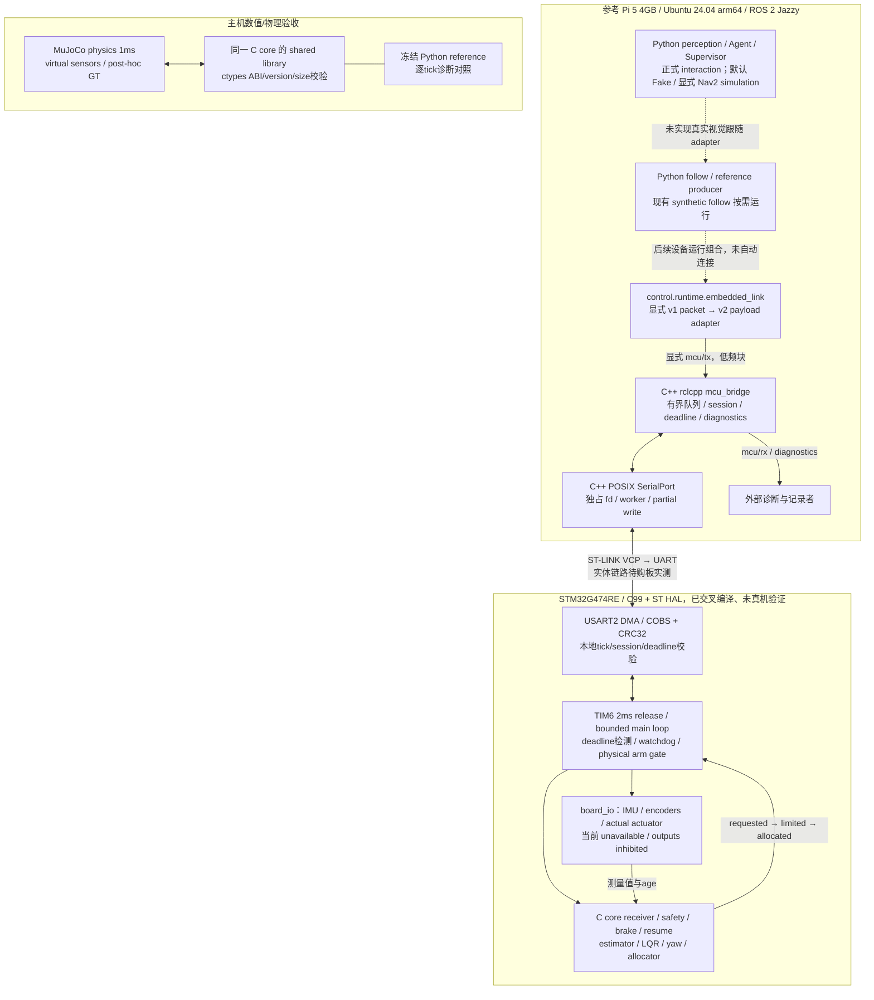
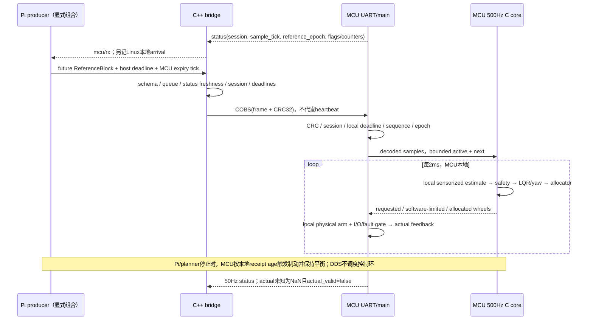

# Python / C++ / STM32 C/HAL 工程合同

当前实现。研究决策与价格/benchmark见 [调研及硬件选型](../models/minisegway/cross_language_embedded/UPSTREAM_AND_HARDWARE.md)，实际验收/偏差见 [final_report](../models/minisegway/cross_language_embedded/final_report.md)。ROS 应用层的完整数据合同仍见 [RUNTIME_ARCHITECTURE](RUNTIME_ARCHITECTURE.md)。

## 职责与实际部署

| 语言 / 路径 | 实际职责 | 时间与权限 |
| --- | --- | --- |
| Python：perception / behavior | Camera、YOLO、ByteTrack、Master、OSNet、depth、Agent、Catalog、Supervisor、语音与正式交互 | latest slots/后台 worker；Agent 只有原有高层工具。默认 Fake，显式 Nav2 模式用于物理仿真；hardware_execution_ready=false。 |
| Python：follow / control中的高级研究模块 | Pi radial KF/Governor、Ruckig/稀疏规划、ReferenceBlock producer；离线 ID/DARE、slope/payload/Q诊断与行为对照 | 不因为语言分工改算法、Q/R、plant、truth/tolerance；真实视觉→follow仍未接入。 |
| C++：control/src、include | `mcu_bridge` rclcpp Node、POSIX SerialPort 独占所有权、有界 TX、partial write、CRC/分帧、session/deadline gate、错误传播与诊断 | 串口 worker独立于ROS executor；ROS只传低频块/心跳/yaw/safety和50Hz telemetry。没有cmd_vel→轮转矩通道。 |
| C99：control/native | 固定容量receiver、MCU safety/resume、制动、互补姿态＋加速度补偿、encoder PLL/odometry、gyro yaw、LQR反馈、yaw PD、纵向优先allocator、wire codec | 无ROS/HAL/OS/heap/GT依赖。相同源码同时编译为主机库和固件静态库；固定2ms控制语义。 |
| C/HAL：firmware | NUCLEO-G474RE 170MHz clock、UART DMA、TIM6 500Hz、IWDG、SWD、调度/故障/物理输出gate、状态打包；`board_io`物理适配边界 | 未选IMU/encoder/motor时返回 unavailable并禁用输出；不伪造传感器、Nm→PWM或actual torque。 |

跨语言工程保持原七包；当前新增 companionbot_description 后为八包。空间估计/传感器数据合同见 [空间状态](SPATIAL_STATE.md)，尚无 MCU raw IMU/encoder 到 BalanceState 的设备适配。control由ament_python转为ament_cmake＋ament_cmake_python，成为真正的C/C++/Python混合包；其余包无需为语言比例重写。`firmware/COLCON_IGNORE`明确将独立交叉编译工程排除在ROS发现之外。唯一正式交互入口仍是 `scripts/demo_stage8_interaction.py`；`mcu_transport.launch.py`仅用于通信调试，不是第二个Demo，不启动planner/Agent/电机。



实线表示已经实现的软件接口，不代表实体外设已接通；虚线表示未完成的生产组合。PTY验收实际运行了C++进程、ROSIDL/DDS和OS串口接口，MCU端是明确标注的软件夹具。固件不依赖该夹具或Python。主机C实验中，C的数值输出实际驱动plant；原Python仲裁是保留事件/producer交互的诊断mirror，每个tick核对后才施加输出，不能把mirror混同于固件运行依赖。

## 跨语言目录与复用

```text
ros2_ws/src/companionbot_control/
  CMakeLists.txt                 ament C/C++/Python build
  native/include/companionbot/   C ABI / state / wire definitions
  native/src/                   shared C algorithms and bounded wire parser
  native/test/                  standalone C regression + malformed stream checks
  include/companionbot_control/  SerialPort ownership interface
  src/                          C++ POSIX transport and rclcpp bridge
  companionbot_control/runtime/ native.py / embedded_link.py / Python reference runtime
ros2_ws/src/companionbot_simulation/companionbot_simulation/runtime/
  native_backend.py             explicit C acceptance backend + diagnostic mirror
firmware/
  app/                          scheduling / HAL callbacks / local output gates
  boards/nucleo_g474re/          CubeMX ioc / Core / board_io / MDK-ARM project
  generated/                    frozen numerical header + source SHA256 manifest
  cmake/                        ARM GNU toolchain
  CMakeLists.txt / upstream.lock.json / reference_hardware.json
tools/embedded/                 fetch / local toolchain / export / project generation
tools/verification/             explicit host, sim, PTY and capacity diagnostics
models/minisegway/cross_language_embedded/
  final_report.md / learning_log.md / UPSTREAM_AND_HARDWARE.md
  results/                      this engineering session's configs, logs, histories, plots, builds
.venv/embedded/                 ignored official ST sources / compiler / derived startup
```

`firmware/UPSTREAM.md`记录确切来源和许可证。ST startup/system/HAL不自行重写；GCC linker从官方模板在build目录派生，主SRAM96KiB、CCM32KiB、8KiB栈、0heap。Keil也使用官方ARM startup的ignored派生副本，只调整栈/heap常量。C core保留double并禁止fast-math和FMA收缩；G474只有单精度硬件FPU，固件WCET仍须DWT实测，不能以x86性能替代。

## Pi / MCU 数据流与安全



- `LONGITUDINAL_STOP`只接管纵向，yaw仍走fresh latest；`HARD_STOP`同时使yaw本地衰减到0。停止使reference epoch递增、清空active/next；恢复需要正确authority、当前epoch、future block，HARD恢复另需停止后的新鲜yaw。保留heartbeat150ms、starvation margin12ms、yaw timeout200ms/decay0.8rad/s²。
- 固件startup在估计有效和首块实际到期前不伪造运行控制；随后可在禁用电机时消费reference并输出诊断。物理arm只能来自board adapter的本地边沿；要求健康传感器/驱动、fresh heartbeat、NORMAL、低速度/姿态及连续的近零reference。该gate尚未用真实电路验证。Agent/ROS没有arm字段。
- I/O错误、控制deadline overrun、异常倾角/运算、运行中传感器故障会禁用实际输出，关键故障锁存。软件safety brake保持平衡控制，与物理输出禁用分开。IWDG名义250ms监控主循环服务，LSI误差/真实复位未测。
- 串口队列最多8帧，status为latest；有效safety会清除排队旧意图。TX按8N1线速预算限速，并在绝对deadline内等待driver output queue排空；write成功不等于远端接收，USB私有FIFO仍未实测。队列有待发数据时worker不额外等待5ms。partial write失败后不重放半帧/旧指令；worker错误传播至主进程非零退出，关闭时best-effort清除driver待发数据，须显式重启。设备session改变清队列，不自动恢复运动或代发heartbeat。
- ROS是内部可信部署域；`allow_command_tx`是只读运行配置，不是身份认证系统。正式behavior不发布设备 wire 命令，也仍拒绝真实硬件执行。新增 [Nav2 simulation backend](RETAIL_NAVIGATION.md) 仅接高层意图到原 ReferenceBlock/MCU safety 链；未增加 SROS2、实体 RobotBackend 或视觉闭环，不改变 wire v2、ReferenceBlock v1 和物理 arm gate。

### 嵌入式 wire v2

冻结 simulation `PiMcuPacket`/JSON及ReferenceBlock binary v1保持原样。新硬件协议是独立的**外层v2**；MCU不解析JSON，Python `command_from_packet`显式转换控制小包，ReferenceBlock字节完整复用。

每个串口包：`COBS(raw) + 0x00`。raw为小端 `version:u8=2, kind:u8, payload_len:u16, session:u32, sequence:u32, tick:u32, payload, crc32:u32`。CRC-32/ISO-HDLC覆盖header＋payload，不含CRC；校验向量`123456789 → 0xCBF43926`。payload上限672B，raw上限692B，编码缓冲696B；收包超长丢弃到下一delimiter。固定内存、无对齐struct强转。

| kind | payload | tick语义 |
| --- | --- | --- |
| 1 Reference | 原v1 `<IIIIddIf>` 40B header＋25×`<6f>`；总640B。每样本`p,v,a,theta_lean,theta_dot,u_ff_after_lifecycle` | 外层是有效截止tick；内部start_control_tick是执行起点，dt固定0.002。内外sequence必须一致。 |
| 2 Heartbeat | 空；sequence仍须递增 | 接收端用本地receipt tick更新健康，不读取host absolute time。 |
| 3 Yaw | `<d>` yaw rate target，保持原JSON roundtrip的binary64精度 | 本地receipt与timeout决定freshness。 |
| 4 Safety | `<BH>` authority（0 HARD / 1 LONGITUDINAL）＋reason code | BRAKE/HARD_STOP映射HARD；默认外部原因1，具体文字留在Pi原事件中，也可显式提供u16业务原因码。 |
| 5 Resume | `<IB>` reference epoch＋authority | 恢复必须满足MCU当前状态、epoch、fresh rearm规则。 |
| 128 Status | 144B，布局如下 | MCU采样tick；不是ROS publication time。 |

Status字节0–31是8个u32：reference_epoch、safety_state、reason、fault bits、最后一个非零receive rejection（锁存）、rejection总数、deadline overrun数、flags。flags bit0 actual_valid、bit1 armed、bit2 estimator_valid（当前sensor故障时清除）、bit3 sum_clipped、bit4 differential_clipped、bit5 allocator_guard_clipped。32–111是20个f32：估计`p,v,theta,theta_dot,psi,r`；reference六字段；sum requested/limited、diff requested/used；allocated左右；actual左右。112–143是8个u32原因计数：ok/invalid/epoch-or-session/stale/capacity/sequence/underrun/state。CRC丢包也计invalid；core内underrun另由状态reason/计数记录。未知actual不是0，也不从allocated复制；adapter返回非有限actual会使输出禁用并锁存actuator故障。

故障位：1 sensor、2 actuator、4 overrun、8 UART、16 RX overflow、32 not armed、64 controller、128 tilt、256 tick exhaustion。reason 2 heartbeat、3 starvation、4 missing reference；外部Pi reason可自定义非零u16。C++ diagnostics另分tx_disabled、link_failed、device_stale、host_deadline、host_clock、session、mcu_deadline、schema、queue_full、superseded、rx_sequence、rx_schema及framing/CRC计数。

`mcu/tx`、`mcu/rx`使用新增有界`McuFrame.msg`。`host_clock_id`必须匹配本机`linux-boot:<boot_id>`，延续既有同内核clock proof；TX的`host_deadline_monotonic_ns`属于**当前Linux内核CLOCK_MONOTONIC**，至多100ms未来；RX同字段是本地arrival。设备status超250ms时bridge拒绝TX；MCU自己的截止tick不得落后且至多125ticks未来。tick/sequence不允许绕回，固件在tick耗尽前禁用输出，需重启建立新会话。

MCU sample tick与Pi host/ROS time不能相减。status提供设备tick锚点和本地arrival，尚无经实测的跨设备clock mapping/RTT上界；MCU最后自行裁决stale。boot session使用UID和备份寄存器计数，不宣称跨断电绝对唯一或密码学认证；串口断连需重启bridge，物理arm不自动恢复。`generated_time_s`只是保留的producer元数据，不能把host perf time伪装成设备控制时间。

921600 8N1下一块参考约7.2ms，20Hz块流约13.3KB/s，50Hz status约8.3KB/s，两个方向均有余量；这是字节预算，不是USB/UART实测延迟。115200不适合保持25×2ms完整块流，不能靠降低控制频率绕过。

### UART 与本地控制的补充时序合同

COBS最坏长度为 `raw + floor(raw/254) + 2`（含delimiter）。640B ReferenceBlock连同header/CRC为660B raw、最多664B wire；heartbeat/yaw/safety/resume/status分别最多22/30/25/27/166B。当前20Hz reference、20Hz heartbeat、20Hz yaw合计Pi→MCU最多 **14,320 B/s**，921600 8N1利用率 **15.54%**；反向50Hz status为 **8,300 B/s / 9.01%**。全双工按方向分别核算。115200下正向需求已达124.31%，保持默认921600，不放宽任何安全期限。

两块reference＋heartbeat＋yaw的突发线速时间约14.97ms；八块reference为57.64ms，含一块已在途为64.84ms。八帧队列不是八块可执行reference窗口，MCU仍只有active/next，超载需拒绝并本地制动。接口没有承诺接纳任意publisher速率；受控负载、超载和故障结果见当前final_report的补充验证部分。

1024B circular DMA在满线速下每半缓冲约5.56ms、全缓冲11.11ms；4095B可用ring约44.43ms。每2ms线速最多约184.3B，poll的768B解析预算是字节上限，不是已证实的CPU吞吐。连续无IDLE时还应计入至多半缓冲的交付等待；主机限速PTY没有模拟真实HAL IRQ耗时。next block须在当前块开始后38ms之前收到，扣除7.21ms线速、5.56ms DMA批次及2ms控制相位，剩约23.24ms留给host/USB/parser/clock不确定性；再计idle worker最多5ms，约剩18.24ms。这是工程预算，实体链路时延仍待实测。

`SerialPort::transmission_time`向上取整线速时间；bridge的host/MCU expiry gate计入该时间。driver排空用有期限的TIOCOUTQ查询，未调用可能无限阻塞的tcdrain；再保守等待一帧线速，避免把kernel接受当作可无限积压的传输能力。TIOCOUTQ不能证明USB转接器FIFO或远端已收到，MCU本地deadline、reference epoch和receipt-age仍是最后裁决。

固件将TIM6 ISR释放时间与主循环开始时间一并记录；写出actuator请求前检查“自本次ISR释放已到2ms”或“下一tick已释放”，触发FAULT_OVERRUN并锁存输出禁用。返回后还检测board写入期间的超时。此机制不能认证IRQ入口延迟、被屏蔽/合并的硬件更新事件或未来BSP的阻塞上限。

`cb_timing`是供SWD只读观察的DWT最大值：release latency、control、release-to-output、sensor、estimator、arbitration、feedback、actuator、单byte parser/dispatch（含delimiter完整CRC）、status、RX callback、ring高水位及control/full-control计数。callback不含HAL IRQ前导；各段可能包含抢占，不能简单相加当作WCET。board_io当前unavailable，startup快路径不代表完整控制负载。

170MHz下2ms是340,000 cycles。购板后的**待验收预算**：ISR→主循环≤200µs，control body（含BSP及抢占）≤1400µs，其他前台不可中断服务≤150µs，预留250µs；总计2ms。当前没有测得其中任一板上上限，也没有据此宣布有250µs真实余量。仍保留double和原libm算法，未改float32、gain或控制周期。

## 构建、验证与烧录

所有项目Python命令使用仓库`.venv/bin/python`。在Ubuntu/WSL先核对环境；没有将系统Python作为项目运行环境。ARM GNU包只解包到`.venv/embedded/native`，不需系统安装：

```bash
cd ~/projects/CompanionBot
source scripts/env.sh
.venv/bin/python -c 'import sys; print(sys.executable); print(sys.version)'
.venv/bin/python -m pip --version

# 首次准备；下载的是锁定Ubuntu Noble软件包、ST官方源，保留许可证
.venv/bin/python tools/embedded/bootstrap_toolchain.py --download
.venv/bin/python tools/embedded/fetch_upstream.py
.venv/bin/python tools/embedded/export_frozen_config.py --check
.venv/bin/python tools/embedded/generate_board_projects.py --check

bash scripts/build_ros.sh
source scripts/env.sh
bash scripts/build_firmware.sh models/minisegway/cross_language_embedded/results/YOUR_SESSION/firmware_build
```

若使用独立Arm GNU发行版，可CMake传`-DARM_GCC_ROOT=/path/to/prefix`；ST源可传`-DSTM32CUBE_G4_ROOT=/path/to/STM32CubeG4`，须保持lock所列提交。`export_frozen_config.py`无`--check`会重新导出，但baseline比较中不得顺手改来源参数。

主机独立C构建无需ROS：

```bash
cmake -S ros2_ws/src/companionbot_control/native \
  -B models/minisegway/cross_language_embedded/results/YOUR_SESSION/host_build \
  -DBUILD_SHARED_LIBS=ON -DCMAKE_BUILD_TYPE=RelWithDebInfo
cmake --build models/minisegway/cross_language_embedded/results/YOUR_SESSION/host_build -j4
ctest --test-dir models/minisegway/cross_language_embedded/results/YOUR_SESSION/host_build --output-on-failure
# 不使用ROS安装态库时，显式指定该build中的libcompanionbot_core.so
```

显式软件验收，均有限、无GUI/实体设备：

```bash
.venv/bin/python -m pytest -q -p no:cacheprovider tests ros2_ws/src
.venv/bin/python tools/verification/verify_cross_language.py --backend native --suite baseline --output-dir models/minisegway/cross_language_embedded/results/YOUR_SESSION/native_baseline
# suite还支持radial / safety / dynamic / stream；--backend python用于公平对照
.venv/bin/python tools/verification/verify_embedded_bridge.py --output-dir models/minisegway/cross_language_embedded/results/YOUR_SESSION/bridge_pty
.venv/bin/python tools/verification/benchmark_embedded_perception.py --output-dir models/minisegway/cross_language_embedded/results/YOUR_SESSION/capacity
```

ROS测试需要本机socket；不能把沙箱禁止socket当作算法失败，也不能把PTY当成实物成功。capacity脚本可原样在Pi上执行，默认使用现有模型与分辨率，输出raw latency、RSS、模型hash和机器架构。

购板后的通信入口由用户在自己的终端执行，`device`按真实by-id路径填写；默认只读，不发送命令：

```bash
ros2 launch companionbot_bringup mcu_transport.launch.py device:=/dev/serial/by-id/ACTUAL_STLINK_VCP
ros2 topic echo /companionbot/mcu/rx
ros2 topic echo /companionbot/diagnostics
```

只有显式`allow_command_tx:=true`才接纳低层producer发来的有deadline命令；这仍不构成物理arm或Agent执行授权。固件目前不会驱动任何电机。

ARM构建目录生成`companionbot_g474.elf/.hex/.bin/.map`。安装STM32CubeProgrammer后，用户可在终端烧录：

```bash
STM32_Programmer_CLI -c port=SWD -w /absolute/path/companionbot_g474.elf -v -rst
```

本轮没有执行烧录、控制桌面、打开viewer/CubeMX/Keil。`.ioc`来自官方模板且做了静态一致性检查，**尚未经过CubeMX打开/再生成**；`.uvprojx`为实际文件清单、设备、include、scatter、ARM Compiler 6配置，**尚未通过MDK编译**。需要GUI核对时由用户操作：打开ioc检查170MHz/USART2/TIM6/DMA/IWDG；先生成到本工程results下的review副本；再核对USER CODE及外部app/callback和Keil source groups。不要直接让CubeMX覆盖共享C core、外部依赖或冻结配置。

Keil MDK5安装项目所列G4 DFP并选择可用ARM Compiler 6后，打开`firmware/boards/nucleo_g474re/MDK-ARM/companionbot_g474.uvprojx`；8KiB栈的startup派生副本须由脚本在Windows自己的`.venv`中生成。MDK软件/授权和最终ARMClang代码尺寸未验，不把GNU交叉编译称为MDK通过。

## 实物接入的明确边界

`board_io.h`是实际硬件适配合同：IMU必须给出已去startup bias、按冻结算法轴定义变换的accel/gyro和本地sample age；编码器提供正确方向、展开后的左右count；Nm请求必须经实测驱动/电流/torque校准，actual只来自真实反馈。`cb_board_physical_arm_requested`须接本地物理条件，不能改成ROS参数或常量true。

当前未选传感器、驱动器、驱动使能/急停/故障引脚，也未测UART误码、clock drift、DMA IRQ时延、DWT WCET、watchdog复位、物理arm/倒地/失联行为。高级slope EKF/supervisor、payload ID/Q诊断尚不在固件；主机使用C数值核心＋原Python高级模块做回归，不等于已移植整套高级运行时。以后替换板或电机应保留C core、ReferenceBlock和ROS接口，只改HAL/board_io及经确认的物理参数。
