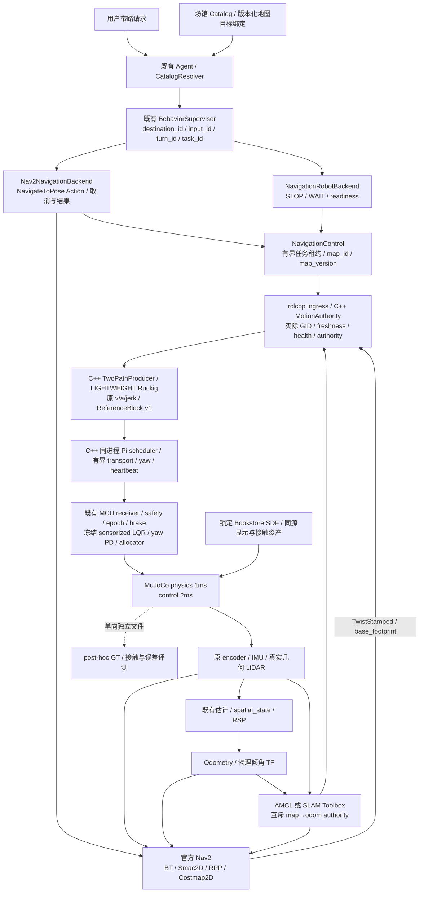

# 商业场景、地图与 Nav2 运行合同

本工程在 WSL2 的真实 MuJoCo 物理与 ROS 2 Jazzy 图中集成 AWS Bookstore、SLAM Toolbox、AMCL、Smac2D、Regulated Pure Pursuit 和原 ReferenceBlock/MCU safety 链。正式交互入口仍只有 `scripts/demo_stage8_interaction.py`；下面的 launch 是功能组合，`tools/verification` 是有限验收工具。实体驱动、Pi 5 性能与 GUI 人工验收不由这些仿真结果认证。

## 唯一数据流与权限



当前 MCU 框的reference/safety已由共享C99核实际执行，物理控制仍经冻结simulation runner；不是已连接 STM32。共享 C 核心、C++ 串口桥及原协议另做冻结回归；本模式不自动启动串口 TX、不物理 arm。`hardware_execution_ready=false`。Agent 只发目标或停止请求，Nav2 不写转矩、MuJoCo pose 或关节状态。

| 数据 | canonical source / 唯一 owner |
| --- | --- |
| 场景位置、尺寸、外观与原始 collision | `bookstore_world.lock.json` 锁定的 AWS commit/SDF/mesh；只从同一布局派生 |
| robot 几何 / footprint | 冻结 MJCF → `nav2_geometry.json`；launch 校验源 SHA256，半径 0.1740169256m 含 2cm 几何余量 |
| map 文件、图与目标 | 标准 YAML/PGM、上游 posegraph/data；`navigation_map.load_map_binding` 同时校验 YAML/图像 SHA；版本绑定拒绝不一致 |
| map→odom | mapping 仅 `/slam_toolbox`；localization 仅 `/amcl`；C++ auditor 检查真实 GID/parent/owner |
| odom→base_footprint、物理 roll/pitch | 原 `spatial_state`；不添加 EKF、identity TF 或 GT odom |
| navigation 运动意图 | 唯一 `/controller_server` → `/companionbot/navigation/cmd_vel`，`TwistStamped`、frame=`base_footprint` |
| motion authority | `/companionbot/navigation/control`；一个 task/source_epoch、递增 sequence、有界本地 receipt-time 租约 |
| 高频轨迹与控制 | 原 Pi producer、ReferenceBlock、MCU receiver/safety；ROS 不调度 500Hz 闭环 |

NavigationControl 原命令为 ACQUIRE、RENEW、RELEASE、STOP、WAIT、CHECK、CHECK_STOPPED，默认对应GUIDE_TO；另显式支持 ACQUIRE_FOLLOW、RENEW_FOLLOW、CHECK_FOLLOW。FOLLOW需已配置的真实观测/独立障碍与制动门禁；没有可用depth证书时拒绝。模式切换先撤销再新grant，不重用旧task/观测。CHECK 是软件导航 readiness；CHECK_STOPPED 观察 MCU SAFE_HOLD。它们都不是物理 arm。CANCEL 先撤销租约、发本地 safety，再取消 Action；新目标需要新的显式授权和匹配的 reference epoch。独立 MCU heartbeat/starvation/fault 不属于 Nav2 可恢复的停止原因。

cmd 同时检查 ROS source stamp 与本机 receipt freshness；租约只使用服务器本机 monotonic age，不把客户端时间与 MCU tick 相减。scan/odom/map TF 缺失、定位协方差失效、命令过期和节点退出均撤销旧意图。没有命令队列，也没有恢复传感器后自动重放。rclcpp速度入口同时检查逐消息实际GID与单一Graph endpoint/重启锁止，不宣称网络身份认证。部署域仍遵守原内部可信 ROS 边界。

Nav2 Action 的 SUCCEEDED/CANCELED/ABORTED 分别映射为原 Feedback 的 COMPLETED/CANCEL/FAILED，保留业务合同。ACCEPT/RUNNING 不是到达；Agent 文本轮次 COMPLETED 也不是导航完成。进度来自 Nav2 距离反馈，初始化默认零表示未知，只有实际成功结果产生 1.0。执行 readiness 同时要求 motion health、安全状态、Action discovery 与五个官方节点 ACTIVE；服务被发现不等于 lifecycle 已激活。到点释放会启动真实 MCU 制动，重复任务须等 SAFE_HOLD 后才能重新授权；不会为重复目标跳过这一过程。

租约续期为0.35s，terminal result独立及时处理并RELEASE，不等待下一次续期以免先触发0.3s命令watchdog。有租约而无有效非零运动意图时不请求MCU resume；有效新HARD_STOP在唯一MCU C99核立即撤销旧reference epoch与pending/armed resume，即使已SAFE_HOLD也成立；不依赖Pi重复STOP补偿。重复/陈旧sequence拒绝，独立fault不能由同名业务reason冒充恢复资格；控制律与协议保持。

## Borrow / Adapt 的运行选择

资产使用 pycollada/trimesh 处理 COLLADA graph、厘米单位、UV/纹理，CoACD 分解闭合非凸碰撞，开放墙面使用原三角面的小厚度凸棱柱。静态显示组2与物理/射线组4来自同一 SDF transform；物理碰撞不能用 alpha=0，否则 MuJoCo ray 会跳过它。视觉隐藏碰撞组由 viewer option 完成。

原世界的一件图书 z=343582m 被有记录地排除；Spotlight URI 的大小写错误在派生解析时按锁文件修复；floor 的 collision top 与冻结地平面对齐，视觉厚度差单独记录。上游原件不覆盖。未使用的 BookB visual 本身截断，不因它而丢弃完整 Bookstore 或导入无关模型。LICENSE 原文为 Amazon permissive，而 package.xml 声称 Apache2.0；两者及 hash 均保留，不用 package.xml 覆盖真实许可文本。

参考 linorobot2 的实际 navigation/bringup/description 源码；借用官方 Nav2 组件、生命周期与接口，不接其 micro-ROS、普通差速 PID、第二套 odom/EKF 或默认 joint_state_publisher。确切 commit/文件 hash 见 `navigation_upstream.lock.json`。

Nav2 desired v=0.20m/s、转向目标0.35rad/s、controller10Hz；adapter 最多0.25m/s与0.5rad/s。纵向 acceleration/jerk 留在原 Ruckig，velocity smoother OFF。导航 envelope 小于原 FULL 分支阈值，显式复用既有 LIGHTWEIGHT 路径并关闭不适合连续 Nav2 retarget 的候选稳定/最小变化 gate；原 FULL baseline、gains、周期和安全参数不改。无 Spin、BackUp 或自动清图恢复行为。采用安装的原版 `navigate_w_replanning_only_if_path_becomes_invalid.xml`，不自研 BT：无条件1Hz重规划会重置到点状态，实测引起最终朝向失败。目标 checker 收紧到8cm/0.15rad，为保持不变的实际停稳15cm/0.20rad验收留余量。

## 复现资产与建图

所有 Python 使用同一 venv。第一次安装资产转换依赖前核对解释器和 pip；Gazebo/AWS 旧 ROS 依赖不安装。

```bash
cd ~/projects/CompanionBot
export ROS_LOG_DIR="$PWD/models/minisegway/retail_navigation/results/YOUR_SESSION/ros_logs"
source scripts/env.sh
.venv/bin/python -c 'import sys; print(sys.executable); print(sys.version)'
.venv/bin/python -m pip --version
.venv/bin/python -m pip install -r tools/assets/requirements-bookstore.txt
.venv/bin/python tools/assets/prepare_bookstore.py
bash scripts/build_ros.sh
source scripts/env.sh
.venv/bin/python tools/verification/verify_bookstore_world.py \
  --output-dir models/minisegway/retail_navigation/results/YOUR_SESSION/world_audit

ros2 launch companionbot_bringup retail_simulation.launch.py mode:=mapping \
  mapping_scenario:=mapping duration_s:=271.75 \
  route_file:="$PWD/models/minisegway/retail_navigation/config/mapping_route.json" \
  output_dir:="$PWD/models/minisegway/retail_navigation/results/YOUR_SESSION/mapping"
```

上游与派生 mesh 默认只在忽略的 `.venv/assets/bookstore/{upstream,derived}`。运行时验证 manifest，不偷偷下载或退回玩具世界。cache 缺失先显式准备；第三方与派生 mesh 不入 Git。

完成有限路线后 physics/clock 保持最终状态，使用第二终端按原脚本保存，随后 Ctrl+C 退出整图：

```bash
bash scripts/save_slam_map.sh "$PWD/models/minisegway/retail_navigation/results/YOUR_SESSION/maps/bookstore"
```

北侧补图从同一已知 dock 重新启动、读取上游保存图，使用 `mapping_north_route.json`、`duration_s:=79.5` 和 `map_file_name:=.../maps/bookstore`；这是新一轮实际物理运动，不是将机器人传送到上轮末点。保存到新的 basename，拒绝覆盖旧证据。有限路线是明确的仿真实验，不是正式 Agent 导航模式。

## 目标版本与正式导航模式

`config/catalog.json` 是 Bookstore 区域目录，原 `service_desk` 仍为服务台；没有把旧方便面/机器人展品等 ID 改成书架。`config/map_destinations.json` 提供有来源的 map 目标，LLM 不拥有坐标。新图先生成 candidate，再由真实 Smac Action 验证，最后生成已验证 binding：

```bash
.venv/bin/python tools/assets/bind_retail_map.py \
  --map-yaml /ABSOLUTE/PATH/bookstore.yaml --output /ABSOLUTE/PATH/candidates.json
# 在相应 localization 图中执行 --mode plan，或使用 run_retail_acceptance.py 统一验收。
.venv/bin/python tools/assets/bind_retail_map.py \
  --map-yaml /ABSOLUTE/PATH/bookstore.yaml --proof-dir /ABSOLUTE/PATH/planning \
  --output /ABSOLUTE/PATH/bookstore_bindings.json
```

验收地图为 `results/session_20261022/mapping_north/maps/indoor.*`，正式绑定为 `results/session_20261022/maps/bookstore_bindings.json`，map version `b48c61b3b2bf76d5`。这些是本轮本地成果；重新建图必须生成新版本，不能复制 verified 标志。

```bash
ros2 launch companionbot_bringup retail_simulation.launch.py mode:=localization \
  navigation_bindings:="$PWD/models/minisegway/retail_navigation/results/session_20261022/maps/bookstore_bindings.json" \
  set_initial_pose:=true duration_s:=250.0 \
  output_dir:="$PWD/models/minisegway/retail_navigation/results/YOUR_SESSION/navigation"
```

`set_initial_pose:=true` 只适用于本仿真的已知启动 dock。未知实体起点必须用 AMCL 标准初始化流程，不能从 GT 初始化。未明确初始化时 AMCL 不提供可用定位，运动保持不可用。一般功能 `navigation.launch.py map_yaml:=/absolute/map.yaml` 只提供官方定位/导航节点，不创造传感器、运动授权或 map TF fallback。

另一个同 domain 终端运行唯一正式交互入口：

```bash
.venv/bin/python scripts/demo_stage8_interaction.py --no-camera --headless --no-mic --no-tts --ros \
  --navigation-mode nav2 \
  --catalog-file models/minisegway/retail_navigation/config/catalog.json \
  --navigation-bindings models/minisegway/retail_navigation/results/session_20261022/maps/bookstore_bindings.json
```

正式 ROS bringup 同样透传 `navigation_mode:=nav2 catalog_file:=... navigation_bindings:=...` 到同一 app。默认 mode 为 fake。`--fake` 仅选择原离线语言模型夹具，不会取消显式 nav2 的运动权限；使用 nav2 mode 时不要将其理解为整机 Fake。现有离线模型主要针对旧示例措辞；本工程自动 Agent 验收使用确定性工具夹具，真实 Qwen 语言理解质量未作新的云端验收。

有终端 TTY 时可直接输入“你好小柒，带我去服务台”。ROS 服务模式不会读取管道 stdin；自动客户端应沿用 `/companionbot/interaction/input` 的 UserInput/SourceStamp 与 freshness 合同，不能把 `queued` 当成导航 ACK。正式入口的 headless 服务验收见 `verify_formal_navigation.py`。

MuJoCo 运行仍由原有限实验 runner 承担，当前实际验收到250s；长期无人值守与 Pi/实体持续运行另需资源/设备验收。Ctrl+C 或 required process 退出关闭整图并撤销任务；不恢复物理 gate。

## 用户手动可视化

Codex 未启动或操作桌面 GUI。用户可在上面的同一 retail launch 增加 `viewer:=true`，开启被动 MuJoCo viewer，显示同一物理 model/data 的完整纹理书店与机器人；不另建仿真。物理碰撞组默认隐藏但仍参与碰撞和 LiDAR。此 GUI 路径已实现，尚未人工验收。

用户自行在第二终端运行：

```bash
rviz2 -d ros2_ws/src/companionbot_description/rviz/navigation.rviz --ros-args -p use_sim_time:=true
```

RViz 显示地图、估计姿态/物理倾角、原始扫描、全局路径与 Costmap；启动正式 Nav2 backend 后发布版本化目标 MarkerArray。运动目标通过同一 Agent/Supervisor 授权。资产 headless 渲染与接触投影仅作独立检查，不能替代物理导航验收。测试与失败边界见本工程 [final_report](../models/minisegway/retail_navigation/final_report.md) 和 [learning_log](../models/minisegway/retail_navigation/learning_log.md)。
