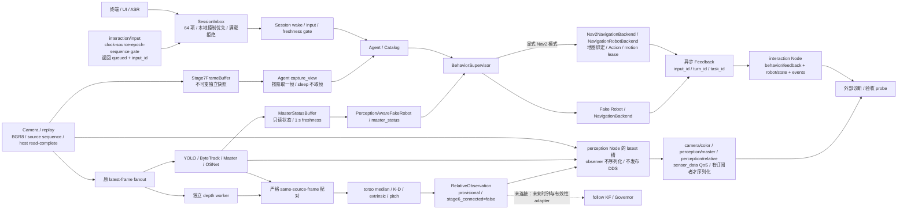

# CompanionBot 运行架构与数据流

当前合同，2026-10-23。八个 package 的源码是唯一当前实现；package 是职责/安装单位，Node 是 ROS 通信单位，进程是部署/故障单位。唯一正式用户入口保留 [`scripts/demo_stage8_interaction.py`](../scripts/demo_stage8_interaction.py)，bringup 和终端都调用同一个 `companionbot_behavior.app.main`。文件名中的历史编号不代表另一套运行架构。

control现含主机/STM32共用C核心和独立C++ `mcu_bridge`，参考G474 HAL固件已交叉编译；语言分工、设备协议与硬件边界统一见 [跨语言控制工程](CROSS_LANGUAGE_EMBEDDED.md)。正式interaction与有限simulation拓扑不自动启动MCU通信调试，真实视觉跟随和实体执行仍未接通。

SLAM 建图复用 spatial_sim / spatial_state / RSP，原版 SLAM Toolbox 唯一发布 map→odom；保存/加载见 [SLAM 建图合同](SLAM_MAPPING.md)。显式 `navigation_mode=nav2` 后，同一 interaction 可通过真实 Action 在 AWS Bookstore 物理仿真中带路；默认仍为 Fake。AMCL 定位与 mapping 互斥，Nav2 意图必须经租约、原 Pi reference 与 MCU safety，完整数据流和启动合同见 [商业场景导航](RETAIL_NAVIGATION.md)。所有模式均 `hardware_execution_ready=false`。

## 系统架构

```mermaid
flowchart TB
    B[companionbot_bringup<br/>interaction.launch.py / config/interaction.yaml]
    I[companionbot_interfaces<br/>ROSIDL + contracts / codecs]
    subgraph APP[正式交互进程：behavior interaction executable / app.main]
        A[behavior app / runtime.session<br/>asyncio Session + Agent + Supervisor<br/>默认 Fake；显式 Nav2 backend]
        PN[perception Node<br/>独立 ROS executor 线程]
        BN[interaction Node<br/>独立 ROS executor 线程]
        NAV[可选 Nav2 backend Node / 同一app进程<br/>独立 context/executor / 版本化目标 / motion lease]
        P[perception runtime.owner → runtime.session<br/>唯一 Camera owner + detector / depth workers<br/>Master / ReID / pairing / geometry]
        BUF[不可消费的最新 Frame / Master buffers]
        P --> BUF --> A
        P -->|三个有界 latest 槽| PN
        A <--> BN
    end
    subgraph SIM[独立、有限的 frozen_sim 诊断进程]
        SN[frozen_sim Node / ROS executor]
        W[simulation 原 run_case worker<br/>MuJoCo 1 kHz + sensorized control 500 Hz]
        W -->|只读数值快照 / 单槽| SN
    end
    subgraph FOLLOW[按需运行的既有 synthetic-follow 场景进程，无 ROS Node]
        F[follow 库<br/>radial KF / Governor / reference producer]
        L[simulation packet_link<br/>模拟 Pi / MCU 调度与 bytes transport]
        C[control 库<br/>receiver / safety / estimator / LQR / yaw / allocator]
        M[simulation plant / virtual sensors / post-hoc GT]
        F <--> L <--> C <--> M
    end
    B --> APP
    B -. simulation.launch.py 诊断 .-> SIM
    B -. 显式 opt-in .-> TF[独立 camera_tf 进程<br/>仅 provisional base_link → camera_optical_frame]
    I --- BN
    I --- PN
    I --- SN
    I --- L
    A -->|显式 navigation_mode=nav2| NAV
    NAV --> RETAIL[retail_simulation localization<br/>官方 AMCL / Smac2D / RPP / Costmap / BT<br/>原 ReferenceBlock / MCU safety / MuJoCo]
    C -. C移植与C++transport已实现，实体待验 .-> MCU[STM32 C/HAL / board_io unavailable]
```

这是 rclpy **静态组合**，不是 `rclcpp_components` container，没有动态 load/unload 服务。默认共进程保留原相机帧与 Master 的本地消费，避免将 RGB 先发 DDS 再读回；每个 ROS executor 都不运行 Agent、推理或控制算法。感知仍有原始 capture、detector/tracker、depth worker，控制侧不因 ROS 增加高频通信。

Python 异常可传播并有序关闭进程；共进程不能隔离 native crash、OOM 或 GIL 竞争。现阶段没有新增独立感知进程部署模式。将来有测量证据需要隔离时，必须同步实现带 source epoch / clock mapping / freshness 的远程消费者。

## 实际数据流



Graph 看不到本地 buffer、算法调用和 binary in-memory transport；图中这些实线由实际代码核实。Topic 的生产消费者表如下，没有用虚构 subscriber 把断开的视觉运动闭环画成完成。

| 数据/入口 | 实际生产者 | 当前生产消费者 / 执行路径 |
| --- | --- | --- |
| RGB `ColorFrame` DTO | 原 Camera / video source | 原 detector/depth slots、behavior FrameBuffer；ROS tap 是额外 observer，不从算法 slot 偷帧 |
| Master DTO | 原 Master/ReID session | MasterStatusBuffer → Agent `master_status` / PerceptionAwareFakeRobot → FOLLOW prerequisite；ROS tap |
| relative DTO | 原 pairing / geometry | ROS 诊断 tap、原 perception metrics；**没有运行中的 follow/controller consumer** |
| `TextInput` | interaction service（或本地文字/ASR） | 有界 inbox → Session → Agent/Supervisor；ROS 原始 provenance、adapter 到达时间、input_id 写 JSONL |
| RobotSnapshot / Feedback DTO | 显式选择的 Fake 或 Nav2 simulation backend / Supervisor | Supervisor 与本地 UI；interaction 发布 typed 诊断副本；硬件 readiness 始终 false |
| reference / yaw / safety / state packets | 原 Pi producer / MCU receiver | synthetic-follow 场景的 packet_link 与控制 runtime；不经 DDS |
| control telemetry | frozen run_case 的 estimator / applied-command API | 独立 ROS timer → `sim/control` / `/clock`；无反向控制输入 |

验收真实 Graph 原始记录位于 [`ros_runtime_run2`](../models/minisegway/runtime_architecture/results/20261021T1335/ros_runtime_run2/)：`text_graph.json`、`replay_graph.json`、`simulation_graph.json`、`after_shutdown_graph.json`，含 endpoint 类型、QoS、publisher/subscriber 及 service/client owner。验收 probe 是临时诊断消费者，退出即消失。回放使用 `/runtime_replay` namespace；正式默认 `/companionbot`。

观察到 `perception/relative`、replay 的 `robot/state` / `behavior/feedback` 无 DDS consumer，属于明确的诊断出口；真实本地消费已在上表列出。ROS Graph 不代表它们已接 actuator。`after_shutdown` 只剩 probe，无项目 runtime 节点。

## 模块职责、接口与依赖

| Package / 实现位置 | 责任 / 输入 → 输出 | 运行单位与依赖 |
| --- | --- | --- |
| interfaces / `companionbot_contracts` | ROSIDL；ROS-free `packets.py` / `paths.py`；ROS-only `stamps.py` / `ros_diagnostics.py` | 库，无 node；ROS helpers 依赖 generated interfaces / diagnostic_msgs / rcl_interfaces |
| perception / `core`、`runtime/session.py` | 原相机、模型、Master、配对、geometry；原始帧 → DTO / metrics | 原 worker 保持；依赖 interfaces 与现有视觉库，不依赖 behavior/control/follow/simulation |
| perception / `runtime/owner.py`、`ros/node.py` | app 参数 → 原完整 session；observer DTO → latest 槽 → typed Topics | `PerceptionNode` 由正式 app 组合；不拥有第二相机，不产生运动命令 |
| behavior / `app.py`、`runtime/session.py` | 正式资源组合、音频/UI/文本、Agent/Catalog/Supervisor、任务取消与退出 | app 主 asyncio owner；依赖 perception/interfaces，无 control/follow/plant import |
| behavior / `ros/interaction_bridge.py`、`ros/runtime.py` | service → inbox；DTO → typed feedback/state；ROS context / executor 生命周期 | `InteractionBridge` Node 仅 I/O；`InteractionROS` 持有两 node/context/线程并传播异常 |
| follow / `core`、`runtime/reference_producer.py` | 合成 target observation + state history → KF/Governor/reference blocks/yaw | 库，无默认 node；依赖 ROS-free contracts、既有数值库；不加载 MuJoCo/rclpy/视觉 |
| control / Python `core`、`estimation`、`runtime`＋`native` C core | sensorized state + reference/safety → requested / limited / actual command语义；Python对照及共享C实现 | 正式应用不含DDS actuator subscriber；C99核心无ROS/HAL/plant/GT依赖。C++ mcu_bridge仅显式设备调试启动 |
| simulation / `core`、`runtime/packet_link.py`、`scenarios` | plant / sensors / 模拟调度 / 原场景 / post-hoc GT | 组合原算法；依赖 control/follow/interfaces；GT 不进入生产 controller/estimator |
| simulation / `ros/frozen_sim.py` | 原 run_case 的只读估计与实际命令 → 降采样遥测 | 独立有限诊断进程，非正式交互/跟随 Demo |
| bringup / `launch`、`config`、`processes.py` | 配置/namespace → 正式或诊断进程；required process exit → launch exit | 依赖 behavior/perception/simulation/interfaces 与官方 launch / ament index；无算法 |

`core` 算法与既有 control/follow runtime 保持原实现、Q/R、限幅、plant、噪声、truth/tolerance；500 Hz controller / 1 kHz physics 仍由原循环调用。`frozen_sim` 运行冻结平衡控制诊断，synthetic-follow 是另外按需运行的既有场景，不由正式 interaction 自动启动。

## ROS 接口合同

所有相对名称位于启动namespace下。本节旧业务消息的 ROS Header 是 publication time；原始 source time 不重写。新增 BalanceState 与标准空间消息使用映射后的 source time，详见 [空间状态合同](SPATIAL_STATE.md)。默认正式应用无`cmd_vel`、轮端command service或map goal。新增C++ MCU transport仅由显式`mcu_transport.launch.py`调试启动，`mcu/tx`默认禁发、`mcu/rx`为状态，物理链路未验；完整有界消息、clock/session/deadline合同见跨语言文档。

| Topic / Service | 类型 | QoS / 执行意义 |
| --- | --- | --- |
| `camera/color` | ColorFrame / BGR8 Image | sensor_data，best effort / volatile / keep-last 5；原 1280×720 profile，不缩放 K |
| `perception/master` | MasterStatus | 同 sensor_data；source epoch/sequence、state/visible；不授权运动 |
| `perception/relative` | RelativeObservation | 同 sensor_data；robot_leveled_axle、source-time pitch/geometry，provisional，stage6_connected=false |
| `robot/state` | RobotSnapshot | reliable / volatile / depth 10；backend 明确为 fake 或 nav2_simulation，hardware_execution_ready=false |
| `behavior/feedback` | BehaviorFeedback | reliable / volatile / depth 32；task/input/turn/request/destination/progress；ACCEPT 不等于完成 |
| `interaction/events` | std_msgs/String JSON | reliable / volatile / depth 32；UI/诊断，不能代替 typed feedback 授权 |
| `diagnostics` | diagnostic_msgs/DiagnosticArray | reliable / volatile / depth 10；各 node 自己发布，默认 host steady 1 Hz；带 PID、运行状态、age/error/容量计数 |
| `sim/control` / `/clock` | ControlTelemetry / rosgraph_msgs/Clock | sensor_data；timer 名义 50 Hz、可合并旧样本，统计 superseded；完整 run history 独立保存 |
| `interaction/input` | UserInput | 同 boot clock、v2 source/epoch/sequence、text_submitted、source age [0,1] s；成功返回 queued/reason/input_id；消费前再次检查同一 deadline |
| `interaction/cancel` / `interaction/stop` | std_srvs/Trigger | 本地优先控制投递；success 仅表示入队，不能宣称实体取消/停止 |

`UserInput.Response.input_id` 是本工程的接口增量；旧字段 `queued/reason` 保留。必须重建使用旧 ROSIDL 生成代码的所有客户端；没有声称旧 DDS wire schema 可混用。SourceStamp contract version 仍为 2，冻结 binary packet protocol 仍为 1，两者不同。

文字 service 在 STARTING / STOPPING / ERROR 时拒绝正常请求；cancel/stop 在 STARTING 可投递。首个成功接纳的 source/epoch 绑定本次运行；拒绝不会推进 watermark。满载拒绝新普通输入，local control 清除旧排队意图；`superseded` / `rejected` 有计数。接纳不保证将来仍新鲜或获准执行，JSONL 的 input_received / input_decision / behavior 通过 input_id 串联。ACCEPT、RUNNING、COMPLETE、CANCEL_REQUESTED、CANCEL、UNKNOWN 仍按原 Supervisor 合同区分。

Color/Master/relative 的 ROS 与本地 buffer 使用同一次采集运行的 source epoch；原 Camera 时间仍是 host read-complete，不是曝光或 media PTS。`received_at_s` 为 ROS observer 槽接纳时刻；relative 的 produced time 保留 geometry result-ready。跨机接收者必须另记自己的 arrival time。`linux-boot:<boot_id>` 只证明同 Linux kernel 的 perf clock，不能跨 Pi/STM32 相减。`reference epoch` 不等于 `source epoch`。

`ControlTelemetry.requested_wheels_nm` 明确是 **allocator 之后**的轮端请求，`actuator_wheels_nm` 是实际施加输出；完整 history 另存 `u_sum_request`、软件 clip 后 `u_sum`、`u_diff_request/used`、allocated wheels 与 actual。遥测消息没有假造缺失的 pre-allocation scalar；saturation/fallback/rejection/failure 仍看原始 history 与状态日志。

正式 interaction 的 TF 默认 OFF；显式开启仅广播 provisional `base_link → camera_optical_frame`。`robot_leveled_axle` 是 source-time pitch 去倾斜的观测 frame，未提供其动态 TF。该正式 interaction 图没有 map/odom 定位。新增独立有限空间诊断由 spatial_sim / spatial_state / robot_state_publisher 提供估计 odom、保留倾角的 TF 和物理 ray scan；不发布 map，也不运行 SLAM，见 [空间状态合同](SPATIAL_STATE.md)。上层 runtime 拒绝切换 `use_sim_time=true`；`/clock` 只表示 MuJoCo 时间，不改变 camera/Agent/MCU deadline。

## 生命周期、错误与配置

- app 建立配置/日志 → ROS context 与 node → 相机 owner/首帧 → 音频 → RUNNING；感知诊断在原推理链首次产出后才标 RUNNING。无相机模式不创建 perception node/topic publisher，Master 为 UNAVAILABLE。
- STARTING / RUNNING / STOPPING / CLOSED / ERROR 是本应用运行状态，**不是 ROS ManagedNode lifecycle**。没有热 reset/reconfigure、lifecycle manager 或自动 respawn。restart 是完整进程重启并生成新 epoch。
- 独立 executor 的异常由 `check_health()` 传到 session；monitor/camera 异常不会静默失活。诊断可在 Agent loop 延迟时独立报告 session_tick age，但它不是实体 watchdog。
- 退出先关闭 ingress，再取消 monitor/Agent/backend task、停止音频/相机，清空 buffers，最后 shutdown executors/context。每项异步 cleanup 的错误均记入 manifest，后续资源仍清理；required process 非零退出让 launch 同样失败。SIGTERM、有限 lifetime 在首帧前也生效。
- native 模型加载/设备 read 的不可中断阻塞仍受库行为限制；Python 线程不是强制隔离边界。正式 launch 给正常模型/worker 退出留时限，最终进程管理仍可能升级信号，不能承诺任意驱动挂死都能无损关闭。
- 每次运行保存 `<run_id>.jsonl`、`<run_id>_runtime.json` 与原感知 metrics；manifest 含配置、解释器、node/executor、队列/合并计数、错误类型和 threads_stopped。默认路径是 `models/minisegway/runtime_architecture/results/sessions/<uuid>/`，不覆盖历史实验。
- 原 `stage8/config/agent.json` / knowledge、`stage7/config/final_demo.json` / calibration 与所有冻结 control config 各司其职。安装的 `bringup/config/interaction.yaml` 只配置 ROS adapter 周期。launch 的 `params_file`、`namespace`、`agent_config` 可显式指定；adapter 周期参数只读，重启修改，不暗改算法配置。

## 当前入口与调试

```bash
cd ~/projects/CompanionBot
source scripts/env.sh
python -c 'import sys; print(sys.executable); print(sys.version)'
python -m pip --version
bash scripts/build_ros.sh
source scripts/env.sh

# 同一个正式 app；可直接终端输入：
python scripts/demo_stage8_interaction.py --no-camera --fake --headless --no-mic --no-tts --ros

# 正式 bringup，默认无设备 / Fake / headless；通过 ROS service 输入：
ros2 launch companionbot_bringup interaction.launch.py

# 正式入口的回放，不自动选择 Master：
ros2 launch companionbot_bringup interaction.launch.py no_camera:=false \
  video:=/absolute/path/to/1280x720.avi exit_after:=20.0

ros2 node list
ros2 node info /companionbot/interaction
ros2 node info /companionbot/perception
ros2 topic info /companionbot/perception/relative --verbose
ros2 topic echo /companionbot/diagnostics

# 有限仿真遥测诊断，无 ROS actuator 输入：
ros2 launch companionbot_bringup simulation.launch.py duration_s:=8.0
```

launch 不接终端 stdin；需要终端交互用上面的根脚本。实体相机/音频/GUI 仅由用户亲自操作。首次 Linux 安装、模型来源与历史设备限制仍参考 [Linux 迁移记录](../models/minisegway/stage9/RUNNING.md)中的环境/资产章节；其旧验收命令属于历史。当前验收使用以下显式结果目录：

```bash
python -c 'import sys; print(sys.executable); print(sys.version)'
python -m pip --version
python -m pytest -q -p no:cacheprovider tests ros2_ws/src
python -m colcon --log-base ros2_ws/log test --build-base ros2_ws/build --install-base ros2_ws/install
python -m colcon --log-base ros2_ws/log test-result --test-result-base ros2_ws/build --verbose
python tools/verification/verify_runtime_ros.py --output-dir models/minisegway/runtime_architecture/results/YOUR_SESSION/ros
python tools/verification/smoke_stage9_perception_ros.py --output-dir models/minisegway/runtime_architecture/results/YOUR_SESSION/perception
python tools/verification/verify_stage9_control.py --output-dir models/minisegway/runtime_architecture/results/YOUR_SESSION/control
python tools/verification/verify_stage9_control.py --extended-baseline --output-dir models/minisegway/runtime_architecture/results/YOUR_SESSION/extended_control
python tools/verification/verify_stage9_stream.py --output-dir models/minisegway/runtime_architecture/results/YOUR_SESSION/reference_stream
python tools/verification/verify_stage9_dynamic.py --output-dir models/minisegway/runtime_architecture/results/YOUR_SESSION/dynamic_control
```

完整 clean build 命令、结果、偏差和交付索引见 [本工程报告](../models/minisegway/runtime_architecture/final_report.md)。诊断 smokes 使用 localhost 隔离 domain（94 测试 / 97 正式回放验收 / 98 显式 track-1 fixture），不会连接用户机器人。

## 后续扩展位置与边界

真实视觉跟随需在relative → follow之间验证曝光/receipt延迟、pitch history、clock mapping、stale/LOST/invalid与实测几何；没有新增空壳follow node或放开Agent actuator authority。Nav2 backend 已复用原任务身份/取消/反馈合同，并在真实物理仿真中验证；它不启动硬件串口或取得物理 arm 权限。STM32现已有C receiver/safety/estimator/LQR/yaw/allocator和G474 HAL工程，C++ UART/VCP transport已做软件PTY验收；实际IMU/encoder/电机、设备时钟和真实链路仍待接入/测量。原PiMcuPacket继续只作simulation envelope，硬件使用独立v2外层协议。

上游调查与 Borrow / Adapt / Reject 决定见 [UPSTREAM_DECISIONS](../models/minisegway/runtime_architecture/UPSTREAM_DECISIONS.md)。旧阶段编号仅用于历史证据、冻结合同和保留的入口文件名；当前开发按模块和完整工程命名，不为小调整另开报告。
