# SLAM Toolbox 建图与地图运行合同

本功能使用 ROS 2 Jazzy 原版 `slam_toolbox`（实测 deb 2.8.5）。正式交互入口仍是 `scripts/demo_stage8_interaction.py`；本页维护建图功能与原有限房间回归，空间坐标、原始传感器和 source time 遵守 [空间合同](SPATIAL_STATE.md)。同一建图链在 AWS Bookstore 的路线、保存地图、独立 AMCL 定位及显式 Nav2 权限另见 [商业场景导航](RETAIL_NAVIGATION.md)；实体驱动仍待接入。

## 数据、配置与权限

```mermaid
flowchart LR
  ROUTE[有限仿真 intent 序列] --> PLAN[既有 scheduler / Ruckig / FULL planner]
  PLAN --> PI[PiReferenceBlockProducer]
  PI --> LINK[既有 bytes transport / heartbeat / yaw]
  LINK --> MCU[MCUSafetyArbiter / receiver]
  MCU --> CTRL[冻结 sensorized LQR / yaw PD / allocator]
  CTRL --> MJ[MuJoCo 1 ms physics]
  MJ --> SENSOR[encoder / IMU / VirtualPlanarLidar]
  SENSOR --> STATE[既有 spatial_state]
  STATE --> TF[odom / 物理姿态 TF / JointState]
  SENSOR --> SCAN[原始 /companionbot/scan]
  TF --> SLAM[原版 async SLAM Toolbox]
  SCAN --> SLAM
  SLAM --> MAP[map→odom / pose / OccupancyGrid]
  MAP --> SAVE[官方 map_saver + serialize_map]
  MJ -. 单向 post-hoc 文件 .-> EVAL[离线 GT 评测，不能回流]
```



SLAM 实际消费 `/companionbot/scan` 与 TF，借 `odom→base_footprint` 查询里程计位姿；`/companionbot/odom` 保留给观测与其他消费者，不再添加转发节点。scan 为 Best Effort / Volatile；`/map` 为 Reliable / Transient Local。scan Header 是实际采样时刻，`time_increment=0` 表示当前瞬时阵列模型；不伪装机械旋转扫描或进行 GT leveling。

| 事实 | 唯一来源 / owner |
| --- | --- |
| map→odom、地图匹配位姿 `/pose`、`/map` | `/slam_toolbox`；启用时 C++ auditor 实际检查该 GID、父节点与 owner |
| odom→base_footprint、动态 base_footprint→base_link | `/companionbot/spatial_state`；保留物理 roll/pitch |
| 轮关节与固定 LiDAR / IMU 挂载 | `/companionbot/robot_state_publisher`；description 原几何合同 |
| `/clock` | `/companionbot/spatial_sim`；整图共用 `use_sim_time=true` |
| SLAM 参数 | `companionbot_bringup/config/slam.yaml`；安装文件与源码同源 |
| 有限建图运动 | `companionbot_bringup/config/mapping_route.json`；只供仿真 intent producer，默认 82 s，之后停留零速 |
| 图像与 pose graph | 标准 ROS YAML/PGM 与上游 `.posegraph/.data`，共同 basename；不另建地图数据库 |

仿真启动先等待空间状态消费者；SLAM 组合还等待扫描消费者的 DDS 匹配，然后释放 physics。规划/OS 停顿延长墙钟运行，不追赶成 source-time 突发。仿真数值工作线程限定为 1；没有改变 1 ms / 2 ms 周期、ReferenceBlock、原安全期限或控制参数。实测还定位到 Python 第 2 代循环 GC 在块生成中占用 52.39 ms 并触发原安全门禁：有限 mapping physics loop 前先收集，期间延后循环 GC，结束或异常时恢复原策略；引用计数仍即时清理。此策略仅限当前有限仿真进程，不推广到无限时长任务。该主机调度约束不构成 Pi 实时性证明。

`slam.yaml` 保留 Ceres solver、scan matching 和原回环质量阈值；使用 5 cm 栅格、8 m 真实测距上限、1 s 地图更新。小房间全视野扫描的质心接近房间中心，所以采用 `use_scan_barycenter=false`、1.5 m 回环邻域、0.1 m / 0.1 rad 建图采样门限与 0.1 s 最小间隔。原 3 m 邻域加扫描质心曾让整圈都成为 near-linked scans，实际未生成回环；失败图和参数保留在工程证据中。

## 构建与无 GUI 建图

```bash
cd ~/projects/CompanionBot
export ROS_LOG_DIR="$PWD/models/minisegway/slam_toolbox_integration/results/YOUR_SESSION/ros_logs"
source scripts/env.sh
.venv/bin/python -c 'import sys; print(sys.executable); print(sys.version)'
.venv/bin/python -m pip --version
# 缺少时安装 Jazzy 发行包；无需克隆 SLAM Toolbox / linorobot2：
# sudo apt install ros-jazzy-slam-toolbox ros-jazzy-nav2-map-server ros-jazzy-nav2-lifecycle-manager
bash scripts/build_ros.sh
source scripts/env.sh

ros2 launch companionbot_bringup slam_simulation.launch.py \
  output_dir:="$PWD/models/minisegway/slam_toolbox_integration/results/YOUR_SESSION/simulation"
```

此命令无 GUI。机器人通过正常轮端动力学完成直行、两圈转向和减速，不设置 GT 位姿。默认完成 82 s 后保持进程和最终 `/clock`，供保存地图；终端 Ctrl+C 关闭整图。`finish_grace_s:=N` 可指定完成后等待 N 秒自动退出，默认 `-1` 等待手动关闭。`duration_s` 可用于有限诊断，缩短运行不等于完成原建图验收。`record_truth:=true` 仅启用独立离线评测文件，不创建 GT topic，也不反馈给运行模块。

已有兼容传感器图可单独启动 `ros2 launch companionbot_bringup slam.launch.py use_sim_time:=true`。这只启动上游 SLAM，不生成传感器、里程计或运动命令；不要与已有 map→odom owner 同开。实体图必须在传感器/时钟合同验证后选择 `use_sim_time:=false`，本轮没有实体适配验收。

## 保存、加载与检查

在第二个已 source 同一环境的终端、SLAM 仍运行时：

```bash
bash scripts/save_slam_map.sh \
  "$PWD/models/minisegway/slam_toolbox_integration/results/YOUR_SESSION/maps/indoor"
```

此薄脚本调用官方 `nav2_map_server map_saver_cli` 与 typed `SerializePoseGraph` 服务，检查 result 和四个非空文件，拒绝覆盖已有成果。图像保存与图序列化不是事务；若第二步失败，保留已生成图像和错误，使用新的 basename 重试。移动过程中人工保存的两份产物可能对应相邻时刻；可重复验收在运动完成后保存。

仅检查标准地图，无定位或 TF：

```bash
ros2 launch companionbot_bringup map_review.launch.py \
  map_yaml:="$PWD/models/minisegway/slam_toolbox_integration/results/YOUR_SESSION/maps/indoor.yaml"
```

重新加载 pose graph 并运行新一轮仿真：

```bash
ros2 launch companionbot_bringup slam_simulation.launch.py \
  map_file_name:="$PWD/models/minisegway/slam_toolbox_integration/results/YOUR_SESSION/maps/indoor" \
  scenario:=balance duration_s:=4.0 \
  output_dir:="$PWD/models/minisegway/slam_toolbox_integration/results/RELOAD_SESSION/simulation"
```

basename 不带扩展名；launch 先核对绝对路径和 `.posegraph/.data`。此复用上游 `map_start_at_dock=true`，要求机器人从已保存图的首节点/已知 dock 启动；当前固定仿真满足该前提。未知实际起点应使用上游 `deserialize_map` 的明确 initial_pose/match_type 流程，不能用 identity TF 或复制作假定位。序列化文件依赖上游版本，迁移时保留版本与原始文件，不能推定跨版本兼容。

人工可视化由用户亲自在已 source 的终端运行：

```bash
rviz2 -d ros2_ws/src/companionbot_description/rviz/slam.rviz \
  --ros-args -p use_sim_time:=true
```

配置显示 RobotModel、真实倾斜 LaserScan、TF、Odometry 和 OccupancyGrid，fixed frame 为 map。静态地图 review 时只启用 Map；没有机器人定位时 RobotModel 等无法连接 map 是正确的 unavailable 状态。本轮未操作 GUI，配置存在不等于人工观感验收。

## 质量边界与复验

当前 flat-room、固定 seed、瞬时 360-ray LiDAR 测试直接使用原始扫描，无姿态补偿、地面投影、过滤节点或新算法。pitch transient 确有地面命中；不把最终地图通过解释为每一帧都适合二维 SLAM。上游对单个 LiDAR frame 缓存二维外参，不能保证动态 pitch 大范围、坡面、低矮障碍、玻璃或真实旋转畸变的质量。2.8.5 还有已公开的最大栅格边界裁剪问题，早期地图曾缺墙；必须继续保留房间边界覆盖检查，不能仅看 pose 精度或 RViz 是否出现地图。

`acceptance.json` 在完整 mapping run 前固定质量门限。复验命令会运行真实 DDS graph、保存四种地图文件、检查原冻结控制门禁，并记录 CPU/RSS、source time、TF 和消息：

```bash
.venv/bin/python tools/verification/verify_slam_integration.py --output-dir \
  models/minisegway/slam_toolbox_integration/results/YOUR_SESSION/mapping
.venv/bin/python tools/verification/evaluate_slam_map.py \
  models/minisegway/slam_toolbox_integration/results/YOUR_SESSION/mapping
```

离线工具用已安装 Karto API 读取原图，不实现另一套序列化或 SLAM；首次编译诊断 inspector 需要现有 C++/Eigen/Boost 开发环境。位置误差只做首帧原点/航向对齐，不拟合轨迹或墙。墙体几何只进入离线评测。跨圈图边加历史节点优化修正才作为真实回环证据，不把循环行驶或回到起点当作算法回环。

`--extra scan_dropout_start_s:=40.0 --extra scan_dropout_duration_s:=0.5` 显式丢弃该时段五帧原始扫描；原 time 与 TF 不变。`verify_slam_lifecycle.py` 检查地图 image/grid 一致、pose graph 加载、IMU dropout、重复 map authority、SLAM 进程失败、缺失文件和整图清理。成功与失败均保留，统计含 best-effort 接收损失，不声称逐帧必达。

实体安装至少要求刚性外参/遮挡与有效高度校准、roll/pitch 与传感器轴一致、设备 source time→ROS 映射及不确定性、完整动态 TF 历史、实际扫描 acquisition/time_increment、真实 pitch/速度/振动/材质覆盖评测和本地 MCU safety/物理输出验证。需要的门禁或现成 laser_filters 必须由失败证据决定，不能用 GT 或把地板投影成墙。

Nav2 的持久化地图、独立定位、footprint/碰撞、授权 reference/safety 适配与停止/失联验证已在 Bookstore 仿真完成，见 [导航合同](RETAIL_NAVIGATION.md)。mapping 的 map→odom 仍仅由 SLAM Toolbox 发布；localization 仅由 AMCL 发布，两者禁止同时运行。真实平台算力、传感器、时间覆盖及实体输出仍需独立验收。

交付与证据：[final_report](../models/minisegway/slam_toolbox_integration/final_report.md)、[learning_log](../models/minisegway/slam_toolbox_integration/learning_log.md)、[上游取舍](../models/minisegway/slam_toolbox_integration/UPSTREAM_DECISIONS.md)。
