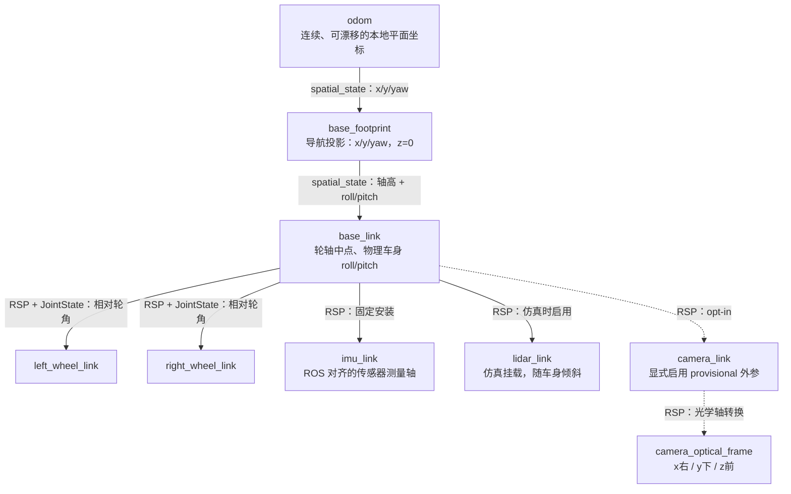
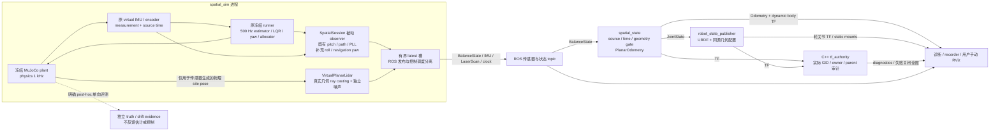

# 自平衡机器人空间状态与传感器合同

本合同覆盖 `companionbot_description`、被动空间估计与有限 MuJoCo 空间诊断。原版 SLAM Toolbox 组合见 [SLAM 建图合同](SLAM_MAPPING.md)，Bookstore 与 AMCL/Nav2 的实际消费者见 [商业场景导航](RETAIL_NAVIGATION.md)。真实 LiDAR 驱动和实体空间状态 adapter 仍待接入。正式交互入口与权限分层保持，见 [运行架构](RUNTIME_ARCHITECTURE.md) 和 [跨语言控制](CROSS_LANGUAGE_EMBEDDED.md)。当前验收与边界见 [CURRENT_STATE](../CURRENT_STATE.md)，原始调研见 [Borrow / Adapt / Reject](../models/minisegway/spatial_slam_foundation/UPSTREAM_DECISIONS.md)。

## 物理坐标与唯一事实来源

ROS 使用 REP-103 的 x 前、y 左、z 上，距离 m、角度 rad。当前 MJCF 的前方是 −Y、轮轴与正 pitch 轴是 +X、上方是 +Z，因此向量转换为：

```text
v_ROS = C · v_MJ
C = [[ 0, -1, 0],
     [ 1,  0, 0],
     [ 0,  0, 1]],   det(C) = +1
```

这是右手旋转。历史 MJCF 的 `left_wheel` 在 ROS 右侧，`right_wheel` 在 ROS 左侧；控制器、编码器与 actuator 的原通道顺序保留，空间 adapter 通过显式索引映射为 ROS 左/右轮，不能用反射或暗改符号“修正”历史命名。

| 事实 | canonical source 与派生关系 |
| --- | --- |
| 轮半径、间距、IMU 安装位置、车身质量/惯量 | 冻结 `models/minisegway/mini_segway.xml`；`tools/verification/export_spatial_geometry.py` 导出 description 的 `config/minisegway.yaml`，含来源 SHA256、旋转与 `geometry_id`；`--check` 检查一致性 |
| 控制 pitch、路径距离和编码器 PLL 状态 | 既有 `LongitudinalEstimator`，空间层复用结果，不能再积分一套普通差速轮速 |
| 空间 roll 与导航 yaw | `control/estimation/spatial.py` 的 `SpatialAttitude`；仅作被动空间输出，不替换冻结控制 yaw |
| 仿真 LiDAR 挂载、采样与噪声 | description 的 `config/sim_lidar.yaml`；MJ site 与 URDF 挂载使用同一配置，无实体标定声明 |
| 可选相机外参 | 既有 `stage7/config/final_demo.json` 的 `camera_extrinsic`；launch 只做 optical/link 表达变换，不维护另一套数值 |
| odom 漂移假设与 source gate | `bringup/config/spatial.yaml`；它不包含 PID/LQR、MCU 或 planner 参数 |

URDF 使用基本几何表达轮轴、车身方向与关节，未复制 CAD mesh；这是描述与可视化模型，不是新的动力学仿真 baseline。动力学仍由冻结 MJCF 负责。当前安装依赖工作区中的既有配置/模型资产；修改配置后须重建并检查来源，不能把一个孤立的 install 目录当作完整部署包。

## 自平衡运动学与估计

编码器测量轮子**相对车身**的角度 `φ`。对平面、无滑移滚动，正 pitch `θ` 绕 ROS +y（车头下俯），轮子的绝对滚动角增量为 `dφ + dθ`，所以轮轴路径增量为：

```text
ds = r · ( (dφ_left + dφ_right)/2 + dθ )
```

纯俯仰但轮轴不动时，`mean(dφ) = −dθ`；只积分编码器会虚构位移。既有纵向估计已经实现该补偿，空间层直接取其 `position_hat_m` 与 `velocity_hat_m_s`。该 position 在这里表示沿路径的有符号弧长 `s`，转弯后不能直接当作 `odom.x`。JointState 则保留轮体相对 PLL 角度，不能再次加 pitch。角度零点沿用启动编码器基准，不声称有绝对轮相位传感器。

姿态采用 `R = Rz(ψ) Ry(θ) Rx(φ_roll)`。将 body gyro 变换至 ROS 轴后，导航 Euler yaw rate 为：

```text
ψ_dot = (gyro_y · sin(φ_roll) + gyro_z · cos(φ_roll)) / cos(θ)
φ_roll_dot = gyro_x + tan(θ) · (gyro_y · sin(φ_roll) + gyro_z · cos(φ_roll))
```

倾斜时直接积分 body gyro-z 不等于导航航向。空间层复用既有 timestamp-aware `GyroRelativeYawEstimator`，输入为上式；冻结控制 yaw 的物理定义和控制数值保持。缺少的 roll 使用既有互补倾角标量内核与原配置，pitch 仍取原纵向估计。初始化使用原控制器刚消费的同一份静止持有 IMU 样本，避免释放后的短暂近自由落体加速度用于初始化重力方向；没有新增采样、噪声流或 GT。

`PlanarOdometry` 使用相邻 source sample 的 `Δs`、`Δψ`，以中点航向和 sinc 因子进行 SE(2) 积分，首个有效样本定义 odom 原点及零航向。漂移协方差由显式过程噪声假设传播；不融合评测真值、绝对航向或地图。默认噪声参数是未标定的工程假设，不是定位精度保证。首样本的相对平面协方差为零只表示选择坐标原点，不表示绝对位置已知；Odometry 未估计的 z/roll/pitch 与横向速度等维度用大方差标记。

当前适用范围为平面支持、小倾角：数据 gate 要求 `|pitch| < 45°`、`|roll| < 30°`。这只是有限有效性检查，不代表覆盖该全范围的精度认证。动态加速度、陀螺 bias、滑移、轮胎接触和滤波延迟仍产生漂移；它不是通用 6-DOF 惯导、坡面状态估计或绝对定位。

## TF Tree 与发布权



独立 spatial_simulation 不生成 `map→odom`；SLAM 功能启用时该边仅由原版 `/slam_toolbox` 发布，C++ auditor 通过显式 `map_authority` 检查该 owner/GID，没有 identity fallback。`base_footprint→base_link` 是动态变换，姿态为物理 roll/pitch，不能由 URDF fixed joint、普通 diff-drive 插件或 `two_d_mode` 压平。

| TF / 数据 | 唯一 owner | 时间与限制 |
| --- | --- | --- |
| `map→odom`（仅 SLAM 组合） | `/slam_toolbox` | 上游 source/transform_timeout 语义；不重打 scan 时间戳 |
| `odom→base_footprint` | `spatial_state` | 当前估计 horizon；与 Odometry pose 完全同源 |
| `base_footprint→base_link` | `spatial_state` | 同一 horizon；轴高近似为轮半径 0.042 m，姿态保留 roll/pitch |
| `base_link→*_wheel_link` | `robot_state_publisher`（RSP） | 同一 source JointState 驱动连续关节，ROS 左轮取历史 index 1，右轮取 index 0 |
| IMU、LiDAR、可选 camera 的固定挂载 | RSP | `/tf_static`；IMU 位于轴上方 0.02 m，当前虚拟 LiDAR 位于 0.18 m |
| `/clock` | `spatial_sim` | 一个仿真进程、一个时间域；不与原 frozen_sim 或其他 clock publisher 同开 |

固定轴高是平面接触近似，没有估计滚转抬轮、跳跃、地形或接触压缩的真实轴高。图中 frame 名目前为单机器人固定名，ROS namespace 只隔离 topic/node；同一 DDS domain 不支持仅改 namespace 就同时运行多套此 TF Tree。未来多机器人需明确 frame 前缀合同。

C++ `tf_authority` 通过 rclcpp 实际 DDS publisher GID 与 ROS Graph owner 检查已知 child 的父节点、动态/静态通道及发布者；换父、重复 GID 或错误 node/namespace 会非零退出，required-process 策略随即关闭空间图。Jazzy rclpy 不暴露 publisher GID，不能用 Python 订阅元数据猜测 authority。该审计是只读基础设施，不运行状态估计。DDS GID 可能先于 Graph 节点名可用；基座八个已知 child、SLAM 组合额外一个 odom child 暂存真实 GID，并最多等待 1 s steady time，期间 diagnostics 为 AWAITING_GRAPH_IDENTITY/WARN。解析后才登记 owner，未知身份没有 fallback；超过期限非零退出。meta.pending_count 与 meta.graph_pending_observations 可诊断该过程。旧独立 `camera_tf` 只适用于原显式诊断路径，不能与此树的相机 RSP authority 同时启动。该检查维护运行一致性，不构成不可信网络的身份认证。

## 节点与真实数据流



`spatial_simulation.launch.py` 只启动 `spatial_sim`、`spatial_state`、C++ `tf_authority` 与官方 RSP 四个进程，没有 Agent、follow、cmd_vel subscriber、MCU transport 或 GUI。控制与仿真仍在原单个 worker 调度，DDS 发布不进入 500 Hz 控制路径。50 Hz 空间快照和 10 Hz scan 交接到有界 latest 槽，过载可合并旧快照，`superseded` 计数可见；完整本地 source history 单独保存。

| 模块 / 重要入口 | 输入 → 处理 → 输出 |
| --- | --- |
| `prepare_indoor_model` | 冻结 MJCF + geometry/LiDAR 配置 → 添加无质量 site 和室内几何 → 独立派生 XML 与来源 manifest；不覆盖原模型 |
| `VirtualPlanarLidar.sample` | 当前物理 site 与碰撞几何 → MuJoCo `mj_multiRay`、独立测距噪声 → 只有时间/角度/范围的 ScanSample；不输出 pose、hit id 或场景 oracle |
| `SpatialSession` | 原 runner 的公开 estimate、实际消费的 IMU measurement/timing → 坐标适配、被动态势、50 Hz 快照 → BalanceState 所需 DTO 与 source JSONL；observer 返回空字典，无 actuator augmentation |
| `SpatialSimulation` | 快照和 scan → 稳态 ROS timer、原始 source stamp → BalanceState、Imu、LaserScan、clock 与 diagnostics |
| C++ `SourceGate.accept` | typed BalanceState + ROS clock → schema/frame/source/epoch/mapping/geometry/time/validity 检查 → coherent SpatialSample 或明确错误 |
| `PlanarOdometry.update` | 既有 pitch-corrected path + navigation yaw → 连续平面积分与过程协方差 → odom 估计；错误锁存，不隐式 reset |
| C++ `SpatialState::publish_sample` | 同一有效 sample/estimate → 标准 ROS 表达与轮索引映射 → Odometry、JointState、两条动态 body TF |
| C++ `TfAuthority::inspect` | TF parent/child + rclcpp publisher GID/Graph → 单父、单 owner、静态/动态通道检查 → authority diagnostics 或非零退出 |

空间 ROS owner 已为 C++ `spatial_state` ELF（普通 C++ SourceGate/PlanarOdometry + rclcpp）；旧 Python 估计仅保留冻结实验/oracle，被动 SpatialAttitude 仍在仿真侧。空间状态与 C++ TF 运行审计位于伴随计算机/仿真侧，独立于 MCU 确定性控制；没有为了空间输出新增 MCU 控制频率或 DDS 依赖。

## ROS 接口与时间合同

下表相对 topic 位于启动 namespace（默认 `/companionbot`）；`/tf`、`/tf_static` 与 `/clock` 为全局 topic。BalanceState、IMU、scan、odom 和 joint_states 使用 sensor_data QoS（best effort、volatile、depth 5），诊断为 reliable、depth 10；TF 使用官方 broadcaster/RSP 的对应 QoS。消费者不能把 best-effort 样本数当作固定实时频率保证。

| Topic | 类型 / frame | 数据语义与名义 source cadence |
| --- | --- | --- |
| `state/balance` | `companionbot_interfaces/BalanceState` / `base_link` | 50 Hz coherent estimate horizon；含 control SourceStamp、geometry_id、原 clock→ROS 映射声明、physical roll/pitch/navigation yaw、路径与 PLL 轮角、IMU source/available/age/validity |
| `imu/data_raw` | `sensor_msgs/Imu` / `imu_link` | 500 Hz 原 IMU 中抽取与 50 Hz state 对应的已消费样本；带原噪声和启动 bias 校正，轴转换至 ROS；header 是 packet sample time |
| `scan` | `sensor_msgs/LaserScan` / `lidar_link` | 10 Hz 真实射线测距；header 是整束瞬时采样时间，time_increment=0 |
| `odom` | `nav_msgs/Odometry` / `odom`，child=`base_footprint` | pose 属于 odom，twist 属于 footprint；基于现有 wheel/pitch 与 gyro 的相对估计，50 Hz 名义输出 |
| `joint_states` | `sensor_msgs/JointState` | header 使用估计 horizon，position/velocity 是轮体相对 PLL 状态；effort 未提供，不能复制请求力矩 |
| `diagnostics` | `diagnostic_msgs/DiagnosticArray` | 每个 node 报自己的状态、source age/identity、错误、publish/superseded 计数；不是物理 watchdog |
| `/clock` | `rosgraph_msgs/Clock` | 空间 graph 的唯一 MuJoCo 时钟，在发布 state 时更新，名义 50 Hz；不改变 1 kHz physics / 500 Hz control |

空间标准消息及 BalanceState 的 Header 使用**映射到 ROS 时间的 source/horizon**，原 interaction/感知业务消息 publication-time Header 合同保持。不能拿本机到达时间替换 MCU 采样时间，也不能为消除 TF extrapolation 错误而重盖 `now()`。

当前仿真状态 horizon 为 `t`，所消费 IMU 的 sample time 为 `t−0.001 s`、available time 为 `t`。动态 TF / JointState / odom 标记 `t`，原 IMU 标记 `t−0.001 s`；scan 标记实际 ray acquisition time。IMU 没有独立 orientation 估计，`orientation_covariance[0]=-1`，消费者必须忽略该 orientation 字段；gyro/accel covariance 仅来自已声明白噪声密度，不包含所有 bias/动态建模误差。

SourceStamp v2 保留 `source_id=mujoco:spatial`、运行 epoch、500 Hz control sequence、`clock_domain=mujoco_sim`、`clock_id=sim:<epoch>`、`time_semantics=control_sample` 与 host receipt provenance。BalanceState 的空间合同版本为 1，`ros_time_mapping_id=identity:sim:<epoch>`、映射 uncertainty=0，header 必须与 source horizon 一致；二者不是 ReferenceBlock 或 MCU wire 协议版本。

运行 gate 要求 IMU `sample≤available≤horizon`、age 与 horizon−sample 一致且不超过 5 ms；sequence/time 严格递增，空间样本间隔不超过 120 ms。跨 topic 的 `/clock` 与 state 调度先后允许 120 ms 有界窗口，允许的只是传输先后，不改写任何 source time。epoch/clock/mapping 变化须重启 owner，不能自动连接旧 odom。

起始第一份动态 TF 之前没有姿态历史；例如首个 IMU packet 比第一份 TF 早 1 ms，精确时间查询可返回缺少 coverage。消费者应等待所需历史或明确报告 unavailable，不能回填假历史。时钟暂停时不推进 odom/TF；若时钟前进而 source 停止，watchdog 超过 120 ms 后锁存失败。首个 source 的启动等待使用 10 s host steady deadline。

## 室内场景、扫描与 SLAM 前置边界

派生室内场景保留原机器人的质量、关节、传感器、摩擦和 actuator，增加 ROS 初始坐标 x∈[−2,6] m、y∈[−4,4] m 的墙体与侧方箱体。虚拟 LiDAR 仅是无质量 site，配置为 360 束、10 Hz、0.05–8 m、独立固定 seed 的 0.005 m 高斯测距噪声。命中的不透明碰撞几何包括地面和自遮挡；不把透明 CAD 可视化 mesh 当成量测目标。

扫描平面固定在实际 body 上，随 pitch/roll 倾斜。地面交点、遮挡和物体高度变化都是测量的一部分，不做 GT leveling，也不把未命中的光线填成假障碍。无命中/超过上限使用 `+inf`，低于最小范围使用 `−inf`；intensities 未提供。所有光线为同一时刻的瞬时阵列采样，`time_increment=0`、`scan_time=0.1 s`；未模拟机械旋转扫描、运动畸变、反射率、多径或真实 LiDAR dropout。

MuJoCo 原生射线已经能够支撑这个有界室内传感器模型，当前没有证据要求切换 Gazebo。扫描可被 TF 按实际时间变换至 odom，但扫描与估计姿态都有各自误差。原版 SLAM Toolbox 已在固定平地建图场景中使用原始倾斜 scan 通过验证，范围与 upstream 限制见 [建图合同](SLAM_MAPPING.md)；不能推及真实传感器、坡面或所有 pitch。以后只有失败证据支持时才考虑现成处理组件，不能清零 body pitch 或把地板投影成墙。

当前不启动 robot_localization EKF：wheel path、pose/twist、gyro 与 body attitude 大量同源，机械叠加会重复融合信息；two_d_mode 也不能替代物理 body TF。以后有独立信息源或量化不足时，可由状态估计模块替换唯一 odom authority，并保持消息/source/TF 合同，不让 SLAM 或导航承担原始运动学职责。

## 生命周期、失效与实体迁移

STARTING / RUNNING / CLOSED / ERROR 是应用运行状态，未实现 ROS ManagedNode lifecycle 或热重连。传感器 invalid/stale、非有限值、超出有效倾角、schema/frame/geometry 错误、时序反转、epoch 变化、source timeout、多个 BalanceState publisher 或 TF authority 冲突都会停止新的空间输出并非零退出；不是用上一帧冒充当前有效估计。required-process 退出策略会关闭整个有限诊断 graph。

simulation worker 接收停止信号，主线程有限等待 worker 并写 runtime manifest；进入清理后忽略重复 SIGINT，防止终端进程组信号与 launch 转发重复打断清理，SIGTERM 仍可终止进程；正常结束短暂 drain 最后样本后关闭。诊断 `imu_dropout_at_s` 在 virtual sensor 生成处注入明确失效，不在估计结果端伪造值。clock 多 owner 同样作为错误处理。它们不改变原 MCU 安全/物理输出 gate，也没有扩大 Agent 的 actuator 权限。

实体迁移时继续保留 STM32 本地 500 Hz 估计/控制、ReferenceBlock、C++ 有界通信和 Pi 高层职责。需要真实 IMU/encoder 的校准轴、sample time/validity、物理挂载与测得的设备→ROS 时钟映射；SpatialState 的设备入口要求显式 mapping id 及至多 2 ms 的声明不确定性，但当前没有已验证的映射测量算法或真实 producer。该字段不是时钟同步已完成的证明。

现有 MCU status 尚不包含本合同要求的完整 raw IMU、轮体相对角和 navigation attitude；不能从 body-z yaw、arrival time 或 actuator 请求拼造它们。本轮未扩展 wire v2 或 board_io，也未提供真实硬件 readiness。未来在传感器/状态 adapter 完成时间与有效性验证后接入，不更改冻结控制器的职责。

## 构建、诊断与人工可视化

以下为有限、无 GUI 诊断，不是第二个正式交互 Demo。使用独立成果目录；不要同时运行其他 `/clock` 或相同 TF authority。

```bash
cd ~/projects/CompanionBot
export ROS_LOG_DIR="$PWD/models/minisegway/spatial_slam_foundation/results/YOUR_SESSION/ros_logs"
source scripts/env.sh
.venv/bin/python -c 'import sys; print(sys.executable); print(sys.version)'
.venv/bin/python -m pip --version
bash scripts/build_ros.sh
source scripts/env.sh
.venv/bin/python tools/verification/export_spatial_geometry.py --check

ros2 launch companionbot_bringup spatial_simulation.launch.py \
  scenario:=mixed duration_s:=14.0 \
  output_dir:="$PWD/models/minisegway/spatial_slam_foundation/results/YOUR_SESSION/ros"
```

支持 `balance / forward / turn / mixed / pitch` 场景；`pitch` 是显式初始俯仰扰动，控制参数不变。`provisional_camera:=true` 只增加已标记未标定的挂载 TF，不产生相机图像或声称实体标定。独立终端可检查真实数据与 TF：

```bash
source scripts/env.sh
ros2 topic info /companionbot/state/balance --verbose
ros2 topic echo /companionbot/imu/data_raw --once
ros2 topic echo /companionbot/odom --once
ros2 run tf2_ros tf2_echo odom base_link
```

如需 GUI，由用户亲自在已加载同一环境的终端运行，修改 namespace 时同步调整配置中的 topic：

```bash
rviz2 -d ros2_ws/src/companionbot_description/rviz/spatial.rviz \
  --ros-args -p use_sim_time:=true
```

RViz 配置以 odom 为 fixed frame，显示 RobotModel、TF、物理倾斜 scan 和估计 odometry。配置提供不等于 GUI 人工验收通过。

`tests/test_spatial_state.py` 检查轴/轮名映射、pitch 与 yaw 解析反例、source/epoch/失效 gate、有限输入溢出保护和实际 ray 几何；`tools/verification/verify_spatial_foundation.py` 运行平衡、前进、转向、混合和俯仰物理场景，真值只进入独立 post-hoc 漂移评测，并与原 frozen runner 作被动传感器 ablation。结果存本工程 `results/<session>/`；实际构建、DDS/TF 和回归结论以交付报告为准，不由这些入口的存在推定通过。

`verify_spatial_ros.py` 检查实际 DDS/TF authority、精确 source-time 查询、sensor dropout 与退出；`verify_spatial_protocol.py` 使用独立软件夹具检查 source epoch、错误时间/坐标/geometry、无效数据、重复源以及暂停/前进时钟的差异。软件夹具从不接入正式控制路径。
