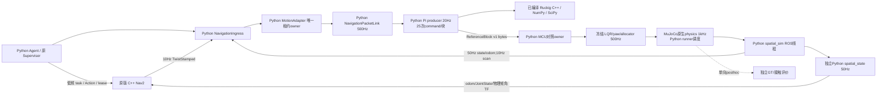

# Native Migration Audit

审计日期：2026-10-23；依据当前工作区，不以历史文件名判断实现是否有效。本审计先于本工程原生运行层实现建立，后续用真实构建、parity 与 profiling 补充决策。实体执行和 Pi/STM32 性能未经认证，`hardware_execution_ready=false`。

## 当前真实运行链

正式入口仍为 `scripts/demo_stage8_interaction.py`。Nav2 后端由同一 app 显式选择；默认 Fake。独立 C++ `mcu_bridge`/`serial_port` 负责硬件 wire v2，但当前 Bookstore 物理仿真不启动串口 TX。C99 `native/src/mcu.c` 是主机 shared library 与 STM32 共用控制核；此前仿真 C 验收通过 checked mirror 对照 Python，不能将它描述为生产图已经没有 Python MCU owner。

physics worker 同时执行模拟传感器、500Hz estimator/控制、Pi/MCU模拟调度和被动SpatialAttitude。独立 rclpy executor 发布有界 latest 槽中的状态/扫描，并运行 NavigationIngress。空间发布为另一个 rclpy 进程；官方 RSP、SLAM/AMCL、Nav2 与 C++ TF GID auditor 各有明确 authority。`map→odom` 在 mapping/localization 间互斥，GT 不参与导航。

## 迁移责任与理由

| 责任 | 当前实际执行与边界 | 决定 / 验证要求 |
| --- | --- | --- |
| MCU safety/resume/reference revoke | C99 shared core + Python对照；2ms本地裁决 | 第一优先修复唯一MCU语义；C99保持。有效HARD_STOP必须撤销旧恢复资格/epoch，native与Python parity、故障注入、ARM构建 |
| task lease、authority epoch、命令source/receipt freshness、取消 | `follow/runtime/navigation_motion.py`；ROS低频更新、每2ms被packet link查询，含RLock/DTO/dict分配 | 迁ROS-free C++ owner；Python只做低频时钟/DTO适配，不保留平行正式状态机。有限watermark容量不能淘汰后重新允许replay |
| Nav2 ingress/健康/Graph | `simulation/ros/navigation_ingress.py`；10Hz命令、20Hz健康、scan/odom/AMCL/TF回调 | 与同进程C++ motion owner组合的rclcpp adapter，避免2ms DDS往返；真实GID与source/receipt分别校验。不能把进程拆分收益当作已实测 |
| LIGHTWEIGHT lifecycle / ReferenceBlock producer | Python批量25×2ms：source.command→dataclass→rows→float32序列化；Ruckig求解已原生 | 迁完整C++外围调度/生命周期/批量编码，直接链接**同版本**Ruckig0.19.4；逐块bytes和逐tick历史parity。仅导航已授权的LIGHTWEIGHT策略，FULL不得隐式降级 |
| FULL projection / KF/Governor | FULL为现有Ruckig+SciPy sparse/KKT；KF为小矩阵NumPy，Governor为稀疏事件 | profiling后决定完整迁移；保留原数学/触发/quiet/fade/exit。不能将BLAS/求解原生算力重复计为迁移收益 |
| packet_link | 当前每2ms遍历模拟in-flight列表、解析JSON、调用多个owner；含模拟latency/drop与生产heartbeat/epoch职责 | 生产调度迁C++固定容量库；仿真latency/loss与posthoc留simulation边界。与C99核直接接口，不经DDS调度500Hz、不代发heartbeat |
| spatial_state | 独立Python source gate+PlanarOdometry+odom/joints/two dynamic TF，50Hz | 完整迁rclcpp独立owner，保留标准topic/node/time/geometry/gap/fault合同。固定小矩阵C++核，不新增EKF。Python旧实现仅测试oracle |
| SpatialAttitude / physics runner | 每2ms被动tap，1ms Python调度调用MuJoCo原生库 | 单独测外围开销后决定；不因MuJoCo计算已原生而宣称没有Python调度成本，也不为迁移破坏sensor RNG/控制观察顺序 |
| perception / YOLO / ByteTrack / OSNet / depth | Python编排，推理/OpenCV/PyTorch已有原生核心；capture/detector/depth worker | 保留Python成熟AI生态。集成真实RGB→现有模型→严格同frame depth→geometry；明确source/ready/receipt和pitch历史。没有视觉观测消费者的现状不能画作闭环 |
| Agent / Supervisor / Catalog / 音频 / 离线实验 | asyncio、低频业务、现有工具生态与测试 | 保留Python；不改业务权限、不建第二Agent/Supervisor/Demo，不为了零Python引入跨语言复杂度 |

## 可复用证据与本轮基线

历史证据是调查线索，不是本轮优化后的成绩。SLAM工程明确定位Gen2 GC导致52.3947ms reference停顿；有限mapping scope延后循环GC，41000tick控制历史不变。它没有证明无限运行内存有界，也没有解除GIL或调度不确定性。Retail最终reference生成P95约0.50ms、max约1.6ms；spatial_state约9%单核CPU/109MiB RSS，来自WSL特定窗口。纯迁移收益必须重新同机测量。

本轮源/保护快照在 `results/session_20261023/source_snapshot_before.json`（1251文件）；原工作区git status独立保存。Python Bookstore对照以相同冻结plant、seed、导航配置、地图binding与190s窗口运行在 `baseline_bookstore/`，必须等实际summary/evaluation后判断成功。后续统一采集wall/thread CPU的P50/P95/P99/max、block间隔/headroom/underrun、ROS source与receipt age/丢弃、GC/分配/跨语言次数、process/thread CPU/RSS/上下文切换及端到端RTF。单独插桩的开销不与未插桩原生结果混算。

## Borrow / Adapt / Reject

| 上游和实际实现 | 取舍 |
| --- | --- |
| ROS2 Jazzy installed `rclcpp/executors/single_threaded_executor.hpp`、executor/callback groups；[official composition](https://docs.ros.org/en/jazzy/Concepts/Intermediate/About-Composition.html) | Borrow标准executor、QoS、callback groups和shutdown；低频ROS与native owner可同进程组合。Reject自研通用event loop/executor/thread pool。组件动态加载无当前需求，不为了使用components增加生命周期 |
| [Nav2 1.3.12 controller_server.cpp](https://github.com/ros-navigation/navigation2/blob/1.3.12/nav2_controller/src/controller_server.cpp)、原官方lifecycle/action与已锁版本 | Borrow现有导航及明确ACTIVE/Action语义，Adapt stamped命令与租约边界；Reject重写controller/BT、第二速度平滑器、越权恢复/arm |
| [Ruckig0.19.4 ruckig.hpp](https://github.com/pantor/ruckig/blob/v0.19.4/include/ruckig/ruckig.hpp)、installed calculator_target.hpp/trajectory.hpp和CMake target | Borrow原版C++库，Velocity interface、Discrete duration、离线calculate/at_time；Adapt批量采样与原端点覆盖。Reject另一套S-curve、改内部算法、fast-math或更换版本伪造速度提升 |
| 本地C99 control.h/mcu.c、C++ serial_port/mcu_bridge/tf_authority | Borrow现有固定容量、安全/协议与实际GID机制；Adapt明确必要接口。RejectMCU改C++、复制物理arm、把ROS heartbeat当本地安全 |
| pybind11（本机系统headers） | Borrow库绑定、同进程shared owner和批量数据调用；跨语言只在清晰合同处。Reject每个样本Python→DDS→C++→DDS→Python |

主库不依赖ROS/pybind，便于主机单测及不同部署组合。物理simulation仍需要调用native核，但不应在每tick构造多重Python状态查询和序列化。独立进程故障隔离仅用于真实owner边界；DDS、copy、clock mapping和shutdown成本均须记录。

## 视觉接入的先决条件

现有relative仍是诊断出口，C920外参与YOLO depth米制/轴向距离未认证。仿真不得把person GT或renderer完美depth塞进KF后称为视觉闭环。人物采用有锁定来源/许可的成熟人物/动画资产，第三方及派生mesh仅放ignored cache。机载相机渲染真实RGB，原YOLO/Master/ReID和独立depth同源配对后，经显式时间域映射/车身pitch历史生成RobotRelativeObservation。LOST/身份不确定/陈旧/外参错误/时间无覆盖均应拒绝运动、撤销旧task；恢复需新的显式授权。FOLLOW与GUIDE_TO必须复用同一motion authority出口，原Agent/Supervisor继续负责高层任务。

具体逐文件审计和视觉/空间迁移路径将由同目录 `audit_motion.md`、`audit_spatial_vision.md` 补足；它们是本审计的工程附件，不是另立final_report。
