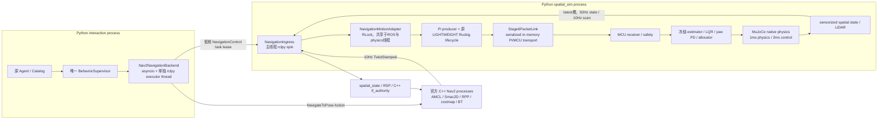

# Native Migration Audit — motion runtime

审计基准：2026-10-23 工作区；本文件为统一 Native Runtime 工程的审计片段，不是独立工程报告。当前行为与下文建议须区分，迁移是否完成以实际构建、consumer 与验收证据为准。

## 真实运行链与事实来源

- 正式入口仅 `scripts/demo_stage8_interaction.py` → behavior app/session。默认 Fake；显式 `nav2` backend 使用同一 Supervisor，不应迁移/复制 Agent 或业务任务状态机。
- `Nav2NavigationBackend` (`runtime/nav2_backend.py:25–61`) 建独立 rclpy Context、SingleThreadedExecutor、`nav2-action-executor`线程；asyncio 负责工具生命周期、显式 task、取消。服务租约正常1.2s，每0.35s续约；terminal result每0.01s独立轮询，先停止权限再取消Action（:192–244）。生命周期ACTIVE和Action discovery都检查，不把ACCEPT当完成。
- `SpatialSimulation` ROS主线程持有 NavigationIngress，`SpatialSession.run`在`spatial-simulation`线程运行冻结runner；两者共享adapter。主线程的steady 5ms timer只排空latest发布槽，不调度控制 (`ros/spatial_sim.py:86–92,119–179`)。
- 每2ms控制周期先`mcu_local_state_callback`再`pre_reference_tick_callback`再MCU reference消费 (`run_stage3b_yaw_control.py:383–386`)。`Stage6PacketLink.before_control_tick`每tick收发字节包；每25tick发heartbeat/ReferenceBlock，即20Hz，启动prefill两块；MCU仍本地500Hz。
- `ReferenceBlock`字段、采样与float32序列化canonical source是`companionbot_contracts.packets.ReferenceBlockPacket`，不是ROS。Stage5配置规定2ms×25 samples、640B v1、ACTIVE/NEXT两槽及4ms原始延迟ablation；冻结v/a/jerk为0.6m/s、0.6m/s²、1.0m/s³。
- Nav2 envelope0..0.25m/s、±0.5rad/s、controller10Hz；已有显式policy关闭候选稳定/最小变化gate，保持LIGHTWEIGHT，FULL阈值0.35m/s。不得将它推广为Stage5/6通用规则。`build_navigation_reference` (:110–143)读取原Stage5、Stage6配置，而非自行复制数值。
- source time使用shared MuJoCo ROS clock；receipt、lease、health age使用server本机perf_counter。不同时间域不可直接相减。reference epoch来自MCU状态，source epoch来自任务身份，authority epoch来自适配器；三者不同。

## 六项迁移判断

| 实际职责 / 源码 | Python是否在关键路径 | 当前真正的原生计算 | 建议及完整边界 |
| --- | --- | --- | --- |
| NavigationMotionAdapter (`follow/runtime/navigation_motion.py:18–223`) | `NavigationPacketLink.after_pi_packets`每2ms调用update_mcu_status/sample/take_stop/snapshot；锁、元组、MotionIntent和dict分配；cmd本身10Hz | 无，状态/权限/时效/生命周期纯Python | 完整迁入ROS-free C++库；唯一owner、显式双时基、固定容量身份watermark/日志，薄Python绑定保留兼容DTO；不再留Python正式状态机 |
| NavigationIngress (`simulation/ros/navigation_ingress.py:27–166`) | ROS回调10/50Hz，health20Hz，command路径会同步Graph查询和JSON日志 | DDS/RMW已经C/C++；rclpy消息转换和校验为Python | rclcpp低频I/O组件调用同一motion库；实际MessageInfo GID比仅Graph检查更直接。按原schema、frame/source/receipt gate迁移，Graph异步unknown仍不可批准 |
| NavigationPacketLink / Stage6PacketLink (`runtime/navigation_motion.py:21–99`, `packet_link.py:61–242`) | 每2ms分支/遍历/解码，20Hz producer/heartbeat/yaw；resume和STOP时序由Python承担 | 仿真MCU默认Python；独立native C99已有验收backend | 把生产调度/STOP/resume衔接完整迁入普通C++；模拟loss/latency与posthoc保留Python实验。共享MCU C99提供reference消费/本地gate；不要新建ROS 500Hz控制topic |
| PiReferenceBlockProducer (`follow/runtime/reference_producer.py:21–58`) | 每50ms内25次Python command、dataclass/row构造及float32打包；deadline敏感 | Ruckig solver、部分NumPy操作已原生 | 完整block批量C++生产最有价值；跨语言只一次block调用，禁止每sample Python↔C++反复调用。compute wall必须继续参与原模拟到达时间 |
| SparseTwoPathReferenceSource / VelocityReferenceLifecycle (`rolling_reference.py:781–924,1275–1544`; `reference_lifecycle.py:238–492`) | 每block执行25次lifecycle.command/advance，多数组复制与日志；plan时大量trajectory.at_time绑定调用 | Ruckig calculate/at_time在C++；NumPy运算、FULL SciPy LSQR/稀疏分解在编译库 | 首先迁LIGHTWEIGHT完整Ruckig外围和block输出；随后FULL完整scheduler/lifecycle逐步parity，可用Eigen/SciPy低频计划结果合同，不可把已编译求解器成本说成原生化收益 |
| Radial KF / state history / FollowGovernor (`radial_velocity_kf.py`, `follow_governor.py`) | 原packet观测20Hz；KF/Governor由到达观测更新，不能每2ms重复学习。历史插值每观测遍历deque/list；KF每观测创建2×2矩阵 | NumPy矩阵乘法已原生，但很小矩阵且Python封装多 | 因完整motion责任和固定容量管理可迁C++；保持Joseph covariance、对称化、同capture-time ego对齐、重复/顺序检查、5/20 median、刹车距离/触发条件。不能只换KF而留下跨语言每子步骤调用 |
| MuJoCo plant / ray (`minisegway.py`, `spatial_scene.py`) | 每1ms Python调度、每2ms控制组合、10Hz360 ray循环 | MuJoCo本身C/C++且binding释放GIL；独立C99 estimator/LQR已有 | 不重写MuJoCo；测量外围调用与数据复制；可batch现成mj_multiRay，保持ray/geom语义与冻结RNG/physics。有限physics runner先保留Python作为仿真owner，不得宣称是Pi生产runtime |
| spatial_state / SpatialAttitude / odom (`control/ros/spatial_state.py`, `estimation/spatial.py`) | ROS50Hz状态gate/积分/TF构造，另SpatialSession每2ms读取sensor readout并构造SpatialSample（只每10tick向外发布） | SciPy Rotation部分原生；tf_authority已经rclcpp | 适合rclcpp空间gate+estimate+publisher；保持物理倾角、平面投影/轮体相对角各自语义，时间/epoch/unique TF authority不变，不能用GT补链 |
| BehaviorSupervisor / Agent / AI推理 / 离线辨识与验收 | 业务与视觉低频，不是500Hz控制owner；目前relative无follow consumer | PyTorch/OpenCV/YOLO/OSNet/depth/MuJoCo/SciPy已有native kernels | 保留Python。LLM工具、Pydantic DTO、音频/AI生态及离线绘图移植收益不明，易割裂职责；动作授权出口迁native，不复制业务任务机 |

以上频率来自源码/配置；分配存在来自实际构造点，**不等于已证明它们占用最多CPU**。历史实测只表明deadline尾部受Python GC影响；新性能结论必须用同机同输入测量。

## 历史证据与已暴露机制

- SLAM工程明确测得Gen2 GC一次52.3947ms wall、56.8581ms thread CPU，触发reference starvation (`slam_toolbox_integration/final_report.md:92`, learning_log:19–23)。现mapping/navigation有限physics scope先collect再disable、finally恢复；41000tick GC-on/off控制逐值相同。该有限实验策略不能承诺无限生产内存或实时性。
- Bookstore最终两轮5804 block，compute P95约0.50ms、max1.59/1.68ms，导航RTF约0.995–0.997；此值仅主机、当前有限窗口。不是Pi实测，也没有独立RPP内部timing。CPU/RSS证据和失败索引保留在`retail_navigation/results/session_20261022/`。
- 重要失败：future resume在SAFE_HOLD被armed后原MCU忽略新HARD_STOP，旧resume晚到NORMAL。上轮仅以Pi重申STOP补偿；本工程应在唯一MCU本地撤销pending resume/old blocks/recovery资格，Pi不得成为该性质的owner。
- 相同任务terminal轮询曾慢于0.3s cmd watchdog；0.35s lease周期不能同时成为terminal响应周期。迁移必须保留独立终态处理，不能使用一个“通用tick”吞并不同owner。
- DDS discovery早于lifecycle ACTIVE、GID早于Graph owner解析、重型并行夹具导致source gap都是真实旧失败。不能通过增加queue/伪造timestamp/降低source gate隐藏。
- 冻结native C/Python验收199300仲裁tick，state/epoch相同，reference max diff约4.17e-17；尚不能替代本轮Pi规划器parity。原Stage3–6动态−1ms sensor phase和最新5/20 median需保留；早期Stage6.5证据与最新governor算法版本不同。

## 首选原生责任组织与接口

1. `MotionAuthority`普通C++库：task/source identity、watermark、lease、health、cmd freshness、单motion owner、取消和MCU状态衔接。构造时声明map与envelope；每调用显式传`source_now_s`与`receipt_now_s`，不把clock当全局静态状态。thread安全由库承担，事件有界且覆盖计数可观测。
2. `ReferenceRuntime`普通C++库：直接持有同一Authority引用、原LIGHTWEIGHT Ruckig、lifecycle、25sample batch、协议序号/epoch；长尾不穿Python/DDS。MCU control/safety仍独立C99 owner。不得把Pi motion和MCU safety合成另一套状态机。
3. `rclcpp` ingress：任务service+stamped cmd+sensor health+actual MCU状态，标准executor/callback groups/QoS；调用上述库。只在低频清晰边界接受AI relative observation或高层task。按实际故障隔离需求再决定组件容器/独立进程，不默认超级进程。
4. 仿真消费：PythonMuJoCo runner经一个batch/step ABI调用上述库；生产物理高频控制依然MCU 2ms，不创建 Python→DDS→C++→DDS→Python 500Hz往返。pybind适合Python对象/数组与C++库同进程；C ABI适合固定wire/MCU共享结构与明确ABI尺寸检查；两者按边界用途选用。
5. 官方Nav2保持已有进程与算法；Agent保持Python；相机RGB本地fanout保持原worker（低频relative合同跨边界），不将图像DDS往返引入跟随闭环。

水位和stop理由不能无限增长。原adapter 256水位满后删除最早key，会让被淘汰身份的旧sequence再次被当新输入；新C++实现应显式拒绝新identity并要求runtime restart，或采用经审计的epoch生命周期策略，记录此有意fail-closed语义收紧。不可静默退回Python或丢watermark。

## Borrow / Adapt / Reject 与实际阅读

- **Borrow** installed Ruckig 0.19.4原生库：wheel已包含`site-packages/include/ruckig/{ruckig,trajectory,input_parameter,calculator_target}.hpp`、`lib64/libruckig.a`及`lib64/cmake/ruckig/ruckig-config.cmake`。已读`calculate`、Velocity接口、Discrete duration和`at_time`实现；`find_package(ruckig 0.19.4 EXACT CONFIG REQUIRED)`复用，不复制第三方源到仓库，不自写jerk planner。
- **Borrow** [Jazzy rclcpp executor实际源码](https://raw.githubusercontent.com/ros2/rclcpp/jazzy/rclcpp/src/rclcpp/executor.cpp)：现成waitset、callback group、cancel/guard wake、message take与错误处理。rclcpp取消executor并不等于MCU停止，应用须先撤销运动权限。
- **Adapt** [rclcpp_components ComponentManager源码](https://raw.githubusercontent.com/ros2/rclcpp/jazzy/rclcpp_components/src/component_manager.cpp)：标准装载/卸载与executor ownership可用于实际组件部署；不为当前固定组合先写通用plugin manager。
- **Borrow** [Nav2 1.3.12 ControllerServer源码](https://raw.githubusercontent.com/ros-navigation/navigation2/1.3.12/nav2_controller/src/controller_server.cpp)及[LifecycleNode源码](https://raw.githubusercontent.com/ros-navigation/navigation2/1.3.12/nav2_util/src/lifecycle_node.cpp)：保留Lifecycle配置/激活和cleanup、既有Action接口；本地motion gate的lease和MCU授权不由Nav2 Lifecycle代替。
- **Reject** 自制executor/threadpool/事件循环、重写Ruckig/SLAM/Nav2、默认fast-math、提高block depth/timeout掩盖starvation、Python/C++双正式authority、按源码行数推断瓶颈。
- 官方docs.ros.org Jazzy Executor页当前web访问被Anubis拒绝，已改读上述官方源码；Ruckig github tag文件在线取回未成功，使用实际安装0.19.4头文件作为当前实现证据，不把main当相同版本。

## 公平profiling与可复现验收建议

同一Bookstore模型/地图hash、seed、原冻结config、采样窗口、debug日志内容和建构Release设置。先留旧实现oracle与输入trace，再逐步迁移，不混用时间窗口和算法版本。

- 分层采集`wall=perf_counter_ns`、`thread CPU=thread_time_ns`、P50/P95/P99/max，区分tick正常/plan/STOP/resume；native使用steady_clock和CLOCK_THREAD_CPUTIME_ID。完整block计时包括生命周期与打包，不只Ruckig solver。
- 保存block generated/ready/start tick、deadline headroom、消费underrun/starvation、epoch/seq拒绝；真实DDS arrival相减须同clock且标明发布粒度。队列长度、覆盖/丢弃和source age都记录。
- Python统计GC callbacks暂停与collection generation、tracemalloc单独profile运行（有开销，不能混同公平性能run）、跨语言调用次数；原生统计每tick heap分配与batch大小。GIL等待不能用总CPU直接推断，必要时profiling工具单独采样。
- 从`/proc/<pid>/stat/status/task/*`采进程/线程CPU、RSS/peak、voluntary/nonvoluntary context switches；同一观测窗口采集所有Nav2/physics/Agent/视觉进程，完整视觉推理并行作为独立压力ablation。
- parity逐tick比数学状态、reference six fields、yaw、epoch、task和SafetyStatus；正常case只允明确float rounding，安全修正case先写新预期。wire float32应优先逐byte比较；正常控制history沿用原门禁。
- 现成诊断入口：`verify_stage9_control.py`（含`--extended-baseline`）、`verify_stage9_stream.py`（原benchmark/stream及4ms delay）、`verify_stage9_dynamic.py`（8项最新动态governor）、`verify_navigation_safety.py`、`verify_navigation_ros_faults.py`、`run_retail_acceptance.py`、`verify_formal_navigation.py`、`verify_spatial_ros.py`及`verify_spatial_protocol.py`。均显式`--output-dir`落本工程session，不能覆盖冻结证据。
- 参考收益门槛仅用来筛选后续优化：关键路径约20%或尾部约30%改善；权限owner、生命周期和内存隔离有独立架构价值。未实测前不承诺任何提升，主机提升不外推Pi5/STM32。
