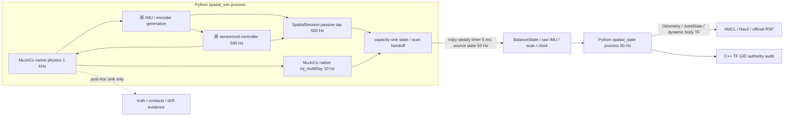

# Native Migration Audit — spatial / perception / assets

审计日期：2026-10-23；审计对象为当前本地实现。本文是统一 Native Runtime 工程审计片段，不是独立工程报告。未实施部分标为建议，历史实测不冒充本轮性能结果。所有硬件执行 readiness 保持 false。

## 真实运行链与 owner

`simulation/runtime/spatial_session.py:57-171` installs passive callbacks in the existing frozen runner. `physics_step()` owns real-time pacing and scan acquisition, not a second physics/control loop. `output()` initializes roll using the same stationary held IMU sample already consumed by the controller. `observe()` updates missing roll/navigation yaw at each control tick and emits every tenth control sample (50 Hz). Pitch, pitch-corrected path and wheel PLL remain owned by the existing longitudinal estimator; it must not be replaced by ordinary differential odometry.

`simulation/ros/spatial_sim.py:29-234` owns one ROS node, one simulation worker and two latest handoff slots protected by a lock. Its 5 ms steady timer drains state/scan without queueing old snapshots, publishes one `/clock` authority, and retains superseded counters. `state/balance` is 50 Hz, `scan` 10 Hz, and `imu/data_raw` is the actually consumed IMU sample selected with each 50 Hz state, not a synthetic 500 Hz DDS stream. `record_truth()` is a one-way post-hoc sink; source sensor generation may use physical site transforms but cannot export scene pose/contact oracle to control.

`control/ros/spatial_state.py:39-198` is a complete independently owned system responsibility: source/schema/geometry/clock gate, epoch and mapping identity, planar integration, standard ROS message construction, body TF authority, error latch and watchdog. It has no command or actuator subscription. Its normal cadence is 50 Hz; its 100 ms steady watchdog distinguishes paused ROS clock from advancing clock with a stopped source. A bad stream stops output and exits nonzero; source/mapping change requires restart. `tf_authority.cpp` remains the separate read-only DDS GID/Graph auditor, and RSP remains the sole wheel/static-mount publisher.

## What is Python overhead, and what is already native

| Path | Actual computation / allocation | Decision basis |
| --- | --- | --- |
| 500 Hz `SpatialAttitude.update`, `control/estimation/spatial.py:37-63` | Python checks/trigonometric calls, small NumPy arrays, existing complementary scalar tilt filter and timestamp-aware gyro yaw; dataclass return | Candidate pure C++ library in the simulation/control native segment. No DDS hop per tick. Must retain physical Euler yaw/body-z distinction and stationary initialization. No measured isolated P99 yet. |
| 50 Hz `PlanarOdometry.update`, `spatial.py:135-174` | Python lifecycle/gates plus tiny 3×3 NumPy covariance multiplies and copies | Complete C++ kernel + rclcpp node migration boundary; fixed arrays avoid tiny array overhead. Preserve midpoint/sinc equations and covariance assumptions exactly. |
| 50 Hz `SpatialState.publish_sample`, `spatial_state.py:134-169` | Python ROS object construction/list copies, two SciPy rotations, TF publication | Migrate with the same node owner; no new relay/IPC necessary. SciPy rotation math is already compiled. Benefit must be attributed to Python boundary/object/lifecycle removal, not reinvented rotation math. |
| 1 kHz MuJoCo step, 10 Hz LiDAR rays | MuJoCo C engine through official C++/pybind11 bindings; `VirtualPlanarLidar.sample` calls `mj_multiRay` | Keep engine/library. Whole simulation-language migration has no demonstrated physics compute benefit; profile Python surrounding callbacks/copies separately. |
| YOLO / OSNet / OpenCV / NumPy | PyTorch kernels, Ultralytics/Torch preprocessing, native OpenCV and numerical libraries | Retain Python AI orchestration initially. Native inference rewrite/export is a separate measured backend experiment, not a language-line-count win. |
| Asset preparation / map binding / post-hoc evaluation | Offline XML/JSON/mesh processing | Keep Python; mature pycollada/trimesh/CoACD tools and no deadline owner. |

Historical resource evidence: `slam_toolbox_integration/final_report.md:46-60` measured spatial_state about 8.8–9.3% of one host core and ~109 MiB peak RSS; simulation peak ~884–958 MiB. `retail_navigation/final_report.md:164-166` measured simulation ~76–77% of one core, ~941–943 MiB during finite navigation windows, reference generation P95 ~0.50 ms/max ~1.6–1.7 ms. These are WSL x86 historical whole-process/window observations; they do not establish which function is a bottleneck or predict Pi performance.

## Spatial migration boundary and invariants

Recommended first spatial migration: one ROS-free C++17 `PlanarOdometry` + `SourceGate`, consumed by one rclcpp executable named `spatial_state`. Keep topic/node/namespace/QoS/frame names and failure reasons. Use the official SingleThreadedExecutor, native fixed arrays and standard TF broadcaster; no generic custom event loop or thread pool. The node stays a separate failure-isolation process and incurs the same BalanceState DDS hop as before. Components/intra-process communication would only reduce copies if both source and consumer were genuinely C++ components; a Python source cannot gain that benefit merely by renaming packages.

- Preserve source stamp vs IMU sample vs horizon: current `t` horizon uses IMU source `t−1 ms`, available `t`; TF/odom use `t`, raw IMU uses `t−1 ms`.
- Preserve schema versions (BalanceState 1, SourceStamp 2), source epoch, identity mapping for simulation, device measured-mapping declaration and uncertainty ≤2 ms. No actual device mapping algorithm is present.
- Preserve source time window/gap 120 ms, source startup 10 s host steady, sensor age ≤5 ms, pitch <45° and roll <30°; these are existing gates, not broad accuracy certification.
- Preserve right-handed MJ→ROS rotation `[-Y,X,Z]`, explicit historical wheel swap (ROS left=index1/right=index0), wheel-body relative JointState and physical roll/pitch TF.
- Preserve `PlanarOdometry` first-sample origin, midpoint/sinc path integration, wrapped incremental yaw, declared process covariance and fault latch. Unsupported pose/twist dimensions keep large variance; joint effort stays unavailable.
- `geometry_id` is Python `SHA256(json.dumps(content_without_id, sort_keys=True).encode())`; a C++ reader must reproduce that exact canonical format, including float and Unicode representation, or retain the validated canonical normalization at startup. It must not silently establish a second hash convention.
- Python `SpatialAttitude` is still used in sensor simulation. Python `PlanarOdometry` may remain a test oracle; the Python ROS node cannot remain a selectable parallel production owner after native cutover.

## Current vision chain and missing motion connection

`perception/runtime/session.py:54-169,490-590` owns one source fanout, independent depth and detector/tracker threads and bounded input slots. Detector wraps existing YOLO, ByteTrack and Master/ReID; depth wraps independent `YoloDepthAdapter`. `_SameFramePairer` keys on source id, sequence, dimensions and exact source timestamp and retains at most 16 recent results. This is essential: latest depth and latest bbox may be different frames. Reuse this pairer, `representative_master_depth`, `back_project_camera_point`, `MasterReIDSession`, and the frozen Stage 6 observation/KF/Governor/BearingYaw/planner; do not replace them with actor GT.

`perception/core/master_depth.py:56-93` requires an exact same-frame visible Master, clips the central torso ROI, takes median finite positive model outputs and requires ≥10 pixels. `robot_geometry.py:115-157` transforms camera→body→source-time pitch-leveled axle. It rejects missing pitch coverage and malformed alignment. It does not itself authorize motion. Current `final_demo.json` explicitly marks extrinsic, constant pitch, depth convention and Stage6 connection provisional/false. ROS `RelativeObservation` is only a diagnostic publication; no current production follow/controller consumes it.

The current `ColorFrame`/detector/depth/geometry contract is host read-complete time in `perf_counter`, not camera exposure or MuJoCo time. Detection timing validates source≤inference-start≤end≤ready in that one host domain. `RobotRelativeObservation` is hard-coded to the same semantics. A rendered camera integration must therefore either (a) retain a separate explicit mapping record from the render acquisition sim epoch/time to host read-complete and obtain pitch at that acquisition time from sensorized history, using `capture_time_mapped_to_host`, or (b) explicitly version/extend the source contract and all producers/consumers. Simply placing `sim.data.time` in `host_receive_time_s` is invalid. Mapping may need piecewise samples because simulation pacing intentionally accumulates slips rather than catching up.

Source pitch must come from the existing estimator/history at the image acquisition horizon. Never use the newest pitch after delayed inference. No history/clock/extrinsic coverage means unavailable. Use ready time solely for output age/deadline. Source epoch changes invalidate identity, pitch history and follow task authorization.

### Depth semantic risk confirmed from actual upstream and checkpoint

The installed `ultralytics/nn/modules/head.py:785-867` implements a positive exponential depth head and `depth.pow(cal_a) * exp(cal_b)`; `models/yolo/depth/predict.py:35-55` resizes/crops outputs to source shape. The actual local `.venv/models/yolo26n-depth.pt` was loaded read-only with the project interpreter: head `Depth`, `cal_a=[1.]`, `cal_b=[-0.1938]`, training imgsz 768. This buffer does not establish camera/Bookstore metric accuracy or axial-vs-range meaning.

The [official depth documentation](https://docs.ultralytics.com/tasks/depth/#depth-range-and-the-log-depth-head), accessed 2026-10-23, states that relative log-depth and absolute scale are separate and that absolute scaling uses calibration/alignment. Its headline metric table includes aligned evaluation. Thus the existing adapter's metres-labelled array is not sufficient evidence for safe distance control. Before closed-loop acceptance, freeze a model-output evaluation protocol with independent held-out frames/distances and explicit axial/range hypothesis. Log raw model output and calibration identity. Do not fit online to actor GT, inject perfect renderer depth, or report aligned post-hoc scores as uncalibrated accuracy. Failure to validate distance must remain an explicit unavailable/stop boundary.

## Character asset and renderer route

Bookstore currently has no animated human; `.venv/assets/bookstore` is locked AWS static visual/collision geometry and all mesh derivatives remain ignored. Existing `retail_scene.py` preserves source transforms/materials and uses group2 visuals/group4 contact/ray geometry. Do not alter friction/plant or remove collision for visual success.

Candidate first mature source: [Khronos glTF Sample Assets / CesiumMan](https://github.com/KhronosGroup/glTF-Sample-Assets/tree/main/Models/CesiumMan), a textured skinned character with an upstream walking animation. [Model LICENSE](https://raw.githubusercontent.com/KhronosGroup/glTF-Sample-Assets/main/Models/CesiumMan/LICENSE.md) identifies Cesium attribution and CC-BY-4.0; associated logo/trademark rights are excluded. Audit the actual skin, animations, transforms, texture and linked logo terms, pin commit and all source hashes before adopting. Do not claim a download alone solves animation or detection generalization. A mature glTF skin/animation loader/converter should be borrowed; custom geometry people or billboard RGB cutouts are rejected. Source and derived character assets stay in ignored cache, with provenance/license lock in-repo.

MuJoCo 3.2 supports native model/scene/render APIs and its Python Renderer is backed by C/C++ (official [Python API](https://mujoco.readthedocs.io/en/3.2.0/python.html)). Add an on-body optical camera from the explicit simulated mount and a pinhole calibration derived from that renderer, not the C920's unverified K. Camera body pitch remains physical. Render RGB only into perception. Renderer depth may be stored exclusively in an independent post-hoc sink for evaluation, never passed to `DepthFrame` or the controller. Use headless EGL/OSMesa when available; no GUI/desktop automation. Animation/actor route is simulation physics/image generation and cannot export actor state as target observation.

Obstacle safety should reuse scan/costmap/clearance signals with conservative braking tied to existing speed/validity contracts. A visual target ahead is not proof that the swept robot footprint is free. FOLLOW/GuideTo must converge on one native motion authority with task/epoch/sequence and MCU STOP/resume; WAIT/STOP/CANCEL revoke both active and pending authorization. LOST/uncertain identity/stale depth/extrinsic mismatch/time gaps must stop or inhibit acceleration according to fixed existing limits, and reacquisition cannot resurrect an old task.

## Borrow / Adapt / Reject

| Upstream mechanism / actual inspected source | Decision |
| --- | --- |
| Installed Jazzy rclcpp executor headers and [official SingleThreadedExecutor implementation](https://raw.githubusercontent.com/ros2/rclcpp/jazzy/rclcpp/src/rclcpp/executors/single_threaded_executor.cpp) | Borrow executor/waitset lifecycle. Keep one serial callback owner for source gate/odom; no handcrafted generic event loop. Documentation site access returned protection page, so use installed headers and actual official source. |
| ROS TF2 TransformBroadcaster / existing C++ tf_authority GID checks | Borrow broadcaster and retain separate actual-GID auditor. Do not infer authority from expected names or publish fake identity transforms. |
| Native NumPy/SciPy / MuJoCo / Ruckig | Keep algorithms and compiled kernels; adapt only runtime boundaries with parity. Reject claims that their original native compute is a new C++ migration speedup. |
| Ultralytics/ByteTrack/OSNet, current exact-frame pairer | Borrow current Python AI chain. Adapt source/epoch/history bridge and measured invalidity gates. Reject duplicate detector/tracker/identity logic in C++. |
| Khronos CesiumMan glTF skin/animation and license | Candidate Adapt after pinning and source-level validation. Reject custom test-only geometry actor and arbitrary downloaded human without provenance. |
| robot_localization generic diff-drive EKF / two_d_mode | Reject for this migration: same wheel/pitch/gyro source risks duplicate fusion and would flatten physical tilt; no evidence to replace current estimator. |

## Environment and reproducible acceptance route

Verified interpreter `/home/kylian/projects/CompanionBot/.venv/bin/python`, Python 3.12.3, pip24.0 in the same venv. Installed: Ruckig0.19.4 (native `.so`, C++ headers/CMake config under site-packages), MuJoCo3.2.0, Torch2.14.1+cpu, Ultralytics8.4.173, NumPy2.2.6. Python `pybind11` distribution absent, but Ubuntu `/usr/include/pybind11`, `/usr/lib/cmake/pybind11` and Jazzy `pybind11_vendor` exist. `g++`, CMake, nlohmann_json, yaml-cpp and OpenSSL headers exist; ARM toolchain is project-local `.venv/embedded/native/usr/bin/arm-none-eabi-gcc`, not on default PATH. Detector `yolo26n.pt`, depth weights and OSNet weights exist locally. No Pi/GPU/STM32 performance result is established.

1. Save old sensorized sample inputs, Python oracle outputs and source/config hashes before native cutover. Benchmark wall/thread-CPU P50/P95/P99/max and process CPU/RSS on identical windows; no simultaneous heavy run during baseline.
2. Replay identical deterministic physical sensor histories into C++ planar/source kernels. Compare every tick pose/covariance, fault latch, epoch/time rejection and large finite overflow. Add native kernel tests and compare numerical tolerances explicitly; normal control history must be unchanged because spatial remains passive.
3. Install/launch the native `spatial_state` through existing formal launch consumers. Run `verify_spatial_protocol.py` (10 DDS fault cases), `verify_spatial_ros.py` (actual GID/TF/source coverage/dropout/shutdown), `verify_spatial_foundation.py` (five physical cases + passive ablation), then SLAM/AMCL/Nav2/Bookstore regressions. Preserve initial unavailable TF coverage and drops.
4. Freeze visual acceptance thresholds and their sources before image experiments. Validate person detection and exact-frame depth from true Bookstore RGB, independent distance/depth convention evidence and sensorized pitch history before enabling Follow. Record failed detection/depth and domain gap honestly.
5. Run visual motion scenarios through the same native authority and existing algorithms: straight/turn/stop/short occlusion, LOST/ReID uncertainty, stale depth, wrong extrinsic and missing history. Measure contact/braking/pitch and actual outputs from independent post-hoc logs. Test FOLLOW→GuideTo→STOP→new FOLLOW authorization and navigation/Agent/vision resource competition.

No step permits fake hardware feedback, implicit fallback, altered control/gains/deadlines or GT observation. If valid model distances cannot be established, complete the real image/inference/software safety chain and report distance-dependent motion acceptance as incomplete.
