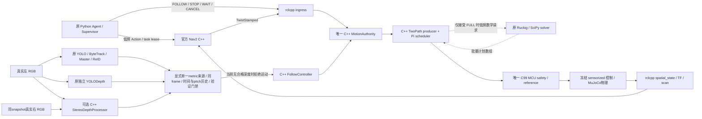

# Native Runtime Modernization & Visual Companion Integration

状态：**工程进行中，不能据本文宣称最终验收通过**。更新至2026-10-26。当前工作基于 WSL2 Ubuntu 24.04 / ROS 2 Jazzy、项目 Python3.12 venv、MuJoCo3.2、Ruckig0.19.4。`hardware_execution_ready=false`；无 Pi5/STM32 实体认证、烧录或 GUI 操作。本文是本工程唯一 final_report，后续统一更新。正本为`/home/kylian/projects/CompanionBot/models/minisegway/native_runtime/`；桌面`stage report/Native_Runtime/`仅保存当前进展的独立副本，交付状态与SHA以正本`results/session_20261023/report_delivery_current.json`为准，不代表工程已完成。

## 目标与保护合同

第一优先完成关键运行责任 C++/C 原生化，其次完成真实视觉陪伴闭环。冻结 1ms physics、2ms control、25-sample ReferenceBlock、MCU C99、LQR/yaw/Ruckig 参数、Q actuator OFF、物理 arm 与原 Agent/Supervisor owner。GT 只在物理生成、图像生成和独立 posthoc 评测，不能作为控制观测。

开工源保护快照 `results/session_20261023/source_snapshot_before.json` 记录1251文件；原 git status 独立保存。最新进行中复核 `regression/source_protection_editor1/summary.json`：1222文件SHA256保持，29项为逐路径列明原因的本工程运行代码/文档变更，无缺失或未声明修改；其中Stage3–6冻结成果1003/1003保持，AGENTS保持。Git逐文件清单另覆盖初始快照外的修改/新增文件；本轮测试改动的`log/latest_test-result`已只恢复初始链接，两个历史日志目录均保留，见同目录`generated_link_restore.json`。这不是尚未完成的最终源保护验收，也不将初始快照外文件称为开工SHA已验证。工程全部原始证据在 `results/session_20261023/`，含失败。

## 审计与责任边界

完整迁移前数据流、频率、已编译核心与 Python 外围、Borrow/Adapt/Reject、保留 Python 理由见 [NATIVE_MIGRATION_AUDIT](NATIVE_MIGRATION_AUDIT.md)、[motion audit](audit_motion.md)、[spatial/vision audit](audit_spatial_vision.md)。审计先于迁移；不以源码行数或语言比例推断瓶颈。

- C++ MotionAuthority：唯一 task/source identity、lease、authority epoch、freshness、模式互斥和撤销；无 actuator/physical arm 权限。
- C++ TwoPathProducer：原 scheduler、LIGHTWEIGHT/FULL lifecycle、quiet/fade/pending/lock、批量25sample与640B编码。直接复用同版本 Ruckig C++。FULL 数学 projection 保留原 Ruckig/SciPy cached KKT 低频 solver，接受计划时一次绑定返回数组，不把已编译求解算力重复算作迁移收益。
- C++ NavigationRuntime：Pi packet scheduling、有界模拟 transport、RobotState/STOP/Resume 衔接；同进程共享 authority。MCU 安全状态机仍由共享 C99 核唯一承担。
- C++ FollowController：完整 KF/history/Governor/BearingYaw 组合与观测权限门禁；Python 只送低频 source-mapped 视觉 DTO。
- 独立 rclcpp spatial_state：原 source/geometry/clock gate、平面里程计、标准消息与物理姿态 TF。原 Python ROS owner已替换为启动原生 ELF 的兼容入口。
- 可选 C++ StereoDepthProcessor：真实同snapshot左右RGB→官方OpenCV4.6 StereoSGBM、校准/时序/质量门禁→axial-Z与诊断；由低频图像adapter消费，当前验证失败，不产生运动授权。原YOLO/独立Depth仍在运行。
- Python：MuJoCo 实验 owner、AI 模型编排、RGB采集、原 Agent/Supervisor/Catalog/音频、低频 FULL 数学求解、离线工具。推理、MuJoCo、OpenCV、SciPy 本身已有原生核心；不改写第三方算法内部。

实际仿真进程仍由既有 physics worker 驱动；不新增500Hz DDS控制topic。原生 ROS ingress 有独立标准 executor/context线程，空间节点维持独立进程隔离；这会增加 context/thread/DDS 成本，必须由实测评估，不能默认零成本。

## MCU STOP/resume 根因、修复与证据

原 SAFE_HOLD 中旧 resume 已 armed 后，新 HARD_STOP 被拒绝，旧恢复可在未来生效。修复在唯一 C99 核：接受有效新 sequence HARD 后立即增加 reference epoch、撤销 active/next/pending/armed recovery 并硬停 yaw rearm，适用于所有状态。重复/陈旧 sequence 返回 CB_SEQUENCE，无状态改变；低 authority 不替换 HARD；独立 heartbeat/starvation fault 不因新 STOP 清除；恢复仍须新显式授权、正确 authority/current epoch、future block、新 yaw 和 PI_OK。正常制动第一采样及控制数学保持。

证据总索引 `mcu_safety/summary.json`：修前真实复现 old resume 生效；修后屏障阻止；61定向 pytest、24状态/sequence/authority组合、8 native CTest、18 firmware host fixtures及 address/UB sanitizer；ARM Release ROM39524B、RAM18280B（无实体运行）。LeakSanitizer sandbox ptrace失败保留，不能称完整 leak scanning通过。

五套冻结 native baseline/radial/safety/dynamic/stream 已记录199300 checked ticks，最大 reference差约4.1633e−17；正常 baseline保持。旧软件MCU的8项物理fixture另行保留。最新正式C++ scheduler/typed transport/C99链已完成`regression/native_runtime_faults_v2/summary.json`全部8项、各20s真实MuJoCo回归：STOP/WAIT/CANCEL、command/lease到期、scan/localization失效及pending-resume中取消全部通过原控制门禁、旧authority撤销且无意外接管。最后一项12.10s取消后恢复窗口速度峰值0.002062m/s，旧resume没有生效；其他项新显式恢复速度峰值约0.2305–0.2307m/s。该夹具不包含ROS Action，不能替代完整导航验收。

## 数值与生命周期 parity

- 原 LIGHTWEIGHT batch：2400随机块 wire逐byte一致；浮点64 lookahead差≤2e−13。
- 完整 native Pi调度：6场景×0/4ms延迟，90000tick reference/yaw/epoch/state/reason/block/sample/lookahead对照通过。
- FULL/TwoPath：61500samples，LSQR与正式Follow cached KKT后端、三种policy和prefill/projected-exit均已逐byte/状态/phase/quiet/fade/pending对照；真实计算耗时不作为数值相等项目。
- 原生 KF/history/Governor/BearingYaw：13项已通过，含5000 KF steps、2000 history samples、6000随机Governor steps、最新5/20 median、Joseph covariance、时间对齐和事件容量。
- 容量耗尽 fail-closed、显式 reason provenance、过期旧视觉结果与新task竞态、完整FOLLOW guard/组合和GIL/锁顺序是最终版本仍在收尾的验证项。

## 性能实测与限度

独立空间节点公平DDS对照已完成：相同700输入帧、Python/C++/C++/Python顺序；每轮700odom/700joints/1400TF，数值最大差5.421e−20。CPU约6.32–6.96%→1.69–1.76%单核，RSS约107.5→35.3MiB，发布→odom probe RTT P99约1.55/2.31ms→0.81/0.79ms。RTT包含两段DDS与probe调度，不是MCU采集延迟；C++线程16、Python15，不能宣称线程减少。

相同冻结配置/map/190s Bookstore，旧链与首轮新链均三目标通过、零障碍接触/意外接管。旧reference P95约465.9μs，新约11.0μs；然而新链整机观测RTF约0.899，旧约0.997；simulation CPU约100.5%/RSS982MiB，旧76.3%/937MiB。该退化保留，首轮启动期间存在短资产编译负载可能重叠，且不同实时运行不是逐消息输入一致，**不能据此宣称全链路提升**。下面另行完成固定输入macro对照。

最新源码完整190s复验为`regression/navigation_final_editor1/{summary,evaluation_posthoc}.json`：先以官方planner验证全部五目标，再实际完成西书架→东书架→服务台；3s停稳位置误差6.256/8.178/11.005cm，三段路径合计21.382m，零障碍接触/意外接管，三次正常任务释放，最小保守障碍间距0.228m，原控制门禁及退出均通过。AMCL/Nav2与原canonical地图/物理真实运行，无视觉负载或新Agent验收。观测RTF约0.995、spatial_sim平均71.61%单核CPU/peak RSS990.71MiB，2895条reference生成P50/P95/P99为12.88/38.02/70.42μs、max1.122ms；此单次运行不改写公平macro负结果。原日志保留14条TF message-filter丢弃记录，未声称零丢弃，也未为通过导航修改时间戳或容忍门限；原丢弃行见`timing_log_review.json`。

最新原82s房间SLAM回归见`regression/slam_native_final1/summary.json`：实际消费C++ spatial_state ELF，参数与原SLAM final_mapping逐byte一致，41000控制tick/21.768m物理路径、原控制门禁通过；820/820扫描有source-time TF，实际GID每edge唯一。地图161×161/5cm，geometry P95为5.975cm、四墙覆盖/occupied precision均100%，SLAM位置RMSE1.105cm；125nodes/208edges、84跨圈边及历史修正证明原回环机制实际工作。保存地图25921cells逐值加载一致，posegraph重载以及原IMU/重复authority/SLAM进程/缺失图故障与清理六项全部通过。源与ELF前后SHA保持；该运行仍使用原有限mapping motion实验链，不改写成全C++运动或视觉验收。

固定输入reference微对照已另行完成：`performance/reference_suite_v3_exact_window/suite_summary.json`。同seed20261023、canonical配置、每fresh process10000块，Python/C++/C++/Python分别在GC deferred和enabled运行，共8个进程；全640B wire逐byte一致。C++实际使用正式TwoPathProducer的LIGHTWEIGHT策略，双方复用同版本Ruckig。各语言/GC组的分位数从20000条原始样本合并计算，未平均各run分位数。

| GC对照 | Python→C++ P95 / P99（μs） | 窗口process CPU/块（μs） | peak RSS（MiB） |
|---|---|---|---|
| deferred | 581.845→23.743 / 985.576→31.683 | 356.513→10.560 | 80.371→73.344 |
| enabled | 522.935→24.095 / 624.972→40.293 | 325.740→11.149 | 80.422→73.332 |

对应P95减少约95.92%/95.39%、P99减少96.79%/93.55%，peak RSS仅减少约8.7–8.8%。deferred中C++仍有1.799ms最大值（Python2.815ms）；enabled中最大值0.259ms（Python2.442ms），全部保留。enabled有限窗口Python共72次GC、最大0.178ms，C++零次，不能外推永久无GC/无分配。v3将process CPU终点固定在GC恢复/文件输出之前；旧v2包含cleanup的CPU窗口不混入该比较。原生每块仍有一次batch produce及三次诊断property读取；微对照不代表500Hz物理吞吐、FULL求解器性能、ROS传输或运行中watchdog成绩。

固定whole-physics对照 `performance/physics_macro_v2/`采用原cancel-during-resume20s Bookstore fixture、相同epoch/配置/RNG/1ms physics/2ms control，2份独立functional trace后再以Python/native/native/Python运行4个fresh process。575份源/配置与实际加载库前后及跨perf run一致，原安全检查与日志均保留，无cProfile/AI/GL/DDS。两侧共用当前native MotionAuthority、原Python V1 sensorized physical controller与已修STOP语义；比较的是旧Python Pi/packet/MCU与正式C++ scheduler/typed transport/C99 MCU，不能称整个Python机器人与全C++机器人对照。

20s whole-window包含模型/资产setup、物理、必要日志/report与GC恢复：两个run合计wall **16.989→17.722s（退化4.31%）**、process CPU18.867→19.689s（退化4.36%）、peak RSS665.69→672.60MiB（增加1.04%）。该负结果保留，不能由微对照改写。RTF按完整窗口算，未修改physics倍率。三个模块的pooled wall如下；每语言各20000样本。

| 模块 | Python P95 / P99（μs） | Native P95 / P99（μs） |
|---|---|---|
| scheduler | 38.014 / 384.648 | 18.858 / 38.622 |
| command DTO | 14.904 / 20.596 | 11.662 / 27.815 |
| local estimate传递 | 2.159 / 34.942 | .761 / 2.298 |

command P99反而变差，native最大wall4.079ms（Python81.4μs），calling-thread CPU最大146.7μs；不能宣称500Hz host deadline或GIL等待已认证。模块总wall减少约.352s，whole-window却多.733s，额外时间落在三个方法之外；模型setup、必要report/日志序列化及调度是待分段验证候选，不据此推断已找到根因。两次native各10000step、queue peak4/32、零capacity rejection/reference underrun/drop，正常生成块最小headroom49.912/49.955ms；旧链根据同序producer/transport真实available time复算为49.266/49.249ms，零负headroom或reference drop。原启动prefill headroom0另保留。

独立functional trace的全部10000tick消费reference数值、block/epoch/state/reason/phase、actual/requested torque、sensorized state与physical qpos/qvel **exact**，common取消/恢复事件tick与块metadata一致，旧resume未生效。未消费pending块的完整wire未由macro接口导出，独立61500sample codec parity仍另记。两个时间元数据`block_start_time_s`、`intent_source_time_s`最大差3.4283687e−12s，**超过既有2e−12检查，严格全面parity未通过**；没有放宽门限或改runtime时间戳。NORMAL block start exact，NORMAL generated-time差最大3.295e−13s；SAFETY DTO沿用Python MuJoCo累加double与native整数tick×dt的不同计算表示，两字段映射到canonical control tick均exact，所测物理/控制行为保持。`suite_summary.json`原工具总判定漏将这两列纳入conjunction，原件与as-run脚本/协议SHA保留；权威补审`suite_summary_reaudited.json`明确performance_measurement_valid=true、control_and_reference_gates_passed=true、全列parity/总passed=false。

历史字段`history_50hz`在本loaded Stage5实验实际为500Hz：20s保留10000row，实测dt约.002s；空间DTO仍是50Hz。标签已修，原as-run文本保留。SpatialSession只在50Hz消费者路径构造DTO后，独立原mixed14s回归`spatial/dto_allocation_v1/summary.json`通过：7000控制history与原件exact、700条发布sensor DTO exact；实际7000 observe、700次DTO构造和7001次attitude更新（含held startup）。旧构造次数只由已核SHA的原始straight-line observe源码推论，本次没有伪称重新测量旧计数；500Hz估计/视觉观察顺序保持。

CPU视觉线程预算另以12张固定已存真实RGB、原detector640/independent depth768、两个原模型worker在fresh process对照，结果 `thread_budget/comparison.json`。default实际每worker7线程，pair P95/P99为105.36/108.62ms、窗口CPU5.037s；1线程退化为295.87/299.78ms、CPU3.992s；2线程115.14/115.78ms、CPU3.663s；4线程86.27/86.47ms、CPU5.331s。2线程节省CPU约27.3%，4线程降低P99约20.4%但CPU增加约5.8%；保留1线程负结果。2/4线程的12份depth数组与default exact，detector数量/类别/finite mask保持，但bbox/conf最大差6.104e−5，不能称全部逐bit一致。单次短barrier微对照不能证明正式latest-slot吞吐/跟随时效，未改变安全门限。

`RenderedPerceptionRuntime(inference_threads=None)`保留库默认行为；显式预算通过两个worker真实首帧lazy setup后、双阶段标准Barrier之间的公开`torch.set_num_threads`设置，后续每call检查实际预算。初始慢帧不丢弃，故障/关闭abort barrier、10s有限等待，无第三方常量补丁；仅新显式视觉配置可选择预算。新增配置/同步/故障单测与原感知合同共24项通过，见`thread_budget/runtime_policy_pytest.txt`；下文最新双目并行run实际使用4线程，完整视觉时效仍未通过。

所有性能仅为WSL主机有限窗口，不外推Pi5。独立诊断绑定`profiling/gil_return_probe/parity_attempt1/summary.json`在同一个实际native runtime实例上完成normal/cancel-pending各7500记录、reference exact、异常传播及容量拒绝不推进状态验证。之后严格执行预声明的两个20s物理夹具，见`physics_comparison_attempt1.json`：各10000tick，command10000×17、motion10000×35全部数值及权限/生命周期逐值exact，原门禁通过，零underrun。无额外worker时原生step返回→实际重新获得GIL的wall区间P99为0.271μs、max16.269μs；新增固定4ms忙/6ms等待的Python线程后P99为4.029ms、max4.116ms，110/10000条超过2ms，均与记录的忙窗口相交。这个区间包含OS调度、探针与解释器恢复，不能称纯GIL锁等待；CPU采样还包围两次wall采样，窗口不完全相同，不作wall−CPU分解或从CPU>wall推断时钟故障。未加实时pacing的物理夹具零underrun不能证明2ms墙钟期限，未改Python switch interval，也不据此追加生产优化。插桩/cProfile/tracemalloc结果不混作无插桩公平速度。

## 真实视觉结果与未通过门禁

成熟 CesiumMan 与 Gazebo官方 walking actor来源、commit/hash/许可锁均记录，第三方及派生mesh只在ignored cache。首次JPEG导入失败、Cesium零person、原720p和普通640p llvmpipe渲染过慢均保留。Gazebo asset保留22bones/5.79s原动画，MuJoCo skin/碰撞capsule真实参与场景；原robot/plant24项核查一致。

明确低成本640×360成像实验（正确K、1 sample、关阴影/反射）使steady render约58ms，完整capture→pair约162–171ms；这改变RGB质量预算，不能作为同输入语言迁移收益。cold startup超.2s照常失败。全144帧真实detector/strictpair通过，Master及一次LOST→ReID(.93288)有证据；140/144帧完整acquisition→pair≤.2s。

**深度未通过**：16calibration位置与32heldout位置预先固定，heldout仅10/32有可见Master；raw axial RMSE4.7248m/P95约7.5116m，一次离线log-affine后RMSE0.387885m/P95约0.728988m，range同样失败。原KF measurement std=.03m及工程P95=.09m门禁不放宽。无passed certificate；runtime不能将raw或标定后该输出授权运动。不能声称已完成主人距离运动跟随。

同步GL曾阻塞physics并造成odom freshness拒绝，失败保留。现用官方MuJoCo3.2 `mjSTATE_INTEGRATION` getState/setState：physics只复制两个复用buffer中的一个，独立renderer线程拥有私有MjData、执行mj_forward并创建/销毁GL。1193 doubles（9544B）快照包含产生图像所需状态；同一source horizon的sensorized pitch另带合同。4个真实Bookstore状态的roundtrip几何/像素一致验证通过。直接`mj_step`后派生pose可能落后qpos，诊断已改为同一canonical forward后比较，而非用旧pose证明快照误差；证据`snapshot_roundtrip_attempt1/summary.json`。

正式同一app＋离线原FunctionModel＋实际Nav2 Action/物理＋真实视觉模型的60s并行运行`visual/formal_parallel_attempt3/summary.json`通过了两次新task GUIDE_TO、原控制门禁、零障碍接触/意外接管与正常清理；3s停稳位置误差11.08/11.57cm。FOLLOW因深度未认证明确REJECT，`visual_follow_acceptance=false`。30000控制tick、1200快照、981完成render、218覆盖；没有把该运行称为视觉运动闭环通过。

资源与完整时效派生见同run `resource_profile/analysis.json`（相邻`analyze.py`可复算）。全部344次观测acquisition→authority **0/344≤原0.2s**，P50/P95/P99为280.47/344.18/388.66ms，max2.531s，包含真实startup。render P99为97.74ms，acquisition→left read-complete P99为131.89ms。spatial_sim平均395.18%单核CPU、观测peak RSS1682.88MiB、kernel lifetime HWM1834.61MiB、最多67线程；全PID树最多292线程。原生spatial_state约2.06%单核/40.28MiB。监控线程自身3.734CPU秒/72.996s，约5.11%单核，不能视为零成本；全树RSS之和会重复计算共享页，TID计数及退出尾部为有限观测，未测GIL等待。异步render已解决物理线程阻塞，但尚未满足视觉完整时效。

用户已明确授权增加经验证的图像米制来源。真实双目与原生OpenCV4.6 StereoSGBM已实际构建、安装、运行，**本轮baseline仍未通过**，原YOLO/独立Depth及0.03m/0.09m/0.2s门限保持，GT仅图像生成和单向事后评分，无perfect depth替代。

`companionbot_perception`迁为`ament_cmake`＋`ament_cmake_python`，编译普通C++17共享库`companionbot_stereo_depth`及pybind11 `_native_stereo`；精确链接system OpenCV4.6.0的core/imgproc/calib3d，不跨入Python cv2 5.x的Mat ABI。原`camera_tf`可执行入口保持，PythonAI模块继续唯一归属原perception包，无Python stereo fallback。输入图像有界快照、native锁前释放GIL、scratch复用、输出独立只读拥有存储；source epoch/sequence/time/clock/calibration精确配对和watermark由native检查。定向证据`stereo/native_review/summary.json`：**45pytest、1nativeCTest、standalone ASan/UBSan通过**；每个正left disparity与独立同版本官方C++matcher比较。LeakSanitizer关闭、upstream OpenCV未被sanitizer插桩，不称完整leak或第三方内存认证。软件契约通过不代表相机精度或闭环通过。

新相机左右真实baseline0.15m，均在原0.177m轮中心宽度内；两次独立RGB来自同一私有完整integration snapshot，无physics advancement。`visual/stereo_render_attempt2/summary.json`的3种pitch/yaw几何、独立图像、snapshot exact及缺left/换snapshot/错GL线程负例通过。左read-complete立即提交原AI后再render右，保留真实左右ready时刻；age从private forward之前的实际acquisition算起。静态grid使用host clock，不把静态simtime伪造成运行时钟。

固定16calibration＋32heldout场景使用原参数/pose/最后phase+.10、相同原torso和门禁；在第一份stereo结果前增加每pose固定40真实warmup帧，再3measurement帧。该选择覆盖原ByteTrack30-update lost buffer与原Master稳定确认，global原tracker/Master不重置、不等到成功、不GT选ID；warmup与原mono三帧诊断不同，coverage变化不能单算成stereo算法收益。协议SHA、原模型/资产、逐帧时刻和原始PNG/NPZ都保留。

| 双目固定grid结果 | 实测 | 原门禁 |
|---|---|---|
| 实际执行 | 48pose /2064真实RGB pair和原AI帧 /144measurement，413.9s | 软件仿真，不是运动验收 |
| heldout可用 | 31/32，#39 Master TEMPORARILY_LOST，保留unavailable | 32distinct positions，FAIL |
| axial-Z RMSE /P95绝对误差 | 0.0608434m /0.110314m，max0.121156m | 0.03m /0.09m，FAIL |
| acquisition→metric ready P50/P95/P99/max | 189.790/239.062/269.832/286.893ms | 124/144≤200ms |
| nativeStereo binding wall P50/P95/P99 | 64.737/85.818/117.767ms | 主机软件有限观测 |
| peak process RSS | 1607.61MiB，含scene/EGL/两个YOLO/OSNet | 无Pi外推 |

完整结果为`visual/stereo_depth_grid_attempt1/summary.json`。原YOLODepth与新增metric深度分别保存，仍严格同left-frame配对。事后GT目标是整个原torso中可见skin的axial-Z median，不以stereo有效mask挑GT。一次有限posthoc分解显示近处有效纹理样本的空间偏远/非skin混入，远处另有matching正偏；不把这些事后量反馈为校正。单帧小于200ms也不证明连续可用：若ready已耗180ms，仅余约20ms新鲜窗口，帧间500Hz权限expiration仍必须验证。

原`stereo_validation.json`失败；`stereo_validation_reviewed.json`只增加实际运行进程所载5个ELF（module/stereo库/OpenCV三库）、原detector/depth/ReID模型SHA与31个distinct pose keys，未改结果。生产validator实际拒绝该文件，见`validation_rejection_check.json`。新增显式`config/visual_stereo_runtime.json`选择`metric_depth_source=native_stereo`、4推理线程，`stereo_validation=null`；同一`RenderedPerceptionRuntime`复用原模型/身份/严格pair，只选择一个metric来源，当前无证书即motion invalid，无rawYOLO或mono校准fallback。

该双目配置已由唯一正式app实际消费，见`visual/formal_stereo_parallel_attempt1/summary.json`。60s/30000control tick、离线原FunctionModel＋真实Nav2 Action＋物理＋原AI的并行运行，两次新task到同一service_desk均完成，3s停稳误差10.529/11.034cm、零障碍接触/意外接管、原控制门禁通过，正常CLOSED且renderer worker退出。1200快照中332完成双目render、867被latest覆盖；332次nativeStereo处理、311组metric pair及308组原YOLODepth诊断pair真实执行。FOLLOW明确REJECT，310次native观测调用全部invalid、零运动命令接受，`visual_follow_acceptance=false`。这证明软件链被正式入口消费及拒绝语义，**不是视觉跟随或三个不同目标的完整巡游验收**。

该run原始`simulation/visual/native_observation_results.jsonl`的310条完整acquisition→authority只有104条≤200ms，P50/P95/P99为225.937/368.263/705.290ms，最大3.158s（含startup）。`resource_profile/summary.json`记录spatial_sim平均569.72%单核CPU、peak RSS1723.5MiB、lifetime HWM1872.51MiB、最多74线程，全PID树最多299线程；spatial_state约1.72%单核/40.38MiB，monitor自身约4.97%单核CPU。RSS求和与退出尾部边界同前；双目新增工作及不同实际输入不构成同功能语言性能对照。两worker首轮setup实际7线程，公开setter后每call验证为4；仍不能从预算设置或部分fresh帧推断连续跟随时效。

根据该失败，只追加了一次预先规定的纯离线scale-only假设：同leftRGB、原torso内全部native有效/原YOLO正有限锚点≥10，`s=Σ(m*z)/Σ(m²)`，原dense模型乘正scale后仍取原torso median。无GTmask/shift/outlier筛选，借成熟最小二乘机制，不引入新模型/控制算法。相同保存的48pose、同31heldout，RMSE/P95退化为**0.179198/0.345595m**，max0.400386m；`visual/stereo_assisted_scale_diagnostic_attempt1/`完整记录Reject与停止条件，没有继续拟合变体、没有新motion证书，也没有将离线重算重打成fresh。

当前全向scalar障碍guard还有独立阻塞：原Bookstore起点静止所需clearance1.355955m，最近桌体range0.750567m；即使视觉门禁通过，仍不能授权FOLLOW。有限几何/原C99审计与候选方向性检查设计见[follow clearance audit](follow_clearance_audit.md)，尚未替换生产guard；没有移动原spawn、裁scan扇区或降低margin。主动双目候选仅有upstream审计与Embree4.3包SHA/解包证据，未有renderer/测距结果，不视为新可用来源；停止扩展无验收证据的优化与保护层研究。

实际主人运动跟随、完整FOLLOW/GUIDE_TO互斥切换、视觉失效物理制动及最终并行时效仍未验收。此新图像职责的C++实现不能作为Python→C++同功能性能收益，更不能由native单测通过替代真实测量门禁。细节见[visual contract](visual_contract.md)、[native stereo contract](stereo_native_contract.md)。

## 主要接口的输入、处理、输出与消费者

| 类/函数 | 输入→处理→输出 | 实际消费者 |
|---|---|---|
| MotionAuthority | task/clock/health/cmd→唯一租约/模式/epoch/freshness→typed intent/stop/status | ingress、native scheduler、FollowController |
| TwoPathProducer.produce | canonical config、start tick、motion intent、低频solver→原scheduler/lifecycle/25samples→ReferenceBlock+诊断 | NavigationRuntime；parity tests |
| NavigationRuntime.step | tick、receipt、sensorized v/pitch/rate→Pi调度/共享C99step→当前与next reference | 正式SpatialSession的薄runner DTO |
| FollowController.accept_measurement | model x/y、source epoch/seq/time、valid/reason→原KF/Gov/yaw+权限→typed结果 | rendered视觉低频桥；native组合test |
| spatial_state | BalanceState/source contract→原积分/covariance/gate→odom/joints/TF | AMCL/Nav2/RSP/TF auditor |
| RenderedPerceptionRuntime | RGB+sensorized capture记录→原模型、显式唯一metric来源/严格pair、验证与age→relative+validity | VisualCompanionSession→FollowController；当前未认证深度保持invalid |
| StereoDepthProcessor.process | 两个实际BGR8与精确source/calibration stamp→官方双向SGBM/texture/LR/有限值检查→axial-Z+mask+测时 | 已执行的48pose诊断；显式StereoDepthAdapter低频消费 |
| VerifiedStereoValidation | 验证文件+camera/protocol/asset→实际source/5ELF/3模型SHA、全部distinct heldout与精度gate→证书identity或拒绝 | StereoDepthAdapter；当前真实失败文件被拒绝 |

## Modified files / tests / deviations / remaining issues

主要修改：control MCU C99/header/Python oracle与firmware fixtures；control C++空间kernel/node；follow hybrid CMake、native owners/绑定及薄navigation/config adapter；simulation hybrid CMake、native scheduler/绑定、spatial/visual composition；perception hybrid CMake/nativeStereo/绑定、rendered及显式metric验证adapter；既有Nav2 robot backend增加FOLLOW任务适配；bringup明确visual配置；对应tests、diagnostic tools、资产lock/config/audit。当前逐文件变更与SHA索引为`results/session_20261023/modified_files_current.json`；原冻结成果保护另见开头索引。

VS Code类型/头文件诊断已做有限配置修复：原工作区仅选中interfaces CMake项目，所有包均未导出编译命令。`scripts/build_ros.sh`启用`CMAKE_EXPORT_COMPILE_COMMANDS=ON`，本地ignored `.vscode/settings.json`直接读取五个实际数据库，并停止单包provider覆盖；原个人装饰设置保留，没有补假类型、手工复制依赖include或关闭error squiggles。八包重新构建安装通过，五库154条命令覆盖ROS工作区全部25个C++源码；原插件1.34.4配置schema、三个绑定/ingress/spatial节点/MCU C99共六个实际参数syntax检查通过。证据为`regression/build_editor_config1/{output.log,summary.json}`，复现设置见运行架构。description为纯资产包，对导出变量报unused warning不产生源码错误；未控制GUI，也未宣称目视验证红线消失。该配置调整不改变运行算法，未为它重复物理测试。

最新一次允许本地socket的根目录全量pytest为`regression/full_stereo1/pytest.txt`/`junit.xml`：**634 passed，40.74s**，包含新nativeStereo、显式metric/证书/线程预算合同；45项nativeStereo pytest包含在该总数内，不重复加计。更早的`regression/full_allowed_socket1/`550项通过发生在这些修改之前，按各自源码范围保留。

colcon复验已完成：`regression/colcon_stereo3/test_result.txt`汇总当前八包**797 tests /0 errors /0 failures /0 skipped**，含CTest/pytest外层，不是797项独立pytest，也不与根634相加计coverage。首次`colcon_stereo1`从build cwd导入repo-only `tools`失败；修复根pytest路径、behavior/bringup各自setup.cfg测试路径，并在perception CMake保留原Stage7注册后，第二轮五包通过。follow空Python目录的无测试注册返回code5，移除该空注册（C++原测试保留）；第三轮follow/behavior/bringup复验通过。原失败日志保留，未把诊断工具变成生产包或加runtime source fallback。`build_colcon_fix1`八包实际构建安装通过。

首次默认sandbox禁止AF_UNIX/UDP send，导致asyncio self-pipe的executor shutdown hang；原失败、py-spy现场与最小socket探针保留。仅在允许本机socket的环境重跑，无应用语义或安全门限修改。

偏差与未完成：单目米制深度、真实双目baseline/scale-only辅助以及正式并行视觉时效均失败，当前没有满足原门禁的视觉metric来源，scalar guard另有原场景阻塞，实际主人距离跟随未验收。固定reference微对照和whole-physics公平对照已完成，后者保留约4.3%负性能与时间字段严格parity失败。根634、colcon797、新版8项物理故障、最新190s三目标及82s SLAM/加载清理各有上述范围的实测；完整FOLLOW/GUIDE_TO互斥物理链与工程整体最终验收仍未完成，当前文字副本明确为进展快照。源保护1003份冻结成果保持，早期冻结回归按其源范围保留，不伪称本轮全部重跑。无commit/push。
