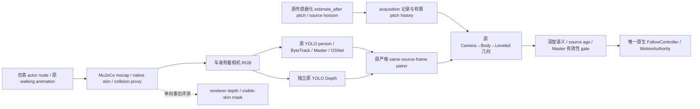

# 视觉仿真合同与本轮证据附件

本附件属于统一 Native Runtime 工程；不是独立 final report。所有结果均为 WSL 主机 / MuJoCo / 软件模型推理，`hardware_execution_ready=false`。以下数字来自保存的原始记录；完整物理视觉跟随闭环尚未因此被验收。

## Owner 与输入边界



- Actor route、骨骼与 mocap 位姿只用于物理 / 图像生成。控制消费接口不接收 actor 位置、renderer depth 或 GT 身份。
- `ColorFrame.host_receive_time_s` 保持原 `host_read_complete` / `host_perf_counter` 合同。仿真 acquisition 的 source epoch、simulation time、host begin、host read-complete 与传感器化 pitch horizon 是独立记录；不能把 sim time 填进 host 字段。
- 失去 pitch / clock history 覆盖、Master 未锁定或不可见、深度不确定、acquisition→消费超时均为 unavailable。原 Governor 的 `valid=False` 保持 latched 速度这一算法行为不等于允许运动，外层唯一 authority 必须撤销 FOLLOW。
- 深度证书只在固定 held-out 门禁真实通过时允许声明可用；运行仅读独立系数 / hash / 验收结果，不读取拟合用 GT。
- `OnboardRGBRenderer` 的公开 sensing 返回值只有 BGR 数组。诊断 renderer depth 由验证程序的独立 post-hoc pass 保存，未构造为 `DepthFrame`。

## 成熟资产复用与许可来源

1. 初始 [Khronos CesiumMan](https://github.com/KhronosGroup/glTF-Sample-Assets/tree/8f492390ddc7a2ae221a1369ef560589cf8c70fb/Models/CesiumMan)：固定 commit，原纹理 / glTF skin / walking animation；CC-BY-4.0，原 Cesium logo 另有 LegalMark 条款。见 `character_asset.lock.json`。pygltflib 解析原数据，SciPy SLERP 离线重采样，MuJoCo native skin 负责运行蒙皮。原 JPEG 离线解码为 PNG 以适配 MuJoCo 3.2，原字节不改。
2. 有限的备用 [Gazebo walking actor](https://github.com/gazebosim/gazebo-classic/blob/b22c6e15e52299865b31093b8feebc9ca19e26e8/media/models/walk.dae)：官方 [Harmonic actor 文档](https://gazebosim.org/docs/harmonic/actors/) 采用同类 walk.dae；固定 archived Gazebo-classic commit、源文件 SHA256、仓库 LICENSE / COPYING。见 `gazebo_character_asset.lock.json`。原 COLLADA 元数据为 Blender User / 2012-05-19；以仓库 Apache-2.0 分发许可记录，不编造艺术家身份。
3. 借用本机 Assimp COLLADA importer / glTF2 exporter 保留骨骼 / 材质 / animation，未手写 COLLADA 解析器。Ubuntu package 为 `5.3.1+ds-2build1`，runtime API 实际报告 `5.3.0`，两者分别记录。Gazebo actor 6 个原材质、22 骨骼、9,317 顶点 / 15,627 三角形；保留局部 walking channels，提取 Hips 水平 root motion，由明确 scene route 负责全局位移，对应 Gazebo 的 trajectory / interpolate_x 职责分离。
4. 原始 / 派生 mesh 均在 ignored `.venv/assets/visual_companion*`。代码库只保存锁、转换器和合同。`prepare_visual_companion.py --profile gazebo --fetch` 显式取回缺少的锁定资源并离线准备；运行时绝不下载 / 猜测替代世界。

Gazebo 的物理对象为明确的运动学 capsule（半径 0.20m，z0.20..1.50m，含端帽），不是人体生物力学模型。原 skinned human 负责图像，capsule 负责保守物理接触 / LiDAR 可见性。它不是供检测作弊的几何假人。

## 原参数保护与原生消费

证据：`results/session_20261023/visual/gazebo_640_fast_depth_eval/scene_audit/summary.json`。

真实构建的原 Bookstore 与 added overlay 模型逐字段核对：原 nq/nv/nu/nsensor、body mass/inertia/inertial frame、geom friction/contact/pose/size、dof damping/friction、actuator gear/ranges、1ms physics step、gravity、integrator 全部保持。新增 23 个 mocap body、1 个 collision geom、6 个 native skin，无新增 actuator。

原 MuJoCo 物理 ray fixture 从 z0.30m 向 actor 发射，在 1.6m 命中 `companion_actor_contact_proxy`（actor 中心 1.8m），证明 actor 确实进入原物理传感几何；这项 narrow fixture 不证明导航绕障 / 制动 / 碰撞已全部验收。

## 成像性能实验与不利结果

原 1280×720/FOV75°/20Hz requested 相机是独立声明的 MuJoCo pinhole，向上 15°、车轴上方 0.35m / 前方 0.08m；不是 C920 实体标定。实际 GL：Mesa llvmpipe LLVM20.1.2（软件 renderer）。

- CesiumMan 三帧：真实 YOLO26n/conf0.25 全部检测 0 人、Master UNSELECTED；原 Depth 模型真实执行、strict pair 3/3，但无 Master 距离观测。域差异失败完整保留。
- Gazebo 1280 原 render profile：可真实检测并按原三帧 OSNet 确认 Master；steady render 约 403ms，完整 acquisition→ready 超过固定 0.2s。
- Gazebo 640×360、正确同比例 K：steady render 约 344ms，仍无法满足 freshness。仅降低像素不足以解决 llvmpipe 的额外渲染 pass 成本。
- 最后一个有限成像质量实验 `visual_camera_640_fast.json`：MuJoCo 原生 offscreen sample=1，关闭 shadows/reflections，保持物理 / mount / FOV / 安全期限。steady render 约 58–64ms；source 图像质量确实改变，因此这不是同输入 C++ 迁移收益，不可混作语言性能提升。

所有 profile / protocol 在各自首次渲染或模型推理前冻结；不更改 detector0.25、Depth768、KF0.03m、P95误差0.09m、source age0.2s。

## 固定 split 的真实模型结果

完整证据：`results/session_20261023/visual/gazebo_640_fast_depth_eval/{protocol,camera,records,summary,master_events}.json`，每个 pose 保存 RGB、raw model depth 和独立 post-hoc 深度 / skin mask。

16 calibration poses + 32 held-out poses，各 3 个真实 source frame，共 144 帧：

- 144/144 帧检测到 person，strict same-frame pair 144/144；74 帧 Master LOCKED。
- 固定 pose-grid 中出现 tracker / identity 变化，seq78 LOST、seq80 OSNet similarity0.93288 ReID reacquired。这个输入包含离线 pose 跳变，不等同于真实连续物理遮挡场景验收。
- 140/144 帧 acquisition→完整 pair ready≤0.2s。全窗口 P50/P95/P99/max = 175.51 / 190.85 / 237.41 / 1742.31ms。排除原有 two-result warmup 后，142 帧中的140帧fresh，P99仍211.52ms、max245.85ms；没有隐去稳态超期。
- Peak process RSS约1416.76MiB，为含 MuJoCo scene / EGL / detector / Depth / OSNet 的主机软件进程，不是 Pi 5 实测。

深度只从真实模型读取。Calibration 16 个有效结果拟合一次 log-affine，held-out 仅10/32 pose 有合法可见 Master 配对，其他明确 unavailable：

| 假设 | Raw held-out RMSE / P95绝对误差 | 固定离线拟合后 RMSE / P95绝对误差 | 原0.03m / 0.09m门禁 |
| --- | --- | --- | --- |
| axial_z | 4.72483m / 7.51157m | 0.387885m / 0.728988m | FAIL |
| euclidean_range | 4.68480m / 7.46400m | 0.391885m / 0.721952m | FAIL |

不输出任何 passed 深度证书。独立 `depth_calibration_rejected.json` 显式 `heldout.passed=false`，供运行时拒绝检查；原 C920、YOLO 米制尺度与 axial/range 语义仍未认证。没有将 renderer depth 接进控制器，也没有在线 GT 校正或继续换模型 / 放宽门禁。

## 尚未证明的验收项

以上证据证明 mature human→实际 on-body RGB→原 models / tracking / Master / strict depth pair 的软件输入链存在，且距离假设不满足原 KF 要求。它不证明完整视觉运动跟随、转弯 / 减速 / 停止 / 真实短遮挡、FOLLOW↔GUIDE_TO 物理互斥切换、真实制动距离 / 碰撞或全系统并行资源门禁已通过。

统一原生运行层可继续完成真实执行与 fail-safe 回归：此失败校准条件下 FOLLOW 应拒绝或撤权，STOP 经原 C99 MCU 链生效。完整物理链结果由 root 后续实际运行的证据更新，不能用本附件替代。硬件 execution readiness 始终 false。

## 独立 renderer 的 state snapshot 等价性证据

后续资源竞争暴露同步 render 会阻塞 physics。为检验独立 worker 的成熟边界，`verify_render_snapshot.py` 使用官方 MuJoCo3.2 `mj_stateSize / mj_getState / mj_setState`、`mjSTATE_INTEGRATION=8191` 和私有 `MjData` 的 `mj_forward`；它不 advance physics，也不把 snapshot 输入 controller。

真实固定 Bookstore + Gazebo + 640fast 模型共4种 pitch/yaw/actor/已积分状态：snapshot1193 doubles（9544B）。独立 worker 拥有自己的 data 与 GL create/use/close；重建后 qpos/qvel/mocap/body/camera pose 全字段与同 snapshot canonical-forward reference 逐值0差，RGB跨独立 EGL context逐字节0差；render不推进时间，producer后续变更不影响已捕获 snapshot。门禁在运行前固定为位置/旋转1e-12、原integration字段exact、RGBmax差0，没有事后放宽。证据 `visual/snapshot_roundtrip_attempt1/summary.json`；两个 small API unit tests 通过，见 `visual/snapshot_unit/`。

实际绑定限制也保留：MuJoCo3.2 Python `mj_setState` 的 Eigen 参数要求 writeable array，即使 C 接口是 const input；worker需要独占可写buffer或自己的copy，不能重新开放共享producer snapshot写权限。

额外观测：`mj_step` 后的 producer 派生 xpos 在一个20-step fixture中与当前积分 state 的 canonical-forward 相差5.97e-5m，旧direct image最大像素差58；因此验证以同 snapshot 的 `mj_forward` 后派生状态为准，不能要求新的 source-horizon image复制旧滞后派生图。这没有修改原控制器的状态读取 / 物理调度，也不成为重新解释旧控制 baseline 的理由。独立渲染的完整生产并行回归由root执行并另留统一证据。

## 有限 sparse-LiDAR 尺度研究：本轮前置条件 Reject

本次仅进行了源码 / primary 资料审查，未新增融合模块、未修改正式链、未运行新的模型或48-pose ablation。判断否定的是**当前传感器合同足以支持该校准验收**，不是声称稀疏 LiDAR 不能帮助单目深度。

| 项目 | Borrow / Adapt / Reject 判断 |
| --- | --- |
| ETH [Marigold 实际 alignment.py](https://github.com/prs-eth/Marigold/blob/main/src/util/alignment.py) | Borrow 有效 sparse pairs 上的 `numpy.linalg.lstsq` 线性对齐机制；该文件原本用于有 target depth 的评测。不能把其 GT 参数直接移进机器人运行路径。 |
| [LiDARTouch 原论文](https://arxiv.org/abs/2109.03569)及[作者实现](https://github.com/F-Barto/LiDARTouch) | 支持 RGB + few-beam LiDAR 可缓解尺度歧义的方向；它有 sparse input / reconstruction objective / pose 的训练设计，不是可原样套在现有 YOLO 输出后的单标量插件。Reject 引入第二套训练 / depth network 来绕过本次范围。 |
| 唯一候选 baseline | 如前置条件成立，Adapt 为单帧**正的 scale-only least squares**，固定 shift=0：在对应像素对 `(d_i,z_i)` 上 `s=Σ(d_i z_i)/Σ(d_i²)`，然后只缩放原 YOLO Depth。这里 d 是原模型值，z 只来自真实 sensor ranges 通过已声明外参得到的 optical axial z；不进行 model/paper 内部修改，不尝试多个拟合/鲁棒器择优。 |
| 当前 VirtualPlanarLidar + Bookstore/actor | Reject 用于本次可授权 metric-depth 校准：跨模态 surface correspondence 的误差无法由当前合同控制到原0.03m噪声假设，原因见下。 |

允许的数据边界本可保持明确：同一 acquisition snapshot 的 `ScanSample`（只有 noisy ranges、angles、time 与显式 common-epoch 映射）+ 原 `DepthFrame` + 固定 K / `T_body_lidar` / `T_body_camera`。把 range 转为 lidar 点，再用 `R_body_camera.T @ (R_body_lidar @ p_lidar + t_body_lidar - t_body_camera)` 投影。刚性同时刻相对变换不需要 robot GT pose。校准器的签名不得接收 `MjModel/MjData`、hitID、actor pose、renderer depth、GT segmentation；仿真器可以使用物理状态生成 sensor，post-hoc evaluator 单向读取 GT 评分，二者不能反流。

实际 `sim_lidar.yaml`：body z0.18m，360 rays / 1°、10Hz instantaneous scan、range noise σ0.005m。RGB camera body z0.35m、向上15°、20Hz requested。因此只在10Hz同相位有严格同时刻 scan；不能把 latest 旧 scan 当作20Hz新 RGB 的同帧测距，也不能暗中改变原 sensor period。

决定性的前置问题来自真实源码：

1. `VirtualPlanarLidar.sample()` 的 `mj_multiRay` 选择 `geometry_groups=[0,3,4]`，输出保守碰撞体的 noisy range，明确不把 group2 的原 visual meshes 当 ray target；hit IDs 在 sensor 内部使用后丢弃。
2. RGB 看到 group2 Bookstore visual 和 native skinned human。Actor 的 LiDAR / collision 对象是 radius0.20m capsule，明确不是 skin collision；低位扫描平面落在腿部附近，capsule 表面可能投影到两腿之间或与原 skin 不同的表面。Gaussian5mm 仅覆盖 range noise，不覆盖这种系统性 shape/correspondence bias。
3. 原 Retail report 已明确 CoACD threshold0.02 是归一化参数，**不保证统一2cm表面误差**；视觉与 ray/collision 的 source/prototype transform 一致，不等于射线测量点与同像素光学表面一致。
4. LiDAR 与 camera 的不同 origin / occlusion 也不能仅凭 extrinsic 精确消除。用 hitID / renderer depth / actorGT 筛选“正确”锚点会把验收 oracle 带进校准，不被允许。低 scan plane 上的好 residual 也不能证明未观测 torso 的深度形状误差已收敛到0.03m。

因此没有把不成立的 correspondence 当作已知事实来强做 ablation，也没有宣布 scale ambiguity 假设已被实测证伪。若后续获得可验证的同表面 sensor 模型 / 跨模态对应合同，才可在运行前固定一个上述 baseline，对原16 calibration +32 held-out split一次比较 raw vs multi-sensor-calibrated，保留 missing coverage；原0.03m /0.09m /0.2s门禁不变。即便将来通过，也必须标记 **RGB + sparse-LiDAR multi-sensor depth**，不能称 YOLO raw / 纯单目精度提升；不能用 LiDAR 直接替代 Depth、改变冻结 Follow 算法或产生隐式 fallback。

## 已授权的新图像测距来源：真实双目原生 baseline（2026-10-24，未通过）

用户已明确允许增加经验证的图像测距来源，并保留原 YOLO/Depth、冻结跟随算法和安全门限。新增来源使用原成熟 Gazebo 人物/动画和完整 Bookstore；左右各一台固定在 chassis 的真实 MuJoCo pinhole camera，baseline0.15m，在原0.177m轮中心宽度之内。原相机单目 profile/失败记录未被改写。当前仅仿真几何声明，不包含物理相机外壳适配、C920、Pi5或STM32认证。

Borrow 官方 OpenCV **4.6.0 C++** `StereoSGBM` / `stereoRectify` / `getValidDisparityROI`，没有修改第三方匹配器。Native构建和实际ELF载入由工程构建证据及 `visual/stereo_depth_grid_attempt1/loaded_native_identity.json` 核对；Python `cv2` 的5.0 wheel不是这个C++算法的parity oracle。Native接收一对BGR8数组和精确相同的 source epoch/sequence/time/clock/calibration ID，一次释放GIL调用，输出拥有独立存储的只读float32 axial-Z/diagnostic masks；只有左、右有效匹配、LR一致性、纹理、ROI与有限正数检查同时成立才有米制深度。参数在首次立体匹配结果前固定，没有GT尺度拟合、depth填洞或单目fallback。

`StereoRGBRenderer` 使用同一私有 `mjSTATE_INTEGRATION` snapshot，不推进physics。原左RGB读完后立即交给原 detector/ByteTrack/Master/OSNet 与独立YOLODepth workers，然后从相同snapshot渲染右RGB；两个host read-complete时间分别保留。Metric observation的age从真实snapshot acquisition开始，包含private `mj_forward`、双render、模型及匹配等待；不是从较晚的read-complete重新起算。离线静态grid使用真实host acquisition时刻和`host_perf_counter`域，未把静态`MjData.time=0`伪装成运行时钟。生产使用真实sim snapshot source time，严格区分两个域。

预先冻结的 [stereo_camera.json](config/stereo_camera.json) SHA为`7de38e9981d553582b9e1aba537423c70248802755cf021214c0810e42f147e4`；[stereo_depth_protocol.json](config/stereo_depth_protocol.json) SHA为`3d24aed8cc60d212fd99331d47e4ca3070c8d6233d5f46e11351f24d02706911`。保留原16 calibration /32 heldout位置、原0.03m RMSE /0.09m P95与0.2s freshness。新实验明确在**第一次双目结果前**增加每pose固定40真实warmup帧（原ByteTrack30 update lost buffer+原Master3 stable updates+固定7update余量），随后3 measurement帧仍为原phase+[0,.05,.10]，只评分原固定最后一帧；不等待直到成功、不按结果增帧、不重置global原tracker/Master，不以GT选ID。诊断的track-1选择为显式软件operator指令。该warmup变化意味着mono10/32→stereo31/32的coverage不能解释为立体算法自身收益。模型4线程预算来自独立固定12RGB预算对照，在本次匹配结果前确定；144measurement帧实际两个worker的预算均为4。

真实render/source合同检查 `visual/stereo_render_attempt2/summary.json` 通过：3种pitch/yaw下左右图独立；actual R=I/T=[−0.15,0,0]，投影误差≤1e−10px；pair前后integration字段exact；left callback先于right render。缺left、换snapshot、跨GL owner线程3种负例正确拒绝。第一次attempt仅因新module尚未安装在import阶段失败，console仍保留，没有用PYTHONPATH绕过安装缺口。

固定完整grid实际执行413.9s，48pose、2064真实RGB pair/原AI帧、144measurement；[summary.json](results/session_20261023/visual/stereo_depth_grid_attempt1/summary.json)及逐pose原始PNG/NPZ/记录完整保留：

| 指标 | 实测结果 | 原门禁 |
| --- | --- | --- |
| heldout有效固定最终帧 | 31/32；#39 Master TEMPORARILY_LOST，明确unavailable | 全部32distinct positions，FAIL |
| heldout axial-Z RMSE | 0.0608434m | ≤0.03m，FAIL |
| heldout P95绝对误差 | 0.110314m；max0.121156m | ≤0.09m，FAIL |
| acquisition→metric ready | P50/P95/P99/max=189.790/239.062/269.832/286.893ms | 仅124/144≤200ms |
| nativeStereo binding wall | P50/P95/P99=64.737/85.818/117.767ms | 非目标硬件/实时性认证 |
| peak process RSS | 1607.61MiB，含scene/EGL/两个YOLO/OSNet | WSL软件进程 |

原YOLODepth仍真实独立运行并按left source严格配对；原模型输出与新增metric深度分别保留。GT只在RGB/模型/native结果已完成后由独立posthoc pass生成，目标为**整个原torso ROI内可见原skin的axial-Z median**，不按SGM validmask选GT。没有控制输入、物理arm或实体执行。

一次有限的 [posthoc_error_decomposition.json](results/session_20261023/visual/stereo_depth_grid_attempt1/posthoc_error_decomposition.json) 分别检查同像素matching误差、有效样本的空间偏差与ROI非skin混入；它不参与模型或控制。31有效heldout全部偏远。近距≤1.5m的同像素误差median约4.1mm，而valid样本GT深度相对整visible-torso偏远median约36.2mm，valid中非skin比例median约35%；远距≥2.1m同像素偏差median约22.4mm。各median分量不是可相加的精确分解，不构成可直接减去的常量校正；不能用GT过滤像素制造精度。

原始 `stereo_validation.json` 显式失败。附加的 `stereo_validation_reviewed.json` 仅补齐实际运行进程映射的5个ELF SHA、原模型SHA和31个distinct pose keys；没有改变输入、参数或指标。实际生产 `VerifiedStereoValidation` 对该失败文件拒绝的证据为 `validation_rejection_check.json`。正式配置不得引用它来授权FOLLOW。

当前baseline同时存在精度、身份覆盖和时效问题，未证明视觉运动闭环。即使单帧age<0.2s，若每pair约0.18s、ready时已用去0.18s，则每帧只余约20ms可用；连续500Hz控制必须检查帧间expiration，不能由“多数帧fresh”推断连续FOLLOW。保持所有原失效门禁，不以放宽age、清零pitch、GT depth、GT身份、调整heldout或伪造source time继续运动。

复现入口（纯诊断，非正式Demo）：

```bash
export ROS_LOG_DIR="$PWD/models/minisegway/native_runtime/results/session_20261023/visual/<new-run>/ros_logs"
source scripts/env.sh
MUJOCO_GL=egl .venv/bin/python tools/verification/verify_stereo_render.py --mode render --output-dir <new-empty-evidence-dir>
MUJOCO_GL=egl .venv/bin/python tools/verification/verify_stereo_render.py --mode evaluate-depth --torch-threads 4 --output-dir <another-new-empty-evidence-dir>
```

图像感知/新测距的后续改进必须预先规定假设和参数、保留本次失败，并另留未用于选择方法的检验数据。该结果不证明“C++立体深度比Python慢”；原生模块新实现了新的测量职责，不能把算法/分辨率变化混入语言迁移性能收益。

### 一次有界的 stereo-assisted scale-only 假设检查：Reject

在上述失败根因落盘后，只执行一次 root 指定的纯离线假设检查，未改生产runtime或冻结stereo协议。实验前的 `visual/stereo_assisted_scale_diagnostic_attempt1/protocol.json` 固定公式、输入、原门禁和停止条件（SHA `3c46816f023791f3f6b02a926c79aa6138973003b9dfc9bc4ce2138f788b5f4c`）：在**原unchanged Master torso ROI**中使用所有原nativeStereo valid且原YOLODepth正/有限的同leftRGB像素，至少10点，取 `s=Σ(m*z)/Σ(m²)`，将原dense YOLODepth乘正scale，再用原torso median。float64累加后float32输出，无shift、clamp、RANSAC、GTmask、outlier挑选或时间记忆。Borrow/Adapt [Marigold实际alignment实现](https://github.com/prs-eth/Marigold/blob/main/src/util/alignment.py)的成熟最小二乘机制，但固定shift0，target改为真实image-derived同像素stereo，不使用其评测GT接口，也没有引入Marigold模型。

同48份保存的真实输出一次计算，原missing#39保持missing；同31 heldout的原Stereo RMSE/P95为0.060843/0.110314m，assisted结果退化至 **0.179198/0.345595m**，max0.400386m。原0.03/0.09门禁失败，结论为Reject该指定scale-only baseline；没有继续试offset/robust/其他拟合变体，没有产生motion certificate。

预测函数只接收原两路图像估计数组、native validmask及原ROI；GT scalar在预测完成后才用于评分。原capture/ready时间保留，离线重算没有重打“新鲜”时间戳；该检查不测在线E2E latency，也不能用其亚毫秒公式耗时推断融合后及时性。微窗口threadCPU与wall是独立WSL host counters，本次threadCPU略大于wall，不将两者之比解释为精确占用率。所有公式、源NPZ SHA、尺度和失败结果均见同目录脚本、records及summary。

## 主动 IR 立体候选：有界上游审计与实验方案（2026-10-25，仅审计）

结论是 **Borrow 成像机制，Adapt 一次受限 CPU 可行性实验，Reject 当前直接生产接入**。主动立体有针对性地检验“原平坦衣物缺少可匹配纹理”这一假设，但不能预先消除 ROI 背景混入、Master LOST、远距亚像素误差或运行时超期。没有安装 SAPIEN / Embree、实现 IR renderer、生成新 IR 图像、运行新匹配或更改正式配置；精度、时效和运动均未通过新验收。可机读审计与分阶段方案在 [active_stereo_audit/audit.json](results/session_20261023/visual/active_stereo_audit/audit.json) 和 [experiment_plan.json](results/session_20261023/visual/active_stereo_audit/experiment_plan.json)。

### 读过的实际实现与取舍

| 来源 | 实际机制与 Borrow / Adapt / Reject |
| --- | --- |
| [SAPIEN 2.2.1 `activelight.py`](https://github.com/haosulab/SAPIEN/blob/ab1d9a9fa1428484a918e61185ae9df2beb7cb30/python/py_package/sensor/activelight.py) | `take_picture()` 先取 RGB，再启用投影光、降低其他光照，真实采集左右 IR；`_fetch()` 取 R 通道，`get_depth()` 才把两个 uint8 图交给 matcher。Borrow **投影→表面反射/遮挡→左右图像→匹配** 的 owner 分离；不把 pattern 直接贴到 actor UV，不用 GT 直接生成 disparity。 |
| [同 commit `depth_processor.py`](https://github.com/haosulab/SAPIEN/blob/ab1d9a9fa1428484a918e61185ae9df2beb7cb30/python/py_package/sensor/depth_processor.py) | 噪声为乘性 Gamma + 加性 Gaussian，随后 rectification / SGBM。Reject 整段移植：`get_depth()` 实际传 `use_noise=False`；CPU helper 的 `np.float` 在本机 NumPy2.2.6 已不存在；即使 `no_pointcloud=True` 仍先 import 未安装的 Open3D；还有 median、`registerDepth(depthDilation=True)` 等改变缺失语义的后处理。保留本仓库原生 OpenCV4.6 的唯一 SGBM、LR / texture / ROI gate，不借此换 matcher、补洞或加拟合。 |
| [Physics-Grounded Active Stereovision 论文 §§5–6](https://arxiv.org/html/2201.11924v2#S6) | Borrow 投影、光输运和图像噪声职责；论文完整系统还包含 IR / RGB 联合材质采集、GGX / 透射 / 间接光。受限的直接漫反射 CPU 实验不能宣称复制其完整物理真实性或实时结果。论文 §7.3 的 Gamma 参数 `(3.98,0.254)` 与实际旧 CPU helper 默认 `(398.12,0.00254)` 不同：均值均约1.01，标准差分别约0.507 /0.0507；不得混称同一个已标定噪声模型。 |
| [Embree4.3.0 `triangle_geometry_device.cpp`](https://github.com/RenderKit/embree/blob/be0accfd0b246e2b03355b8ee7710a22c1b49240/tutorials/triangle_geometry/triangle_geometry_device.cpp) | Borrow `RTC_GEOMETRY_TYPE_TRIANGLE` buffer / commit、`rtcIntersect1` primary visibility、`rtcOccluded1` shadow segment；只借几何查询，不借 tutorial 的 GUI、ID 着色、任务调度或全渲染框架。Embree 是光线内核库，材质/投影/噪声仍须由这个明确的传感器图像 owner 负责。 |
| [同 commit `dynamic_scene_device.cpp`](https://github.com/RenderKit/embree/blob/be0accfd0b246e2b03355b8ee7710a22c1b49240/tutorials/dynamic_scene/dynamic_scene_device.cpp) 与实际 `rtcore_scene.h` / `CMakeLists.txt` | Borrow deforming triangle buffer 的 `rtcUpdateGeometryBuffer→rtcCommitGeometry→rtcCommitScene`、动态场景及 refit；不自写 BVH、射线三角求交、线程池或 stereo matching。4.3 的 CPU API 无需 SYCL；源码默认 `EMBREE_SYCL_SUPPORT=OFF`、TBB tasking，不能照搬旧 Embree3 的 context / stream API。 |

SAPIEN 上述固定源码 / MIT LICENSE 的 SHA 已由 ignored `sapien_2_2_1/source_lock.json` 锁定。Embree 固定 tag `v4.3.0` 解析为 `be0accfd0b246e2b03355b8ee7710a22c1b49240`，5 个实际文件及 [Apache-2.0 LICENSE](https://github.com/RenderKit/embree/blob/be0accfd0b246e2b03355b8ee7710a22c1b49240/LICENSE.txt) 位于 ignored `.venv/assets/native_runtime_research/embree_4_3_0/`；锁与 SHA 摘要保存在本次审计。若以后复制实质代码须保留其版权 / SPDX / license / NOTICE；本轮未把第三方源码或派生 mesh 放入仓库。

[SAPIEN 官方旧 CPU 说明](https://sapien.ucsd.edu/docs/latest/tutorial/rendering/depth_sensor.html)明确警告 ActiveLightSensor 更慢且与 CUDA StereoDepthSensor 结果不同；“CPU depth helper”也不是本机整个 IR rendering backend 已获验证。[3.0 文档](https://sapien-sim.github.io/docs/user_guide/rendering/depth_sensor.html)还标明此章节没有完成3.0 API迁移。因此 Reject 为此引入第二套物理世界、重建人物 / Bookstore、更换 Python 或把未测 SAPIEN3 / GPU 路径当成 WSL CPU 解法。

### 唯一候选的数据流与材质边界

唯一事实来源仍为原 MuJoCo integration snapshot。拟议 C++ simulation-only sensor owner 使用自己的 snapshot / `MjData`，只调用 `mj_forward` / `mjv_updateSkin` 更新原姿态和蒙皮，不 advance physics。原官方 MuJoCo3.2.0 头文件已经暴露 `mjvScene.skinvert/skinnormal` 与 `mjModel.skin_face`；复用这些结果，禁止再实现一套骨骼动画 / Python skinning。静态 mesh / transform、原 skin vertices / normals 和左右 camera pose 从同一 snapshot 导出成有独占生命周期的低频数组，不能在 Embree 查询期间被 producer 改写。

IR 光学表面须与原 RGB 的 visual owner 一致。已有 XML 含193个 Bookstore visual mesh geom、10个机器人 visual mesh geom、3个 visual box、floor plane 和6个原 skin；这个数字是 XML 盘点，尚未冒充 compiled-scene 等价性验证。不能换成1954个 group4 碰撞 mesh 或 actor capsule。只允许利用官方 cube / ground 示例处理这组已知 box / plane；plane 的有限三角表示必须覆盖明确 IR near/far 的完整光线与投影遮挡域。未知 geom、skin inflation、MuJoCo mesh 居中 / scale / quat、透明表面或截面处理无法解释时停止，不能漏掉物体或用通用 renderer / 自写 primitive 内核扩张范围。

左右 IR 几何拟复用原640×360 / K /0.15m baseline / body mount，**左 IR 与原左 RGB optical frame 共位**，因此只需显式同源 array pairing，无新 depth registration / dilation。中央 pinhole projector 有独立、冻结的 K / mount / pattern / gain，不改变人体原纹理。每个 IR 像素先用 Embree 找真实可见表面，再投影到 emitter pattern，并沿 surface→projector 检查遮挡，按固定法线、距离衰减和漫反射计算强度；最后才做图像域 blur / speckle / thermal noise / uint8 量化。geometric hit distance / ID 只在图像 owner 内部服务光输运，不得越过接口。

公开输出仅两张独立 `H×W uint8` IR 图和 source epoch / sequence / source time / clock / calibration ID / 实际完成时间；不输出深度、法线、hitID、actor pose、skin mask 或身份。现有 BGR8 binding 如需适配，只复制同一 IR 值到三个通道，原 native `cvtColor` / matcher 参数完全不变。原 MuJoCo 左 RGB 仍原样进入 YOLO / ByteTrack / Master / OSNet 与独立 YOLODepth；原 torso ROI / median≥10 valid pixels、Camera→Body→Leveled、Follow / MotionAuthority 也不变。GT evaluator 仅在预测落盘后单向评分，不筛 anchors、torso 或 ID，不让源几何成为控制观测。

原 Gazebo / Bookstore 资产没有经测量的近 IR reflectance、roughness、transmission 或 projector/camera response。RGB 颜色 / alpha 不能直接当作已知 IR 材质。可行性实验必须明确标为 **opaque diffuse IR sensor hypothesis**，全场景统一材质假设，禁止按 actor 身份提高衣服反射率；在运行前同时冻结 nominal、低反射 / 高背景和论文级 speckle stress，完整保留无效像素 / 遮挡 / 饱和。若只有理想材质 / 无噪声分支通过，不形成有效深度证书。缺少实体 IR 图像与标定，本轮也不可能证明硬件精度或完整 PBR 光学真实感。

### 有限执行顺序与停止条件

下列是后续实现可直接按顺序执行的诊断协议，**本轮没有执行其中的安装、构建或成像阶段，也没有新增可运行入口**；具体数值与预期文件见 `experiment_plan.json`。每个阶段最多一次完整尝试；只允许一次能由日志定位的接口 / build 修复，不以改变 pattern、材质、gain、噪声、matcher、ROI、门槛或测试位置来重试择优。

1. **依赖 / ownership 前置**：只引入 Embree4 CPU C++ library；先核对许可证、实际加载 ELF 与 CMake config / version，headless 单 triangle / shadow / dynamic refit fixture。当前 WSL8CPU / AMD AVX2、无 `/dev/dxg`，`libembree-dev` 和 `libembree4-4` 均未安装，apt 候选 `4.3.0+dfsg-2`；TBB dev `2021.11.0-2ubuntu2` 已在场。此信息只证明候选存在，未测构建或吞吐。保持原 `.venv` Python3.12.3 / pip24.0，不安装 SAPIEN / Open3D、不编译完整 Embree tutorials 或 second simulator。依赖不能通过小型 CPU 链路完成则 Reject 当前候选。
2. **同 snapshot 几何 / 图像合同**：固定8种姿态 / pitch / yaw，先检查 integration exact、camera projection、全部可见 geom / skin 导出、数组所有权；在独立 post-hoc pass 中与同 snapshot 原 MuJoCo 光学表面核对。原 RGB 字节 / AI 输入不变；负例覆盖 changed snapshot、swapped IR、missing image、wrong calibration、投影阴影与 clock mismatch。任何 GT / hitID 到 matcher 的反向路径、原表面被省略或超过固定几何容差即停止，不进入误差筛选。
3. **成像性能前筛**：8 snapshots 各固定10 pair，一个 C++ sensor owner；在第一张新 IR 图像前补充固定 **1 worker baseline / 成熟 oneTBB 2 worker** 有界对照。`rtcIntersect1` 本身不自动并行逐像素查询，复用 `global_control / task_arena / parallel_for` 分块可检验第二 worker 的资源收益，无自建线程池。两支用相同 snapshot、逐像素独立的固定噪声流，IR8与matcher输出必须逐字节一致；Embree build 同步上限1/2，主机CPU预算仍8，原模型线程预算与其他运行职责保持显式记录。640×360两 IR8合计450KiB，每pair最多921,600次 primary / shadow query，数量不是耗时预测。保存 forward / skin export / geometry commit / primary / shadow / noise / binding 的 wall、thread CPU、RSS及实际并发；source-owner P95≤50ms、任意pair<0.2s和最终原端到端0.2s门禁均不变。只在相同输入成本下降且完整并行期限不退化时采用2worker，否则保留1；两支均失败或输出不同即停止，不再增加线程、降低分辨率、去场景或改变噪声/门槛。原单线程方案另存于 `phase1/experiment_plan_before_thread_amendment.json`，此修改只涉及运行资源布局，未产生 IR 结果。
4. **一次全 split 公平 ablation**：先对原16+32位置和原固定阶段生成 projector OFF / ON、相同 noise seed policy 的真实图像；按同一 unchanged RGB / 原 Master / torso 打分，原 missing#39 必须保留。它回答纹理假设，不能因31有效帧RMSE改善而宣称32/32认证。原完整40 warmup+3 measurement /原全部32位置 /0.03m RMSE /0.09m P95均仍是最终门禁。由于旧 heldout 已参与选方向，通过旧 grid 仍须在第一次新图像前冻结额外32个不同 pose keys 作为确认集；原失败位置不能被替换，且两组都须全覆盖通过。无拟合 / 补洞 / 参数搜索；仅 nominal 通过而预先固定的低反射或 speckle stress 失败，记录适用域不足并停止生产接入。
5. **只在前面全部通过后检查正式调度**：唯一 app、原60s完整场景、真实 Nav2 / 原 AI / C++/C MCU 链并行；不再渲染被新 IR 替代的第二张 RGB 来浪费该候选预算，但原 passive profile /证据保持。source age 从 physics snapshot acquisition 起计，包含 export、RGB、两 IR、模型 / matcher queue；不能重打时钟。逐500Hz消费统计帧间 expiration / authority 撤销，既检查 fresh result，也检查连续可用窗口。超期、Master LOST、no pitch history、投影遮挡均按原 gate unavailable / revoke；同时保留原静态障碍guard和物理 arm，不能由新测距绕过。正式60s时效、FOLLOW↔GUIDE_TO互斥与STOP实际链未通过前，不写 motion certificate。

即使主动纹理消除了有效像素偏远，原640宽 /0.15m几何在3m仍要求 disparity误差约≤0.117px才对应3cm；它不会因投影自动成为已证明精度。一次结果失败后按 matching、ROI contamination、IR SNR、identity、时钟 / CPU 竞争分别归因并保留失败，停止本候选的无限调参。`hardware_execution_ready=false`；本次审计没有把任何新算法或传感器接入 actuator。

2026-10-26状态补记：后续只将锁定的Ubuntu Embree4.3.0包下载校验并解包至ignored `.venv/native/embree_4_3_0_ubuntu/`，证据为同审计目录`phase1/package_extract.json`；未进行系统安装或改变生产依赖。已有CPU fixture源码尚未完成构建/运行，没有IR renderer、IR图像或新测距结果。上述分阶段内容保留为候选方案，不视为已实现；当前工作收回到既有链验收，不继续展开renderer/线程或保护层优化。
