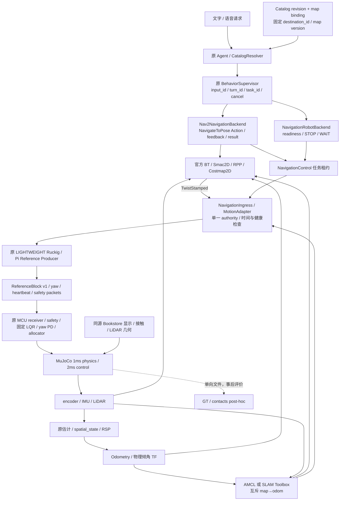

# CompanionBot — Retail Navigation

更新：2026-10-23。环境：WSL2 Ubuntu 24.04、Python 3.12.3 项目 `.venv`、ROS 2 Jazzy、MuJoCo 3.2.0。工程根目录为 `/home/kylian/projects/CompanionBot`。本文件与 `learning_log.md` 是本工程唯一持续维护的文字报告，桌面仅保存经 SHA256 核对的独立副本。

已实现 AWS Bookstore 完整商业空间、原 SLAM 链的新场景建图、独立 AMCL 定位、官方 Nav2 多目标物理导航，以及既有 Agent/Supervisor 的真实 Action backend。运动经过原 ReferenceBlock、MCU safety、sensorized LQR 与实际 MuJoCo 轮端动力学。默认 Fake 保留；只有显式 navigation mode、匹配地图绑定和有效任务授权才能运动。实体硬件、Pi 5 性能和 GUI 人工验收仍未完成。

## 场景、来源与复现

| 来源 | 固定版本 / 实际取舍 |
| --- | --- |
| [AWS Bookstore ros2](https://github.com/aws-robotics/aws-robomaker-bookstore-world/tree/ros2) | commit `f5a2aaacd5418f9ecfa30f79e788856417f17c13`，196 个源文件 hash；复用 SDF 布局、DAE、纹理、原始碰撞与灯光 |
| [linorobot2 jazzy](https://github.com/linorobot/linorobot2/tree/jazzy) | commit `f6b0bd0350c4a9d6b815ef4bb5c701a1e5129711`；已读实际 navigation.yaml / navigation launch / bringup / description，借用组合和接口，不复制其底盘参数 |
| [Navigation2](https://github.com/ros-navigation/navigation2/tree/1.3.12) | tag 1.3.12 / commit `6be3614013ec586051b86c97b919b293281490fe`；官方 AMCL、Smac2D、RPP、Costmap2D、BT Navigator、lifecycle manager；安装态 deb 为 1.3.12 |
| SLAM Toolbox | Jazzy deb 2.8.5，复用前项工程的原始扫描、odom、TF、保存/加载与图优化能力 |
| 转换工具 | pycollada 0.9.2、trimesh 4.7.4、CoACD 1.0.7；不自写通用 3D parser / 凸分解算法 |

来源与逐文件 hash 分别由 `bookstore_world.lock.json`、`navigation_upstream.lock.json` 管理。AWS 根 LICENSE 是 Amazon permissive 原文，package.xml 声明 Apache2.0，两者不一致，因此都保留并披露；没有自行替换许可证。linorobot2 为 Apache2.0；Nav2 根仓库为多许可，使用组件遵守各自 package/file 许可。Bookstore package 中的 gazebo_ros/gazebo_plugins/Gazebo 依赖未接入本工程。

`tools/assets/prepare_bookstore.py` 自动获取固定 commit、校验源、生成 OBJ/PNG/STL/MJCF 与 manifest。upstream 和派生 mesh 仅在忽略的 `.venv/assets/bookstore/`；第三方原件不修改、不加入本仓库。运行时校验 lock 与生成文件 hash，缺失或不一致即报错，不退回玩具世界。生成是有版本和 seed 的流程；未做第二个平台的字节级重生成验收。

完整保留了 26 个实际引用原型、138 个实例，编译模型为 2166 geoms / 331 meshes / 33 textures / 143 bodies / 7 lights。包含原书架与通道、展示柜/桌、InfoDesk、门窗、墙体与装饰，未转换成手放立方体。没有转向 Warehouse，也没有维护第二套候选布局。

派生修复均有依据：COLLADA 厘米单位与节点 transform 显式应用；Spotlight 两个 URI 的大小写按真实文件修复；XML 注释只在解析内存中移除；孤立的 BookE_01_009 源 z=343582.718718m 被排除，未编造替代位置。未使用的 BookB visual 源文件截断，不影响已实例化的完整场景。源 floor collision top 对齐冻结 z=0，世界平移 −0.0133820763m，视觉厚度局部修正 +0.0142086411m；原 robot/ground 摩擦、质量与控制参数不变。缺失纹理数为零。

复杂闭合非凸碰撞使用 CoACD，多连通凸体沿用原组件；开放墙面/椅面按原三角面生成总厚 2mm 的凸棱柱，保留门洞。没有给整间书店或整排货架套大凸包。CoACD threshold=0.02 是归一化参数，不宣称统一的 2cm 误差保证。显示组2与碰撞/射线组4共享原型和 SDF transform；collision alpha 保持可被 ray 命中，viewer 用 geomgroup 隐藏。

`world_audit_cell_intersection/summary.json` 验证了实际编译几何：机器人保守半径 0.1740169256m，其中物理姿态不变半径界 0.1540169256m、余量2cm；0.005–0.22m 高度区间投影916个接触几何，2.5cm保守栅格计算 footprint 可通行性。中心到障碍距离：原点0.746m、服务台接近点0.575m、入口门内接近点0.9m；(5,0) 等不足净宽的点被判不可通行，没有把全图当成空地。原点 LiDAR 360 rays 中358条有限回波，范围0.742–7.668m，采样均值1.35ms。完整通道另由五目标真实 Smac reachability 与物理导航验证。

外观检查使用 headless EGL，成果 `world_audit/textured_bookstore_headless.png`；接触投影与真实射线检查独立进行。没有操作用户 GUI。玻璃反射、真实 LiDAR 扫描运动畸变与材质相关回波不在该模拟器验收范围。

## 数据流与权限

这里的 MCU 是原主机物理仿真的 MCU 逻辑与 runner；本模式没有连接 STM32 或自动启动串口 TX/物理 arm。共享 C 核心和 C++ bridge 的兼容性另做原冻结回归。所有 RobotSnapshot/manifest 的实体 readiness 均为 false。

mapping 只启动 SLAM Toolbox；localization 只启动 AMCL。没有 GT 定位、identity map TF 或两个 map→odom authority。原空间 C++ 实际 GID/parent/owner 审计保留。真实 scan、encoder/IMU 估计 odom 与物理倾角进入 AMCL/Costmap，原始 ground returns 按真实 TF 高度处理。

速度输入只接受唯一 `/controller_server` 的 stamped planar base_footprint 意图；Graph endpoint 变化/多 publisher 锁止。Jazzy rclpy 不提供逐消息 GID，所以这不是网络认证；仍是内部可信 ROS 域。cmd source/receipt timeout 0.3s，scan 0.35s、odom 0.12s、AMCL map TF 0.35s，均保留 clock domain。租约只按服务器本机 monotonic age，最长2s，backend正常使用1.2s/0.35s续约，不跨设备直接减时间。

Nav2 desired v=0.20m/s、controller10Hz、rotate0.35rad/s、转向加速度参数0.6rad/s²；adapter上界0.25m/s/0.5rad/s且拒绝倒车。原纵向参考限速0.6m/s、加速度0.6m/s²、jerk1.0m/s³仍由原 planner拥有，导航只在更小 envelope 中运行。导航替代 Follow 的相对目标策略，不生成第二个 Follow Governor；模式中 FOLLOW明确拒绝。原候选稳定/最小变化 gate 对连续导航 retarget 显式关闭，FULL分支阈值0.35m/s及原baseline不修改。未启用第二套 Nav2 velocity smoother，也没有 Spin/BackUp/自动清图恢复。

CANCEL/失效先撤销本地运动权限，再取消 Action；旧意图清空，新任务须显式新授权及匹配 reference epoch。任务成功也会释放并触发原制动，不解除 MCU gate。独立 MCU heartbeat/starvation/fault 不能由 Nav2 恢复。租约本身不触发 rearm：须有新鲜非零运动意图；若撤销后收到未来 resume 的迟到 NORMAL，在更多 block 产生前重申原 STOP。实际竞态夹具见安全证据。

readiness 同时检查 motion health、MCU state、Action discovery 和五节点 ACTIVE。UserInput queued、ACCEPT、RUNNING、COMPLETED分别有独立语义；仅 Action SUCCEEDED 映射原 COMPLETED，CANCELED/ABORTED映射CANCEL/FAILED，保留原DTO词汇。初始默认distance=0不作为到达，进度只有成功结果才为1.0。同task同目标返回既有结果，不重复授权；同地点新task须等实际停稳后重新授权。

## 地图、场馆与运行方式

主路线271.75s，真实路径37.737m；北侧补图79.5s，从同一已知 dock 加载保存图再走9.225m。最大pitch分别6.443°/6.208°；完整原控制门禁均通过，无非预期接管。最终标准 YAML/PGM 与 posegraph/data 在 `results/session_20261022/mapping_north/maps/indoor.*`；310×291 cells、5cm、66230个已知cell。最终 occupied geometry P95=4.333cm、0.10m内occupied precision=99.816%；补图轮SLAM位置RMSE=2.364cm、yaw RMSE=0.00703rad；主轮位置RMSE=6.632cm。这里只做初始坐标对齐，不拟合轨迹。

地图评分按独立物理投影检验占据几何，并非完整环境语义或所有未知格的认证。早期 cell-center 评测漏掉薄墙，原失败分数保留，改正评测后主轮也达到原门限；没有降低验收标准。上游地图边界、动态二维外参等原SLAM限制仍适用。

正式绑定 `results/session_20261022/maps/bookstore_bindings.json`：map_id=`aws_bookstore`，map_version=`b48c61b3b2bf76d5`，Catalog revision=`4b56c3b9acee5754`；YAML SHA256=`bab56f32745dc6f61d4ba9699dfcc2010990816d6b0dad189f45a4ce9fe30720`，PGM SHA256=`dc5cd66e32730ed5c25d2167fd5ecb068cd8e7afc04aac44ae49918764ca6311`。重新建图需重新绑定并用真实 stock planner 验证，不能复制 verified 标志。

| destination_id | map x / y / yaw（m / m / rad） | 对应布局 |
| --- | --- | --- |
| service_desk | 0 / 2.8 / 1.570796 | InfoDesk南侧接近区，原ID仍为服务台 |
| bookshelf_west | −3.5 / −3 / 0 | 西侧书架通道 |
| bookshelf_east | 3.8 / −3 / 3.141593 | 东侧书架通道 |
| display_area | 0 / 0 / 0 | 原书籍/平板展示柜中央接近区 |
| entrance | −2.5 / 6.2 / 1.570796 | DoorB门内接近区；不宣称穿过关闭门或完成室外导航 |

旧商品/机器人展品 ID 没有改成书架；独立 Bookstore Catalog 明确选择，LLM 只能检索获得 destination_id，不能提供坐标。五个目标均有官方 Smac Action 可达证据。正式的资产、建图/补图/保存、定位初始化、绑定、唯一 app、MuJoCo/RViz手动查看与退出命令统一在 [运行合同](/home/kylian/projects/CompanionBot/docs/RETAIL_NAVIGATION.md)。`set_initial_pose=true` 仅用于已知仿真 dock，未知实体起点不能从 GT 初始化。

## 主要实现与所有者

所有源码仍归原八个 package，不建立第二 Agent、任务状态机或正式 Demo。

| 类 / 函数与文件 | 输入 → 处理 → 输出；实际消费者 |
| --- | --- |
| `prepare` / `load_meshes` / `collision_parts`，`tools/assets/prepare_bookstore.py` | 固定源与lock →成熟库变换/纹理/碰撞转换→ignored cache和hash manifest；retail scene消费 |
| `prepare_retail_model`，simulation `core/retail_scene.py` | 冻结MJCF、几何、资产manifest→验证并组合同源世界/质量为零LiDAR→运行MJCF；SpatialSession消费 |
| `SpatialSession`，simulation `runtime/spatial_session.py` | 明确world/mode/route或adapter→原runner、原传感器、有限pacing→sensorized状态与独立posthoc成果；ROS spatial_sim消费 |
| `NavigationMotionAdapter`，follow `runtime/navigation_motion.py` | task/epoch/sequence/lease、健康、MCU状态、stamped意图→权限与时效门禁/限幅/撤销→MotionIntent和待发STOP；NavigationPacketLink消费 |
| `NavigationIngress`，simulation `ros/navigation_ingress.py` | typed控制服务、真实scan/odom/AMCL TF、唯一速度endpoint→schema/freshness检查→adapter与requested/limited独立日志；不写actuator |
| `build_navigation_reference` / `NavigationPacketLink`，simulation `runtime/navigation_motion.py` | adapter与冻结配置、解码的RobotState/SafetyStatus→原LIGHTWEIGHT/Ruckig、序列化block/yaw/stop及有条件resume→原MCU arbiter消费 |
| `load_map_binding`，interfaces `navigation_map.py` | 绑定JSON→YAML/PGM hash、版本、有限pose、可达性验证→已验证map/目标；launch与backend共同消费 |
| `bind_retail_map.py` | 保存地图、canonical目标/Catalog、真实规划证据→校验一致性→候选/正式binding；正式backend消费 |
| `Nav2NavigationBackend`，behavior `runtime/nav2_backend.py` | 既有task/destination请求→版本绑定、motion租约、官方Action、续约/取消/结果→原Feedback DTO与静态目标markers；Supervisor消费 |
| `NavigationRobotBackend`，同文件 | state/STOP/WAIT请求→真实CHECK、lifecycle ACTIVE、CHECK_STOPPED→RobotSnapshot/Feedback；实体readiness保持false |
| behavior `runtime/session.py`（既有app调用） | CLI显式mode/Catalog/binding→同一AgentRuntime/Session/Supervisor，默认Fake→唯一正式交互及typed ROS反馈 |
| bringup `navigation.launch.py` / `retail_simulation.launch.py` / `navigation.py` | 明确模式/地图/几何→验证唯一map authority、派生radius与官方生命周期→官方节点+原物理仿真；无自研规划器 |
| verification各脚本 | 有限独立实验、真实Action/传感器/日志→断言/事后统计→成功及失败证据；从不成为runtime GT输入 |

## Modified files

- `models/minisegway/retail_navigation/`：两个source lock、acceptance、Bookstore Catalog/目标/主补图路线/原失败路线、唯一报告与学习日志；raw成果统一在results。
- `tools/assets/{prepare_bookstore.py,requirements-bookstore.txt,bind_retail_map.py}`；`tools/verification/{verify_bookstore_world.py,export_navigation_geometry.py,verify_nav2_interfaces.py,verify_retail_navigation.py,run_retail_acceptance.py,evaluate_retail_mapping.py,evaluate_retail_navigation.py,verify_navigation_safety.py,verify_navigation_ros_faults.py,verify_agent_navigation.py,verify_formal_navigation.py}`。
- simulation：新增retail_scene、navigation_motion、navigation_ingress；扩展spatial_session/spatial_sim/mapping_motion的显式世界、路线、权限、日志与用户viewer选择，不改冻结runner或plant。
- follow：新增navigation_motion；interfaces：新增NavigationControl.srv/navigation_map与必要构建依赖，原ReferenceBlock v1和wire v2保持。
- behavior：新增Nav2 backend；session显式配置、cleanup、准确显示执行后端；离线模型文字改为中性“工具反馈”，UI初始化提示与stop服务ACK不再硬编码Fake，原权限状态机保持。
- bringup：新增nav2.yaml、nav2_geometry.json、navigation/retail launch和几何检查；既有interaction/spatial launch传参、相关package依赖/setup更新。description新增navigation.rviz。
- `tests/test_navigation_integration.py`：地图hash、租约/单owner、停止/超时/独立MCU故障、进度与lifecycle竞态；`.gitignore`忽略本工程raw results。更新README/CURRENT_STATE与运行/空间/SLAM/跨语言/retail架构合同。

工作区开工前已有大量用户改动，`initial_git_status.txt`保留；本报告不把整个git dirty集合归为本次修改。587项冻结/保护文件逐项SHA核对，详见最终保护清单。未commit、push、加remote或创建仓库。

## Tests、负结果与实测边界

最终量化矩阵见下文。原始证据根为 `results/session_20261022/`，数值由实际JSON/历史而非截图得出。

固定验收：实际位置误差含3s停稳≤0.15m，yaw≤0.20rad，零机器人/障碍接触、零非预期MCU接管，至少两次三目标成功。目标checker更紧的8cm/0.15rad是导航配置，不替代该物理标准。

已保留并披露的失败包括：初始开环建图碰展示柜；薄墙评测alias；旧无条件重规划BT导致最终转向失败；12cm checker下15.0459cm停稳误差；过早discovery/迟到AMCL订阅/测试续约旧future；正式ROS输入误用管道stdin；重复任务在实际制动中正确被拒绝；并行重型夹具导致空间序列gap与上游planner激活清理错误；快速失败Action在pending resume窗口触发独立starvation；正常到点后backend的0.35s轮询晚于0.3s命令watchdog，导致RELEASE owner mismatch。后两项旧run的基础控制门禁虽为true，审计后明确不计最终安全验收；分别修正motion link与terminal处理时序，并通过物理/正式入口复验，未放宽底层安全。

原STOP夹具早期速度峰值0.03388m/s，后续停稳窗口峰值0.01705m/s，保持原0.03m/s标准；并未删掉早期残余或声称瞬停。实测STOP/命令过期/lease过期的前向制动距离约0.202/0.243/0.331m，仅适用于本测试的0.2m/s条件，不是任意平台的安全距离保证。

### 最终验收矩阵与资源证据

最终两轮均为同一地图、同一配置与最终 motion link，独立运行190s。初始区→西书架→东书架→服务台，路径经过真实通道；以下为实际物理GT的独立事后评价，位置与yaw都检查到点及3s后，GT不返回运行链。

| 运行 / 目标 | 停稳位置误差 cm | yaw 到点 / 停稳 rad | 路径 m | 执行 source / wall s |
| --- | ---: | ---: | ---: | ---: |
| 1 / bookshelf_west | 6.609 | 0.1306 / 0.0106 | 4.898 | 41.54 / 41.55 |
| 1 / bookshelf_east | 8.921 | 0.1346 / 0.0034 | 7.934 | 50.98 / 51.35 |
| 1 / service_desk | 11.106 | 0.1545 / 0.1453 | 8.425 | 46.70 / 46.95 |
| 2 / bookshelf_west | 6.133 | 0.1254 / 0.0162 | 4.920 | 41.40 / 41.65 |
| 2 / bookshelf_east | 7.314 | 0.1078 / 0.0310 | 7.982 | 51.24 / 51.35 |
| 2 / service_desk | 11.548 | 0.1516 / 0.1414 | 8.445 | 46.54 / 46.55 |

两轮分别21.257/21.347m，运动执行累计139.22/139.18 source秒（不含阶段间停稳）；保守机器人边界到障碍最小间距0.2166/0.2191m，接触样本0，非预期接管0；最大pitch4.427°/4.442°。三次正常任务释放各自记录，完整190s控制门禁均通过。早期`navigation_final1/2`也已通过物理门限，保留作本轮接口收尾前的对照；最终依据为`navigation_verified1/2/{summary,evaluation_posthoc}.json`及各自history/command/costmap。

| 验证项 | 实际结果与证据（均相对此会话目录） |
| --- | --- |
| 场景几何、纹理、接触与LiDAR | PASS；`world_audit_cell_intersection/summary.json`、ignored派生manifest；完整场景headless渲染和保守collision projection分别保留 |
| SLAM建图、图保存/加载、地图质量 | PASS；`mapping_corrected`、`mapping_north/{summary,evaluation}.json`及标准maps；`regression/slam_room/evaluation.json`原房间门限仍通过 |
| Nav2 lifecycle/TF/Costmap/规划 | 五节点ACTIVE、两Costmap、五目标Smac路径PASS；`navigation_verified1/2/planning`、`navigation`与launch日志；原真实接口审计`nav2_interfaces/report.json`保留 |
| 唯一正式入口与实际Agent带路 | PASS；`formal_navigation_prompt_release/summary.json`，两次service_desk实际到点/3s误差分别11.14/10.49cm、9.45/11.01cm，yaw≤0.012rad，零接触/非预期接管；ACCEPT→RUNNING→COMPLETED，10个map目标markers，ROS线程及app正常退出 |
| Agent取消、重复task | PASS；`agent_cancel_release/agent/summary.json`：实际原AgentSession `/cancel`得到CANCEL；相同task返回原CANCEL，control_requests_added=0；45s完整控制门禁通过 |
| STOP/WAIT/CANCEL与cmd/lease/健康失效 | 8项PASS；`safety_resume_final/summary.json`。第8项在resume armed窗口取消，迟到NORMAL后2ms重申STOP，后续速度峰值0.00215m/s，无独立starvation接管 |
| 实际DDS故障及新任务重发 | 5项PASS；`ros_faults_ready/summary.json`：STOP/CANCEL、暂停本测试controller、真实scan断流、暂停本测试AMCL。19.8s注入后实际MCU接管分别约19.802/19.802/20.000/20.268/20.062s；scan真实断流始于20s。后续停稳估计速度峰值≤0.00645m/s，28s显式新task均成功 |
| 实际货架阻挡/规划失败 | PASS；`obstacle_navigation_standalone/CANCEL/summary.json`：普通规划host RTT3.134ms、59poses；货架占据目标规划失败16.564ms、0poses；完整NavigateToPose在41.227ms内ABORTED/error208，租约撤销，零独立MCU接管。该诊断目标未加入Catalog/可达绑定 |
| 原控制与跨语言 | baseline/radial/safety/dynamic/stream五套native PASS，合计199300仲裁tick、reference max delta4.1633e−17；`regression/*/cross_language_verification.json`。C++真实DDS/PTy19项PASS，不宣称实体 |
| 原空间、协议、SLAM lifecycle与正式Fake | `regression/spatial`含被动ablation、`spatial_protocol`10项、`slam_lifecycle`6项与`formal_runtime`均PASS；异常退出/无遗留按各自原合同验证 |
| 构建、依赖、自动回归 | 八包build PASS；最终pytest397/0 skipped；colcon417/0 errors/0 failures/0 skipped（含外层，不相加算coverage）；pip/rosdep/冻结配置/空间与导航几何check PASS。见build_release、pytest_final_authority、colcon_result_final_authority与相关txt |
| 成果保护 | 587项SHA256全部不变；`protected_files_before.json`与`protected_files_after.json`；全工作区无commit/push |

性能依据：最终导航 probe分别观察149.25/152.35s，scan9.95–9.97Hz、odom49.76–49.86Hz，source/wall约0.995–0.997；cmd在含任务间隙的窗口平均9.61Hz，source间隔P95=0.100s，controller rate warning=0。按本轮launch PID过滤：Nav2各进程约2.0–6.8%单核CPU、RSS约41–66MiB，physics/simulation约76–77%单核、观察窗口peak RSS941–943MiB。此窗口不是整个进程生命周期的RSS上界。原271.75s主建图full trace进程观测peak约2487MiB，补图约946MiB，SLAM约5.2–6.7%单核/63–67MiB。

最终两轮共记录5804次reference block生成，全部epoch覆盖，P95约0.50ms，最大1.59/1.68ms；属于Pi reference计算的host wall时间，不是MCU tick或RPP时长。Smac官方Action的planning_time使用仿真ROS clock，短计算报告0，按clock发布粒度视为不可分辨，不称为零CPU耗时；独立host RTT见上表。RPP内部计算时长未单独插桩，输出频率/间隔与无rate warning是真实交付证据，硬实时latency认证仍须目标设备。原始统计在两轮`evaluation_posthoc.json:performance`，不是Pi 5测试。

可复查图：`navigation_verified1/physical_navigation.png`、`navigation_verified2/physical_navigation.png`、`mapping_north/map_evaluation.png`及`world_audit/textured_bookstore_headless.png`。它们解释真实数据，不代替Action、控制history和接触证据。成功/失败用途索引为`evidence_index.json`；支持结论的旧run及失败均保留，未作为缓存清除。

### Remaining issues / deviations

- WSL物理仿真验证不等于Pi 5或STM32上板；真实电机、arm、IMU/encoder/LiDAR安装与时钟仍未接入。导航覆盖当前冻结plant/seed，不等于所有载荷包络的新导航认证。生产Q actuator OFF、1ms/2ms周期与原安全合同保持。
- 原有限runner当前实际覆盖最长271.75s建图与250s导航。长期运行、资源有界性、kidnapped robot恢复、非平地/大pitch、实体制动与避障安全须另验；不启用未经验证的恢复动作。
- 静态真实家具绕行、货架占据目标失败、传感器/定位中断已验；没有增加行人AI或动态障碍。二维LiDAR不提供所有矮障碍/悬空物的完整三维覆盖，不能把当前布局的静态绕行称为有人突然冲入路径或所有高度障碍的验收。
- 正式app与现有Agent工具链使用原离线FunctionModel作确定性验收；本次未新增真实Qwen云端语义、真人语音/视觉跟随认证。FOLLOW在Nav2模式明确拒绝。Supervisor本地先决条件拒绝仍可能带原legacy默认backend元数据，应结合source_id、RobotSnapshot与manifest判断，不能视作实体执行。
- passive MuJoCo viewer与RViz配置已提供，未操作用户桌面、未进行人工GUI验收；headless渲染/真实DDS目标markers不替代这一边界。
- 资源数字为WSL host测量，部分早期导航与其他domain并行，报告按本轮PID过滤。提供实际规划时间、参考block生成时间、输出频率/间隔；RPP内部计算时长没有单独插桩，不能用采样ROS age的零值冒充零延迟。
- 软件PTY/C共享核心/跨语言回归证明兼容性，不认证真实串口丢包、MCU周期或实体输出。ROS单publisher检查也不等于SROS2认证。

## 交付与复查

唯一长期运行说明为 `docs/RETAIL_NAVIGATION.md`。本报告与同目录 `learning_log.md` 的独立副本交付到 `C:\Users\29603\Desktop\CompanionBot\stage report\Retail_Navigation\`，来源、绝对路径及SHA256以本会话 `report_delivery.json` 为准；副本不单独演进。raw地图、JSON、history、日志与图仍只保存在本工程results。

最终复查索引：`evidence_index.json`、`source_snapshot.json`、`protected_files_after.json`、`build_release.txt`、`pytest_final_authority.txt`、`colcon_result_final_authority.txt`。全量 `git diff --check` 仍报告用户开工前已修改的两份Stage8测试中四行既有CRLF/尾空白；这些文件本工程未改，未为格式检查覆盖用户内容。本工程新增源码与所改文档另做内容/链接检查。支持正负结论的run均作为工程证据保留；未知owner、既有模型、冻结成果与有效workspace build/install/log均未清理或迁移。
