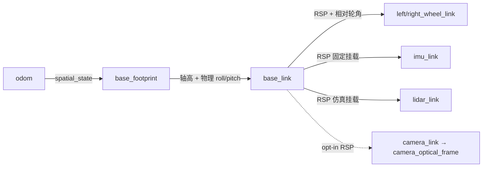
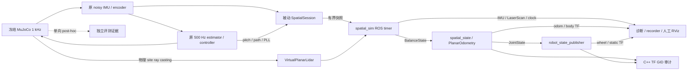

# 自平衡机器人空间状态与 SLAM 数据基座

交付日期：2026-10-22。以本地工作区为准；开工已有改动保留。本文与同目录 learning_log 是本工程唯一两份报告，原始证据集中在 `results/session_20261021/`（下称 E）。未 commit / push，未操作 GUI。

## 实现结果与架构

新增实际可构建运行的 description、被动空间估计、室内物理射线 LiDAR 与 ROS 数据链。保留原 1 kHz MuJoCo、500 Hz controller / MCU、ReferenceBlock、固定 nominal ID-LQR 与 Q actuator OFF。空间节点没有 command subscriber、Agent 或 actuator authority。正式交互仍由 `scripts/demo_stage8_interaction.py` 委托同一 app。

[空间状态合同](../../../docs/SPATIAL_STATE.md) 提供完整 TF Tree、节点/数据流图、接口、时钟、迁移边界与运行命令。实际树为：

不发布 map 或 identity map→odom。RSP 是轮关节/固定挂载唯一 owner，spatial_state 是两条动态 body TF 的唯一 owner；C++ tf_authority 只审计实际 GID/parent/owner，不发布 TF。独立旧 camera_tf 不能与本树相机 authority 同开。

## 自平衡语义与接口

MJ→ROS 是 proper rotation `[-Y, X, Z]`，det=+1。历史 MJ left 实际位于 ROS 右侧，空间 adapter 显式换序，控制通道不改。复用既有纵向估计 `ds=r*(mean(dφ_relative)+dθ_body)`；s 是轨迹弧长，转弯后用 SE(2) 积分成为 x/y。JointState 始终发布轮体相对 PLL 角，不把 pitch 再加进关节角。

导航 yaw rate 使用 `(gyro_y*sin(roll)+gyro_z*cos(roll))/cos(pitch)`，复用原 timestamp-aware 积分核；冻结 controller 的 body-z yaw 定义保持。roll 复用原互补倾角标量内核，pitch 取原估计。body TF 保留物理 roll/pitch，不能减 theta_eq 或清零。首个有效状态定义 odom 相对原点，无绝对定位声明。

| 模块 / 重要入口 | 输入、处理与实际输出 |
| --- | --- |
| `export_spatial_geometry.py` | 冻结 MJCF → 轴/几何/惯量转换与来源 SHA → description 配置及 geometry_id；`--check` 检一致性 |
| `SpatialAttitude.update` | 已消费 noisy IMU、sample-time pitch、age → 互补 roll 与 Euler yaw-rate 投影 → 当前 horizon 姿态；无 GT/command 输入 |
| `PlanarOdometry.update` | coherent sensorized path/yaw → SE(2) 积分和显式过程协方差 → 相对 pose；时间/有效性/有限派生值错误锁存 |
| `SpatialState.decode / publish_sample` | BalanceState → schema/source/geometry/clock/epoch/time gate → Odometry、JointState、动态 TF、diagnostics |
| `prepare_indoor_model` | 原 MJCF + 同一选定 geometry/LiDAR 配置 → 无质量 site、墙与侧方箱体 → 独立 XML 与来源 manifest；原 plant 不覆盖 |
| `VirtualPlanarLidar.sample` | 物理 site 与碰撞几何 → native mj_multiRay + 独立 RNG 噪声 → acquisition time、角度与 ranges；不输出 pose/hit-id/oracle |
| `SpatialSession` | 原 runner 已消费的公开 measurement/estimate → 被动空间计算、50 Hz source 快照 → JSONL 和有界 ROS tap；observer 返回空，无 actuator augmentation |
| `SpatialSimulation` | 只读快照/scan → ROS steady timer → BalanceState / raw Imu / LaserScan / 唯一 clock 与可见合并计数 |
| C++ `TfAuthority::inspect` | rclcpp 实际 publisher GID / Graph / TF → parent、单 owner 与 static/dynamic 通道审计 → diagnostics 或非零退出 |

`BalanceState` 空间合同版本 1，SourceStamp 仍为 2；不改变 wire v2 / ReferenceBlock v1。Header 是映射后的估计 horizon；meta 保留原 source clock/epoch/sequence。仿真映射 identity，设备入口要求显式 mapping id 与声明不确定性≤2 ms，未实现真实时钟同步算法。

名义输出：state/odom/joints/raw IMU 50 Hz、scan 10 Hz，physics/control 分别保持 1 kHz/500 Hz。raw IMU 是原 500 Hz 流中已消费样本的抽取，stamp=t−1 ms；state/TF horizon=t。IMU orientation unavailable，covariance[0]=−1。标准空间消息不沿用旧业务消息 publication-time Header。best-effort DDS 可丢/合并快照，计数明确保存。

LiDAR 为 360 束、0.05–8 m、σ=0.005 m、独立固定 seed，所有 ray 同时 acquisition，time_increment=0。扫描平面随实体 body 倾斜，真实命中墙、箱体、地面与自身遮挡；无命中为 +inf、过近为 −inf。没有 GT leveling、假平面扫描或不存在的定位结果。

## 上游审查与取舍

完整实现审查、锁定 commit、文件 blob SHA 和来源见 [UPSTREAM_DECISIONS](UPSTREAM_DECISIONS.md)、[upstream_review.json](upstream_review.json)。没有 vendoring upstream 源码或 CAD。

| upstream | Borrow / Adapt / Reject |
| --- | --- |
| linorobot2 `f6b0bd0` | Borrow description/sensor/bringup 分工、标准接口；Adapt footprint 投影；Reject fixed body footprint、caster、diff_drive actuator 与无 pitch 轮速模型 |
| linorobot2_hardware `1ed605a` | Borrow raw sensor 与 odometry 分层；Adapt sample-time/axis；Reject executor 调度电机、RPM PID、fake IMU、publish-time 同盖与直接复制协方差 |
| rbot `47af3fc` | Borrow GT/估计隔离、joint_states/odom/map 单 authority；Adapt 仿真传感器配置；Reject 普通差速 plugin、平铺全部导航依赖和同源信息重复融合 |
| REP-103/105、robot_localization | 使用右手/SI、连续可漂移 odom；没有定位不建 map。当前已有相同 IMU/encoder 信息，不叠加 EKF 重复融合，也不用 two_d_mode 压平 body |
| MuJoCo 3.2 官方 API | 实测 mj_multiRay 能实现本轮有界室内几何传感器；无证据要求迁移 Gazebo。未认证旋转扫描、材质、多径或大场景性能 |
| MonoTeach AGENTS | 采用 canonical source、协议兼容、有限 blocker 与系统职责原则；不复制机械臂条款或 GUI 例外 |

部分 ROS 网页被 Anubis 拒绝，实际阅读同项目官方 GitHub 原文及本机消息定义，没有用拒绝页作资料。Jazzy rclpy 官方 subscription.cpp 确认不暴露 publisher_gid，因此 GID 审计使用现有 C++ 运行层，而不猜测 Python 元数据。

## 验证结果

测试前统一核对 `.venv/bin/python` 绝对路径、Python 3.12.3 与同环境 pip。所有结果仅写入 E；已有历史成果未覆盖。

| 验证 | 实测结果与证据 |
| --- | --- |
| 五场景物理矩阵 | 平衡4 s、前进14 s、转向8 s、混合14 s、初始 pitch 扰动4 s，共2200个50 Hz估计；均有限、无跌倒、零 wheel/differential/final-guard saturation，Q OFF、GT_runtime_dependency=false、完整时长 |
| source / covariance / gates | horizon严格递增、500 Hz sequence、单 epoch、1 ms IMU age；协方差对称 PSD；既定短时门槛 peak xy≤0.1 m、yaw≤0.1 rad 全过。`physical_initial/summary_revalidated.json` |
| 被动传感器消融 | 原 plant 与派生场景+被动 tap 的7000行控制历史逐值完全一致，max numeric delta=0；历史键虽名 history_50hz，实际记录为500 Hz，不误报频率 |
| 证据重评 | 补安全/时间门禁后从原记录重评，39个原文件SHA不变；12项故障修改负向门禁全拒绝，`physical_revalidation_checks.json` |
| 旧 native 五套回归 | baseline/radial/safety/dynamic/stream 全过；199300个C/Python仲裁tick，reference最大差4.1633e−17，与上一工程最终parity逐项一致 |
| 历史比较 | 四份baseline完整JSON、九份history完全一致；dynamic comparison与stream verification一致。主机计时、相关arrival统计及路径差异保留；safety一项transport latency 8→10 ms，实际history/门禁一致；不宣称全部文件exact |
| 实际 DDS 正常图 | E/dds_acceptance：698 state/odom/JointState/raw IMU、140 scan；状态与odom全部同stamp配对、body旋转/轮序/covariance正确，8个TF child单GID/owner；相机optical外参闭合 |
| source-time TF coverage | 698个IMU中仅首帧0.019 s早于首个TF horizon而unavailable；其余精确时间查询及140 scan全覆盖。未重盖时间戳或补假历史 |
| 协议软件夹具 | E/protocol：10项实际DDS拒绝检查通过，含epoch/future time/duplicate sequence/frame/geometry/uncertain mapping/invalid encoder/NaN/duplicate publisher；clock暂停不推进，clock前进而源停止会timeout |
| 构建 | 正常八包build与独立空目录八包build通过；最后独立重建22.6 s，实际新C++ GID auditor已编译；`build_clean.txt` / `build_clean_delivered.txt` / `build_audit_counters.txt` |
| 自动回归 | `pytest_all_owners.txt`：388 passed / 0 skipped（其中23项空间case）；独立 `colcon_test_result.txt`：397 tests / 0 errors / 0 failures / 0 skipped，含CTest/pytest外层，不重复计coverage |
| 故障/生命周期图 | E/dds_acceptance 全通过：IMU dropout后last odom=3.0 s，错误TF父/同父重复GID均非零退出，进程组+launch重复SIGINT后worker停止、CLOSED、Graph无遗留 |
| 原正式runtime | E/legacy_runtime 通过：Fake文字service/feedback/cancel、视频回放同owner、有限旧frozen_sim、opt-in旧相机TF、无效源非零退出和线程/Graph清理 |
| 依赖/冻结 | pip check / rosdep check、geometry --check、frozen config与board projects检查通过；3919个既有models文件、24个firmware文件、28个既有control核心/估计/runtime文件SHA256不变；无旧工程新增输出 |

| 场景 | peak xy error (mm) | final xy error (mm) | peak yaw error (rad) | roll / pitch RMS (rad) |
| --- | ---: | ---: | ---: | ---: |
| balance | 1.116 | 1.076 | 0.001158 | 0.016659 / 0.012633 |
| forward | 8.128 | 7.674 | 0.002589 | 0.014772 / 0.012091 |
| turn | 1.215 | 1.119 | 0.001730 | 0.014131 / 0.011625 |
| mixed | 7.700 | 7.335 | 0.002789 | 0.018212 / 0.012056 |
| pitch | 2.567 | 1.907 | 0.004084 | 0.011580 / 0.005146 |

这些是同一固定噪声 seed、平地短时且对齐首个相对原点的观测误差，不是长期定位精度、协方差标定或任意倾角的保证。评测 GT 只落在独立 truth/evaluation 文件，从不反馈控制或空间估计。

## 修改文件与规范调整

- 新增 `companionbot_description/`（CMake/package/config/Xacro/RViz/README），geometry exporter、BalanceState 与 ROS-free geometry contract。
- 新增 control 的 spatial estimation / spatial_state ROS / C++ TF authority；新增 simulation scene / session / spatial_sim；新增 bringup spatial launch / config。
- 增加物理、typed DDS、协议验收工具及空间回归测试；仅在所属 CMake/package/setup 注册依赖、消息、可执行文件和测试。
- 更新根 AGENTS、CURRENT_STATE、README、workspace/package/tool README 与两份已有架构文档，新增 SPATIAL_STATE；SourceStamp 仅纠正 Header 注释，不改字段/版本。
- `.gitignore` 增加本工程 results；本工程报告、调研和元数据保留，原始结果不散落旧目录。最终清单/开工SHA核对在 E/workspace_changes_audit.json 与 delivery_file_inventory.json；4218个快照文件中4201个不变、17个为本轮授权修改，无缺失。

AGENTS 已重组为系统复用、控制/空间/权限、实验故障、环境GUI、Git成果入口与文档交付六组长期原则；删除重复环境要求与过时阶段候选措辞，把动态状态留给 CURRENT_STATE。明确全局依赖分析、canonical source、有限有信息增益的调查、真实 source time/TF authority、按实际收益分配语言职责。保留所有有效专属冻结/Q-OFF/GT/ReferenceBlock/物理arm、唯一Demo、GUI禁令、Git权限、原始证据与桌面副本约束。新工程按内容命名，既有Stage成果不迁移。

规范一致性检查关注实际可执行性：默认接口允许 unavailable，不要求虚构设备/定位；按影响面测试，不要求纯文档重跑仿真；有界调查不授权隐藏失败。规范允许 Python passive spatial 与 C++ GID 审计分工，没有引入MCU/DDS控制依赖。

## 偏差、失败证据与未完成边界

启动初测曾因释放后近自由落体初始化roll失败，改用原控制器刚消费的同一 held-stationary startup readout；不新采样、不改RNG、不读GT。ROS初测还发现 symlink-install 生成脚本缺执行位、源码/安装态LiDAR配置可能分叉、Jazzy MessageInfo 无GID及uint8常量为bytes；分别修复生成权限、统一配置路径、C++实际GID审计与验收工具。原始失败日志保留。

有限输入可在派生运算溢出，因此补充输出有限性gate并验证锁存。首次沙箱全量pytest包含本机通信测试而超时/失败，未当作算法失败或通过；在允许本机socket环境运行完整回归。两次authority启动拒绝最终定位为 DDS 已有 GID 而 Graph 仍返回 `_NODE_NAMESPACE_UNKNOWN_/_NODE_NAME_UNKNOWN_`（E/dds_lifecycle/tf_conflict.txt）。修复为最多八个已知child、1 s steady有界身份解析等待，WARN不就绪，解析后才批准owner；超时、错误owner或重复GID仍拒绝，没有隐藏fallback。最终四类实际运行检查通过；最终正常图的pending计数为0，未声称这一次命中了异步发现分支。三次有界早期startup探测均保存，不用无限重试掩盖问题。

第一次1 s断流fixture在DDS发现完成前结束，probe没有收到odom，原失败保留；改为3 s断流给消费者发现窗口，断流阈值仍为实际fault time，未放宽传感器门禁。首次进程组SIGINT加launch转发的第二次SIGINT打断worker.join，导致runtime未落盘；修复为进入有限清理后忽略重复SIGINT、保留SIGTERM强制终止能力。最终进程组中断检查确认CLOSED、worker停止且manifest写入。

尚未实现或未验证：SLAM算法/地图、map→odom、Nav2、真实视觉跟随闭环、真实LiDAR/IMU/encoder到BalanceState的driver与跨设备时钟映射、Pi实时性能、STM32硬件运行/物理电机输出。现有MCU status不足以拼出完整空间合同，wire/board_io未为演示而伪造扩展。hardware_execution_ready=false。

空间估计仍有gyro/加速度bias、动态加速度与无滑假设误差；covariance参数未标定。固定0.042 m轴高是平面近似，不估计跳跃/坡面/抬轮/压缩。gate的pitch45°/roll30°不代表整个范围已验。扫描随body倾斜，接仅支持水平scan的二维SLAM需另外验证；未模拟机械旋转、运动畸变、反射材质、多径或LiDAR断流。

当前TF名为单机器人固定名；topic namespace不能自动实现多机器人TF隔离。不是ROS ManagedNode，无热重连；epoch变化须显式重启owner。工作区模型资产仍通过仓库路径加载，不把孤立install称为可移植部署包。RSP对root惯量给出KDL不支持的警告，不影响本轮TF；没有为消警告增加虚构定位/根变换。RViz配置已提供，用户未人工GUI验收。

## 交付副本

仓库本目录为维护来源。桌面目标为 `C:\Users\29603\Desktop\CompanionBot\stage report\Spatial_SLAM_Foundation\`；最终独立副本和SHA核对结果在 E/delivery_sha256.json，不建立第二条独立演进报告。两份报告使用独立文件副本，来源、目标与逐字节SHA256一致性记录在该manifest；副本不独立演进。

物理轨迹与漂移图：[spatial_drift.png](results/session_20261021/physical_initial/spatial_drift.png)。源码/安装态与命令证据以当前工作区和E为准，报告副本不携带完整build树。
