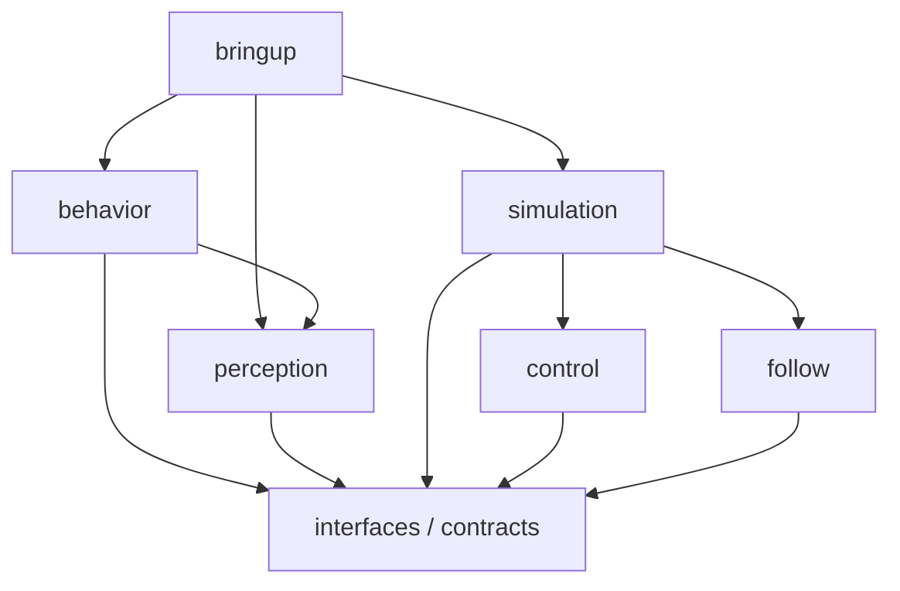

# CompanionBot 软件架构与代码归属

2026-10-05。本文件描述 Stage 9 整理后的当前结构。算法实体按职责迁移到 ROS package 的 Python namespace；ROS adapter 与算法库分层，package 不等于 node。原 Stage 3–8 冻结成果仍在原路径。

## 仓库与 package 布局

```text
CompanionBot/
├── README.md / CURRENT_STATE.md / AGENTS.md / LEARNING_LOG.md
├── pyproject.toml / requirements.txt / requirements-linux.txt
├── scripts/
│   ├── demo_stage8_interaction.py      唯一正式用户入口，薄委托
│   ├── env.sh                        Jazzy + .venv + overlay
│   └── build_ros.sh
├── ros2_ws/
│   ├── README.md / colcon.defaults.yaml
│   └── src/
│       ├── companionbot_interfaces/
│       │   ├── msg/ / srv/ / test/
│       │   └── companionbot_contracts/  ROS-free stamps / binary codecs / asset paths
│       ├── companionbot_perception/companionbot_perception/
│       │   ├── core/                  Camera / YOLO / ByteTrack / Master / ReID / depth / geometry
│       │   ├── runtime/               原完整感知 session 与 stream
│       │   ├── ros/                   publisher taps / optional camera TF
│       │   ├── diagnostics/
│       │   └── benchmarks/
│       ├── companionbot_follow/companionbot_follow/
│       │   ├── core/                  radial KF / Governor / reference / bearing yaw
│       │   └── runtime/               Pi reference-block producer
│       ├── companionbot_control/companionbot_control/
│       │   ├── core/                  frozen LQR / yaw PD / allocator / Stage 4 runtime
│       │   ├── estimation/            longitudinal / slope / slip
│       │   ├── sensors/               encoder profile contract
│       │   ├── runtime/               MCU receiver / safety arbiter / latest yaw
│       │   └── ros/                   simulation-only packet envelope; no command subscriber
│       ├── companionbot_behavior/companionbot_behavior/
│       │   ├── app.py                 原正式交互程序的唯一实现
│       │   ├── core/                  Agent / Catalog / Supervisor / audio / inputs / frames
│       │   ├── runtime/               文字 session 诊断
│       │   ├── ros/                   entry / interaction bridge / input guard
│       │   └── diagnostics/           原 API / Stage 8 验收
│       ├── companionbot_simulation/companionbot_simulation/
│       │   ├── core/                  MuJoCo plant / dynamic payload / virtual IMU
│       │   ├── runtime/               in-memory packet transport / simulated scheduling
│       │   ├── scenarios/             原 Stage 1–6 runner / viewer / benchmark
│       │   ├── experiments/learning/  原离线学习实验，非生产控制
│       │   └── ros/                   frozen_sim 只读遥测
│       └── companionbot_bringup/
│           └── launch/                interaction 正式 bringup / simulation 诊断
├── tests/                             原跨模块回归 + 架构边界回归
├── tools/
│   ├── environment/                   安装 / 资产恢复 / 音频与 rosdep 配置
│   ├── verification/                  Stage 9 自动验收与审计
│   └── build_minisegway_plant.py / extract_minisegway_twip.py
└── models/minisegway/
    ├── stage3/ … stage8/               原配置、冻结 baseline、成功/失败证据、provenance
    └── stage9/
        ├── RUNNING.md / INTERFACES.md / ARCHITECTURE.md / STAGE9_REPORT.md
        ├── reference/pre_reorganization/  整理前 adapter / 文档 / 退休入口
        └── results/architecture/      本轮完整验证、源快照、迁移清单与清理记录
```

每个 Python ROS package 另有 `package.xml`、`setup.py`、`setup.cfg`、resource marker 与 README；有独立 wire contract 时放 `test/`。`setup.cfg` 同时把对应根目录回归纳入 colcon，避免复制测试。build/install/log 与 `.venv` 为 ignored 运行产物，非源码层。

## 为什么这样分

| Package | 原代码归属 / 新职责 | Node / adapter |
| --- | --- | --- |
| interfaces | 原 `control/pi_mcu_packets.py` 与 ROS messages/services、通用 source stamps；不依赖具体算法 | 无 node；rosidl types + `companionbot_contracts` |
| perception | 原 `perception/`、完整感知 runtime 与分层诊断/benchmark | `PerceptionPublishers` 是 observer adapter，复用 interaction node；`camera_tf` 仅 opt-in |
| follow | 原 `control/` 中 Pi 侧 radial KF、Governor、scheduler、reference 规划与 BearingYawServo | 库包，无 DDS node；尚无真实视觉 consumer |
| control | 原 `control/` 实时侧与原 `sim/` 中独立估计器 | MCU reference receiver、safety/yaw runtime；无 actuator node |
| behavior | 原 `embodied_agent/` 与正式交互实现 | executable `interaction`，node `/companionbot/interaction`；source input gate、feedback taps |
| simulation | 原 `sim/` plant、混合 Stage 6 link 中仿真调度、原控制实验脚本 | executable `frozen_sim`，node `/companionbot/frozen_sim`，只读遥测 |
| bringup | 所有当前 launch 的运行管理 | `interaction.launch.py` 唯一正式 bringup；`simulation.launch.py` 有限诊断 |

未单列 planning 与 follow：当前共享 Governor/reference 生命周期，规模与依赖不足以拆两个 package。未单列 agent 与 behavior：同一 Session/授权/反馈生命周期，继续共处一包。仿真 scenario 保留原基线组合，没有把 500 Hz / 1 kHz 内循环拆成 DDS node。ROS package 安装包含算法库，但算法库不因此需要 ROS。

两处真正混合职责的源码做定义搬迁：`stage6_pi_mcu_link.py` 中 producer → follow、receiver/safety → control、transport/composition → simulation；`stage6_yaw_servo.py` 中 bearing servo → follow、latest-yaw freshness → control。原类/函数整体保留，未重写其 body。encoder profile 抽到 control sensors，使 estimator 不再从 MuJoCo plant 模块取类型。

Stage 4 runtime 中低频 batch ID 仍保留原组合。是否把求解上移 Pi 需要实测截止期及 atomic model-update 契约；本阶段没有以目录拆分为理由改更新时机或数值行为。现有 Python 同样表达 MCU 侧职责，未来 C/C++ 移植属于另一阶段。

## 依赖方向

箭头表示「依赖」，仅列运行期项目包依赖；control 的测试依赖 follow 用于原 yaw 交叉测试，不是控制库运行期依赖。



behavior 不依赖 control/follow/simulation，没有低层 actuator authority。control/follow 不依赖 MuJoCo、Torch、OpenCV 或 rclpy 的核心库导入。独立测试检查真实 import、manifest 与无环依赖，而非只检查此图。数值/模型/Agent 依赖仍由现有 requirements 与 Linux 版本补充文件维护；没有再建一套依赖锁体系。

`companionbot_interfaces` 用 CMake 生成 ROS namespace `companionbot_interfaces.msg/srv`，再把不同 namespace 的 `companionbot_contracts` 安装到 Python 路径。遵循官方 ament 的 Python install-dir 机制，避免在 rosidl 同包再次调用 `ament_python_install_package` 导致 target 冲突。参考 [ROS build system](https://docs.ros.org/en/jazzy/Concepts/Advanced/About-Build-System.html)、[Jazzy ament Python 官方源码文档](https://github.com/ros2/ros2_documentation/blob/jazzy/source/How-To-Guides/Ament-CMake-Python-Documentation.rst)、[ament Python 安装路径 helper](https://github.com/ament/ament_cmake/blob/jazzy/ament_cmake_python/cmake/ament_get_python_install_dir.cmake)。这是 Borrow/Adapt，未自造 ROS build system。

根 `pyproject.toml` 只做同一批包源码的 editable bootstrap，允许 colcon 前运行非 ROS 核心与资产工具；colcon 各包安装仍指向相同源码。不存在根目录算法副本或旧 namespace 万能兼容层。`models/` 为本仓库实验资产，`repository_root()` 从明确环境变量/仓库标记定位，不再按搬迁后的文件深度猜根路径；当前部署仍要求保留本仓库资源布局。

## 主要数据流与 authority

1. 正式入口 → behavior app → 原 Session/Camera owner → perception worker → 原同源配对/geometry。ROS adapter 从 observer taps 发布 Color/Master/RelativeObservation，不再次采集相机，不改变自然问答按需取帧语义。
2. 输入/ASR → Agent/Catalog → 原 BehaviorSupervisor → Fake Robot/Navigation task → 原异步 feedback。ROS service 只入 Session 队列，queued 不等于授权或完成。Agent 没有速度/轮端转矩路径。
3. **仿真链**：synthetic observation + sensorized RobotState history → follow 的 source-time alignment / KF / Governor → Pi reference producer、yaw intent → 原 binary packet bytes → control receiver/safety → 500 Hz estimator/LQR/yaw/allocator → 1 kHz MuJoCo plant。in-memory transport/调度在 simulation，低层不链接 plant。
4. `frozen_sim` 的独立 control worker 运行原冻结 baseline，ROS timer 只以 50 Hz 读遥测和 sim clock。DDS 不调度 physics/control tick，不接收 actuator 命令。

第 1、3 条之间仍没有正式真实视觉闭环。source read-complete、producer-ready、receiver time、ROS publication、MuJoCo sim/control time、source/reference epoch 分别保留；所有 QoS、message/service、clock/frame 细节见 [INTERFACES](INTERFACES.md)。TF 默认关；opt-in 只有未实测 `base_link → camera_optical_frame`。不伪造 map/odom 或实体导航。

## 入口分类与旧路径

- 正式用户命令始终是 `python scripts/demo_stage8_interaction.py`；根文件和 ROS `entry.py` 均委托唯一 `companionbot_behavior.app.main`。正式 launch 属于 bringup，原 `companionbot_ros` 已退出 active workspace。
- 感知单层诊断：`python -m companionbot_perception.runtime.session --mode full …`；旧 Stage 7 full-mode 额外 wrapper 已归档。
- 文字诊断：`python -m companionbot_behavior.runtime.session --fake`；旧 cloud/Stage 8 验收用对应 `diagnostics` module，非第二 Demo。
- 控制 runner/viewer：`python -m companionbot_simulation.scenarios.<原文件名去掉.py>`，用途/原场景不变，viewer 由用户人工操作。
- 环境安装与 Stage 9 验收使用 `tools/environment` / `tools/verification`；plant 提取/build helper 留在 tools 根。

旧 `control.*` / `sim.*` / `perception.*` / `embodied_agent.*` import 路径和旧独立脚本路径已变更，外部调用应按新归属更新；这是明确的源码位置兼容性变化。历史报告、冻结 reference 源码与 provenance 保留原文字和字节，不能把历史实验改写为新结构。动态历史复现工具只在该诊断进程为冻结 runner 的一个 bare viewer import 提供窄绑定，不恢复生产旧 namespace。

## 清理与保持行为的证据

整理前记录 Git 状态、阶段 commit 历史、源码 ZIP、文件哈希；搬迁清单在 `results/architecture/relocation.json`。原算法 306 个完整顶层 class/function 定义 AST 与搬迁后完全相同，原项目 import 的本地 alias 完整保留；1,758 个整理前模型/配置/历史证据文件哈希不变。源码审计不替代运行验证，Stage 3/4 完整 metrics/history JSON 及 Stage 6 五场景数值/事件/计数另与整理前 Linux 结果逐项完全相等。

旧通用 ROS 包和两项退休脚本归档至 `reference/pre_reorganization`，带 `COLCON_IGNORE`，不能再次构建/运行。原 Stage 3–8 失败证据、冻结配置、Stage 4 拒绝学习实验均保留，只归属到对应目录。经过新 build/test 验证的旧 build/install 与本轮源码 cache 才清理；详见 [报告](STAGE9_REPORT.md)及 `results/architecture/cleanup_scope.json`。没有为了减少文件数删除仍有依赖或历史解释价值的内容。
